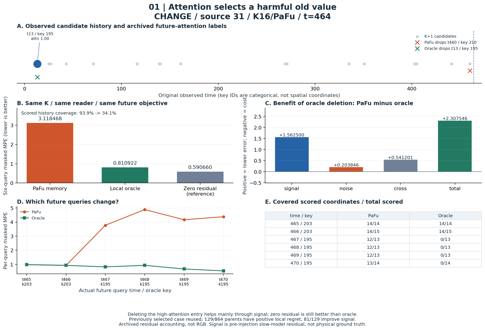
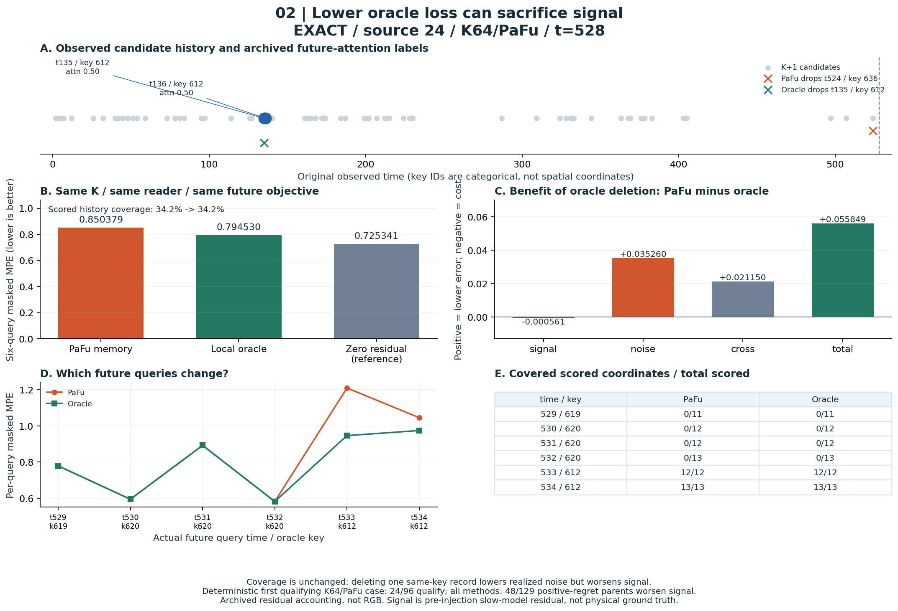
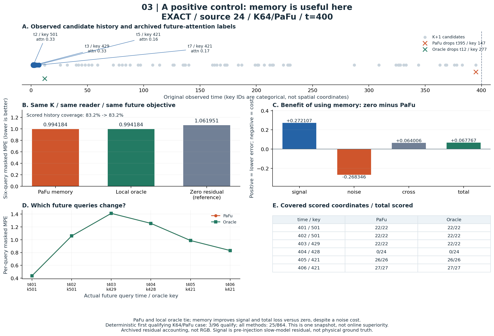
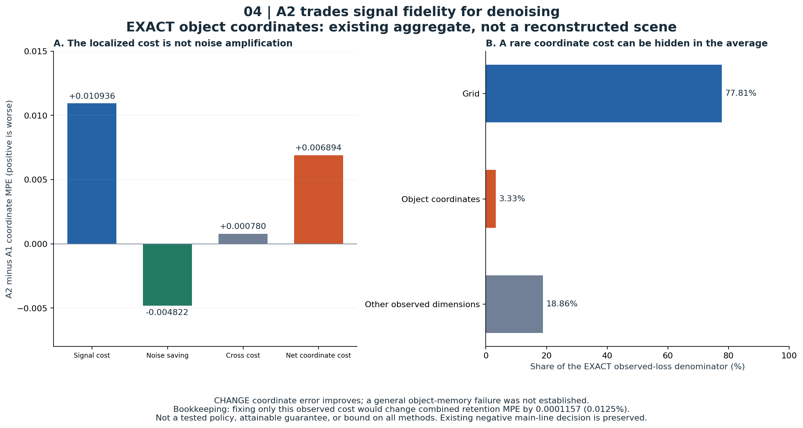

# PM 已有案例图册：读错、噪声与成功对照

2026-10-22。这里把已完成的 BR-0.2 与旧 A2 诊断画出来，**没有再跑 PM 模型、训练、
新场景或新的诊断干预**。图中是实际归档的时间、key、attention、残差误差及覆盖数，
不是 RGB 视频，也不是凭空恢复的物理场景；完整原始 Z、动作和 pose 仍缺失。

先看 [四页 PDF](../experiments/bank_reference/results/case-gallery-20261022/pm_case_cards.pdf)，
或者按下面四张卡逐个比较。图中文字使用英文便于讨论，解释在每张图下面。

| 卡片 | 一眼要看的现象 | 对 proposal 的意义 |
|---|---|---|
| 1：旧值有害 | teacher 全部关注旧 key；oracle 删除后误差大幅下降，但覆盖也消失 | “将来会读”不保证“读它有帮助” |
| 2：噪声主导 | 覆盖不变，oracle 总误差降低，signal 误差却上升 | 删除标签可能奖励单次噪声实现，而非任务信息 |
| 3：成功对照 | 同一个 reader、同类 bank，memory 的确比零残差好 | 不能把所有 memory 都归为有害；还要说明何时有效 |
| 4：旧 A2 权衡 | 坐标 signal 损失超过降噪收益，但只是平均目标很小的一部分 | 不把小效应重新包装成论文主线 |

## 卡片 1：attention 完全命中，读到的却是有害旧值



这是此前已经选出的 `CHANGE/source31/K16-PaFu/t464`，没有重新挑更差的样本。
t13 存下的 key195 得到 teacher 的全部历史 attention；未来 t467–470 又查询195。
PaFu 保留旧条目，四次预测的误差都高。局部 oracle 删掉它后，六步 MPE 从
**3.118468降到0.810922**，其中1.562500的改善来自 signal，不能只归因为噪声。

图 E 显示代价：对应查询的历史覆盖变成0，模型退回**零残差输出**；总体覆盖由
93.90%降到34.15%。因此它没有恢复正确的新状态，只是避免使用这个旧值；oracle
仍不如完全不用记忆的0.590660参照。旧条目年龄大是描述，单独的年龄因果尚未验证。

可讨论的问题：future-attention 应预测“会被读取”，还是“相较其他保留集合能减少
多少任务损失”？怎样避免新监督只学会让 reader 少犯错，却没形成有用的状态记忆？

## 卡片 2：oracle 分数变好，signal 反而变差



`EXACT/source24/K64-PaFu/t528` 留有 t135、t136 两个 key612 条目，teacher 各给0.5。
未来 t533、t534 查询612；oracle 删除其中一个后仍有匹配，**覆盖保持34.25%不变**。
总误差0.850379→0.794530的改善分解为：noise降低0.035260，cross降低0.021150，
signal却增加0.000561。这是“总分更好”与“更接近注入前信号”不一致的直接例子。

它按固定排序取满足条件的第一个案例，不是最大噪声收益。全体864个 parent 中有
129个正 regret，**48/129**会在总误差改善时恶化 signal；K64/PaFu 内为24/96个
parent。这里 signal 是注入前 slow-model residual，仍不是物理真值。

可讨论的问题：要学习的是给定过去的**期望任务贡献**，还是某个已实现随机噪声下的
最佳删除？如果不用噪声分解，仅靠展示漂亮的 oracle gap，会把两者混在一起。

## 卡片 3：同一 source 的成功对照



仍是 `EXACT/source24/K64-PaFu`，但在 t400：早期 key501、429、421 被后续查询读取，
历史覆盖为83.22%。PaFu 与局部 oracle 的损失同为**0.994184**，优于零残差参照
1.061951；signal收益0.272107抵消了noise代价0.268346，并有有利cross项。

这是一个实质性的局部正对照，但多个删除动作可以并列最优，不能说 PaFu 找到了
唯一正确动作。符合“零局部 regret、总误差和 signal 均优于零输出”规则的 parent
共有**25/864**；K64/PaFu 中只有3/96。它证明这个 reader 有时能从历史获益，
不改变原来整体在线 bank 结果仍差的结论，也不保证所有未来查询都更好。

把卡片2与3放在一起看：同一个 source、同样容量和 reader，不同查询时刻，
“保留相似旧证据”既可能有价值，也可能增加噪声。需要条件贡献，不能只学绝对年龄。

## 卡片 4：A2 的旧结论继续保留



这张是此前 EXACT 物体坐标的**总体统计**，不是新抽出的单个 episode。
A2 相比 A1 的 signal代价0.010936，大于noise节省0.004822，另有cross代价0.000780。
但物体坐标仅占 EXACT 被评价维度的3.33%，grid约77.81%；CHANGE 坐标还有改善。

只把这项已观察到的 EXACT 坐标代价消掉、其余误差原封不动，原先账面估计仅改善
合并 retention MPE **0.0125%**。这是账面计算，不是测试过的策略或普遍上界。
旧结论仍是：保留机制诊断价值，**不以修补这一小损失作为论文主线**。

## 这些卡片能与 CV 的什么结果结合

共用的问题是：观察到证据 → 存下 → 留住 → 正确读取 → 改善任务，每一步是否成立。
CV 的启动丢失、保 cue 子集读出更差和事后时间选择，分别属于不同环节。
PM 卡片1/2提醒我们，损失标签同时取决于读取器、剩余集合和噪声；卡片3要求保留
成功对照；卡片4要求先计算研究收益的量级。**它们不是同一种失败的四次复现。**

当前不能合并两仓库 MSE 排名：CV 是历史帧预测器，PM bank 是 residual reader，
A2 是矩阵状态更新。相同 K 也不等于相同字节；跨表示还改变了读取方式。
原论文与案例对应的阅读顺序见[论文阅读指南](PAPER_READING_GUIDE_ZH.md)。

## 来源、选择与复现

[选择规则](../experiments/bank_reference/results/case-gallery-20261022/selection_protocol.json)
明确标作看过结果后的展示规则，不冒充未见数据的预注册；排序固定为
EXACT→NEWPATH→CHANGE、source编号、时刻。卡片1复用旧选择，2与3取符合规则的
首个K64/PaFu parent，卡片4原样使用旧结论。图1的原案例不是总体均值的代表。

[完整分母](../experiments/bank_reference/results/case-gallery-20261022/population_counts.json)
覆盖原864个 parent、三条件、三个K、三方法、四时刻。只有8个原 A source；
多策略和时刻不是独立样本，CHANGE 相邻 B source 还有重叠。
[选中案例与全部查询数值](../experiments/bank_reference/results/case-gallery-20261022/selected_cases.json)、
[原864个分解](../experiments/bank_reference/results/br-0.2-connect-20261022/parents.json)与
[输入／输出哈希](../experiments/bank_reference/results/case-gallery-20261022/render_manifest.json)
均可追溯。没有读取原始特征二进制或生成新预测。

```bash
python experiments/bank_reference/diagnostics/render_case_gallery.py \
  --source experiments/bank_reference/results/br-0.2-connect-20261022 \
  --out experiments/bank_reference/results/case-gallery-20261022
```

需要 numpy 与 matplotlib；只输出图表和展示用 JSON，不改原结果。
