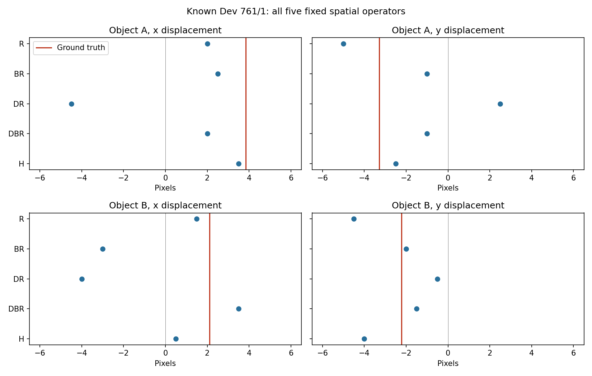

# 从三个坏例理解：空间压缩后，对象为什么会被匹配到错误方向？

这三个案例说明的是：**同一份冻结视觉特征，经过不同的空间平均和网格重建，再交给同一个对应器，正确位移的排名会改变，甚至从正确方向变成反方向。** 它们帮助定位“空间处理＋当前对应规则”的失败；没有证明 encoder 内部哪一层出错，也没有证明原来的长期 memory 已经有效或无效。

案例编号是 `world / variant`。844/1、761/1、891/1 最早是 V5.4 按已评估 episode 的 W reader 水平误差选出的前三例，之后固定沿用，**不是根据 V5.8 的结果重新挑选，也不是总体的随机样本**。V5.8 的总体证据来自全部 256 个已知 Dev world、512 个 episode、1024 个对象查询，见[完整报告](../results/wm/visual-v5_8-20261010/README.md)。

## 先看实际输入，再分清测试的是哪一层

每张图为 224×224 像素，左边是 t=6，右边是 t=7。A 是上方红／橙色对象，B 是下方蓝色对象；中间黄色块是干扰物。任务中的真值来自生成器的连续位置，本文将归一化位移乘以 224，统一写成像素；它不必等于整数光栅边缘移动的距离。


**这张原图拼图的文字标注属于 V5.4：N/W 是当时训练的两个 reader，数字采用归一化坐标；它们不是下文的五组对应预测。** 本文使用这张图展示原始画面和选例来源。六张 RGB 的哈希已经与编码输入核验；V5.4、V5.6 的六张图记录一致，三张 t6 图也与 V5.8 的源图记录一致。[原图核验](../results/wm/visual-v5_4-20261010/bad_cases/render_verification.json) · [V5.6 RGB 记录](../results/wm/visual-v5_6-20261010/correspondence_interpretation/rgb_hash_readback.json) · [V5.8 源图记录](../results/wm/visual-v5_8-20261010/spatial/source_rgb_records.json)

V5.8 实际经过的路径是：

```text
同一原始两帧 → 已缓存的冻结 I-JEPA 特征
           → R / H / BR / DR / DBR 空间处理
           → 固定局部余弦对应器 → 从 625 个候选中选位移
```

这里的 **raw 是 encoder 输出的 latent 特征，不是原始 RGB**。每帧为 16×16 个、每个 1280 维的空间描述子；来自同一次 BF16 encoder 前向，按 FP32 保存。一个空间 token 可以包含全局上下文，不能把它等同于仅看该像素块的独立对象特征。

对应器从**源图颜色**定位 A/B，各取包围框内 3×3 个点；这使用了已知任务颜色的特权信息。随后在两帧的特征场上比较这九个点，采用通道中心化后的余弦距离。它不使用目标帧颜色来寻找终点，也不是 V5.4 的训练型 reader。原项目的 history/P0 gate、memory writer、长期存取与未来预测均不在这条诊断路径中。

## 五组到底改了什么

| 组 | 存储网格 | 处理与查询方式 |
|---|---|---|
| R | 16×16 | 原 latent 特征；在原物理网格上双线性查询。 |
| H | 13×13 | 在半格中心取原特征场，等价于中央 2×2 平均；作为与 BR 同中心、同密度的参照。 |
| BR | 13×13 | 同样的中心，改为有效 4×4 窗口平均，再在密集网格查询。 |
| DR | 4×4 | 从 H 每隔四格取样，在该粗网格直接双线性重建和查询。 |
| DBR | 4×4 | 从 BR 每隔四格取样；复现 V5.6 的 CPU Pool 对照。 |

H 与 BR 的中心均为 `27.5 + 14j`；DR 与 DBR 的中心为 `27.5 + 56k`。`H[::4, ::4] == DR`、`BR[::4, ::4] == DBR` 已逐位验证。平均用 FP64 累加后保存为 FP32；这里的 DBR 复现的是同源 CPU pooling 对照，不能据此宣称它与原 GPU 流水线所有 BF16 池化缓存逐位相同。

因此，**BR−H 比较同相位、同密度下扩大平均窗口的影响；DR−H 与 DBR−BR 比较粗采样加重建的影响。** R−H 仍同时涉及取样位置、隐式平均和支持域，DR 也包含 2×2 插值平均；它们不是“纯相位”或“完全没有低通的抽样”。五组 token 数不同，本轮不是等字节内存竞赛。[算子协议](V5_8_EXECUTION_PROTOCOL.md)

## 844/1：还没换成粗网格，方向就翻转了

下表均为 `(dx, dy)`，单位像素，**右／下为正，左／上为负**。真值保留三位小数，预测来自固定 0.5px 网格。

| 方法 | A 的位移 | B 的位移 |
|---|---:|---:|
| 真值 GT | (−3.278, −3.768) | (−3.690, −1.883) |
| R | (−4.0, −2.0) | (−6.0, −1.5) |
| H | (−1.5, −4.5) | (−1.5, −2.0) |
| BR | **(+3.0, +6.0)** | (−2.5, +1.0) |
| DR | **(+6.0, +6.0)** | (−0.5, −1.5) |
| DBR | **(+6.0, +4.0)** | (−1.0, −2.0) |


A 实际向左上移动。R 的两轴方向正确；H 仍向左上，但水平幅度明显不足。仅把 H 的 2×2 平均改成 BR 的 4×4 平均，预测就成为右下，**水平和垂直都反向**。DR 也反向，且两个坐标都到达 +6px 搜索边界。B 并未呈现完全相同的退化，不能把一个 episode 的两个对象合成一句“全部反向”。

对 A，离连续真值最近的候选是 `(−3.5, −4.0)`：

| 正确候选的排名，越小越好 | R | H | BR | DR | DBR |
|---|---:|---:|---:|---:|---:|
| 全部 625 个候选中的 rank | 22 | 69 | 558 | 574 | 573 |
| 固定到最近 GT y 行后的 rank / 25 | 3 | 11 | 20 | 20 | 20 |

**能定位：** H→BR 在相同网格中心和密度下就出现反向，不能只归咎于最后变成 4×4 粗网格。两对象的全部源点和全部目标候选都不触及特征插值边界，也不能只用边界复制解释。正确 y 行内仍然排名差，说明仅告诉对应器正确纵向位置，水平问题也不会自动消失。

**不能定位：** 这没有证明 encoder 丢失了 A 的身份，也没有证明任何 reader 都无法恢复其运动。+6px 表示当前候选范围内的最小代价在边上；不能据此声称真实位移超出了范围，更不能推断扩大搜索一定会正确。[完整二维代价面](../results/wm/visual-v5_8-20261010/spatial/figures/case_844_1_costs.png)

## 891/1：方向正确但低估，与真正反向，是两种错误

| 方法 | A 的位移 | B 的位移 |
|---|---:|---:|
| 真值 GT | (−3.781, +2.222) | (+3.348, +2.955) |
| R | (−5.5, +1.5) | (+1.5, +5.0) |
| H | (−5.0, +4.5) | (+0.5, +4.0) |
| BR | (−2.5, +3.5) | **(−2.0, +6.0)** |
| DR | (−1.5, 0.0) | (+0.5, −1.0) |
| DBR | (−1.0, +0.5) | **(−2.5, 0.0)** |

B 真实向右约 3.35px。R 的 +1.5px 和 H 的 +0.5px 是**向右但水平幅度低估**；BR 的 −2.0px、DBR 的 −2.5px 才是水平反向。DR 在本例仍为 +0.5px，因而不能把 844/1 的“粗采样导致水平反向”照搬到所有对象；它在这里主要表现为水平幅度不足和垂直方向错误。


热图中白色叉号是选中的候选，星号是连续 GT；横纵轴是候选 `dx/dy`，不是对象在原图中的位置。**每个 panel 独立定色标**，深色只表示该 panel 内代价较低，不能横向比较深浅来判断哪组“更有信心”；代价也不是概率。热图的纵轴按数值向上排列，正 dy 在原图中仍表示向下移动。[逐坐标预测图](../results/wm/visual-v5_8-20261010/spatial/figures/case_891_1_predictions.png)

B 最近 GT 候选为 `(+3.5, +3.0)`：

| 正确候选的排名，越小越好 | R | H | BR | DR | DBR |
|---|---:|---:|---:|---:|---:|
| 全部 625 个候选中的 rank | 64 | 37 | 240 | 241 | 493 |
| 固定到最近 GT y 行后的 rank / 25 | 6 | 4 | 19 | 11 | 20 |

**能定位：** 同相位密集网格上 H→BR 的正确候选排名和方向同时变差；DBR 进一步把正确位置排到 493/625。这里两对象的全部候选也都不触边，所以不是单纯的图像边缘案例。

**不能定位：** R/H 也没有准确恢复位移；方向变对不是“运动理解已经解决”。BR/DBR 在此例失败，不意味着平均在每个采样条件下都更坏；粗网格上 DBR 的总体误差实际上低于 DR。案例支持具体操作下的失败，不支持一个普遍的“平均必然损失一切运动信息”结论。

## 761/1：同一个操作，不会对所有对象产生相同效果

| 方法 | A 的位移 | B 的位移 |
|---|---:|---:|
| 真值 GT | (+3.841, −3.284) | (+2.113, −2.218) |
| R | (+2.0, −5.0) | (+1.5, −4.5) |
| H | (+3.5, −2.5) | (+0.5, −4.0) |
| BR | (+2.5, −1.0) | **(−3.0, −2.0)** |
| DR | **(−4.5, +2.5)** | **(−4.0, −0.5)** |
| DBR | (+2.0, −1.0) | (+3.5, −1.5) |



H 在 A 上比 R 更接近真值，但在 B 上进一步低估水平位移。BR、DR 将 B 的水平位移反向，DBR 又恢复向右且二维误差小于 R。这样的结果是保留五组、两对象完整输出的原因：**总体劣势允许局部改善，不能把坏例讲成每一步都单调变坏。**

**能定位：** B 的所有候选都不触边，仍有 BR/DR 的反向；说明本例并非只能由边缘解释。同时，DBR 对 B 的改善展示平均窗口与粗采样之间存在条件关系。

**不能定位：** A 不属于五组共同无触边子集：虽然它的源点和最终选中的目标点未触边，部分其他候选会在 H/BR/DR/DBR 上触边。不能用 A 作为完全排除边界影响的示例，也不能依据此例单独决定最优压缩方法。[完整代价面](../results/wm/visual-v5_8-20261010/spatial/figures/case_761_1_costs.png)

## 如何理解 rank、错向和候选网格

- **625 个候选**是 `dx,dy ∈ {−6, −5.5, …, +6}` 的 25×25 组合，不是 625 个对象。对应器对每个候选比较九对特征，选平均余弦距离最小者。它输出 0.5px 的整数倍，连续真值通常不在格点上。
- **GT rank**先把连续 GT 映射到最近格点，再数有多少候选的代价严格更低；1 最好。行内 rank 限制在最近 GT y 的那一行，是用了真实 y 的特权诊断，不是可直接部署的新算法。rank 反映当前代价排序，不是 latent 信息含量。
- **错向**表示预测与真实位移的符号相反；**低估**表示同方向但绝对幅度不足；零预测另列。总体水平符号统计只计 `|GT dx|≥1px` 的 1022 个查询，未把零预测并入非零错向。
- **搜索边界**指选中 ±6px；**特征插值触边**指查询超过某组 token 网格的支持域。两者不是一回事。三个案例的 GT 均在搜索范围内，844/1 与 891/1 的全部候选又都不触特征边界。

候选离散化让精确命中连续真值并非必然，但五组共享同一候选表；它不能单独解释组间大幅方向变化。三例所有组的最小代价均无并列，也不是恰好在 tie-breaking 上选错。[逐对象 CSV](../results/wm/visual-v5_8-20261010/spatial/per_episode_object.csv)

## 回到项目：目前证据支持哪一步

全体对象查询的水平 RMSE 为 R 1.534、H 1.520、BR 3.392、DR 4.808、DBR 3.878px；共同无触边子集仍有同样的主要差异。**值得继续研究的是，怎样保留目标附近足够密的空间信息，并让读取规则稳定利用它。** H 的水平点估计略好于 R 不是已经验证的修复：其差值区间跨零，且四坐标平均 MSE 更差。

目前不能把失败全部分给 pooling、encoder 或 reader，也不能把采样与重建拆成已证实的责任比例。这里没有追踪遮挡后的持久身份，没有验证记忆写入是否保留预测所需信息，没有重跑或通过原 history/P0 gate。原图中黄色块在移动，但 **V5.8 没有改变黄色块**，这组三个案例也不能把黄块运动与错误的共现解释为因果。

网页解释可以直接使用本页引用的仓库 PNG、表格和 JSON，不需要下载大型 raw cache、访问 DGX 或重新编码。原始 RGB 已包含在上方认证拼图；若需要单例放大，可打开 [844/1](../results/wm/visual-v5_6-20261010/correspondence_interpretation/case_844_1.png)、[891/1](../results/wm/visual-v5_6-20261010/correspondence_interpretation/case_891_1.png)、[761/1](../results/wm/visual-v5_6-20261010/correspondence_interpretation/case_761_1.png) 的旧 V5.6 图，顶部是相同原图，下面是**旧六种方法**，不要与本页五组结果混读。

本页数值以 [V5.8 fixed_cases.json](../results/wm/visual-v5_8-20261010/spatial/fixed_cases.json)、[逐对象 CSV](../results/wm/visual-v5_8-20261010/spatial/per_episode_object.csv) 与 [report.json](../results/wm/visual-v5_8-20261010/spatial/report.json) 为准；核验见[独立结果重算](../results/wm/visual-v5_8-20261010/spatial_result_review.json)、[图表与结果清单](../results/wm/visual-v5_8-20261010/spatial/archive_manifest.json)。这些是已知 Dev 上的探索性诊断；三例用于解释机制，全体统计与尚未完成的验证边界应一起保留。
