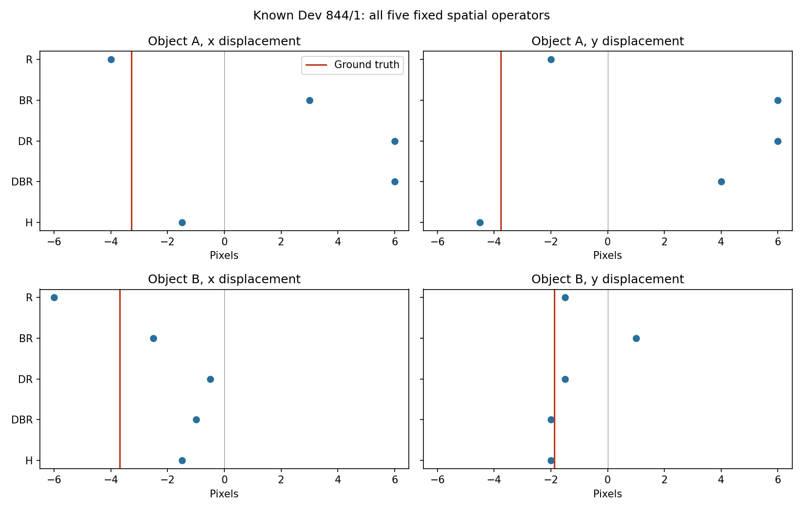
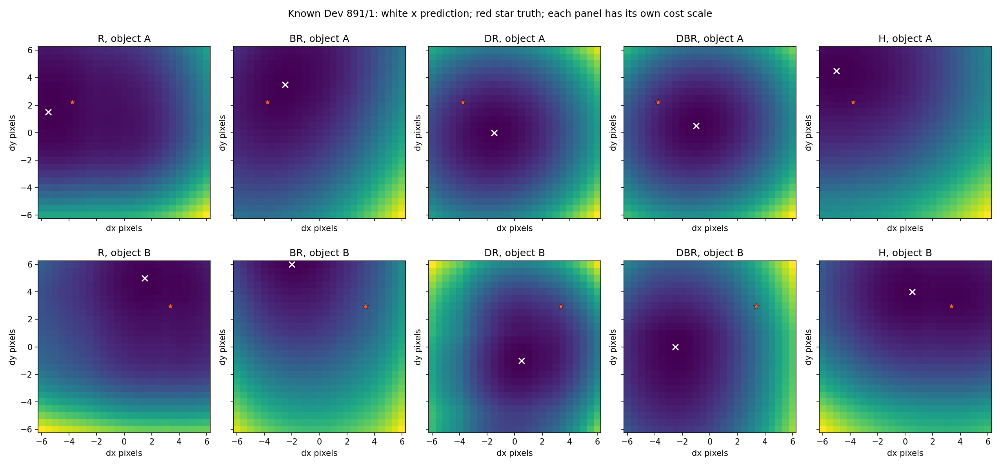

# 从坏例到论文：空间证据、对应定位与预测记忆的阅读路线

本页供接手项目的网页助手、合作者和读者使用。**当前建议先暂停继续扩展消融，把已有坏例解释清楚，再从论文中选择一个可证伪的机制。** 下面是阅读和设计建议，不是新实验登记；没有因此启动训练、GPU 作业或新的科学评分。

用户正在读 Cambrian-S。新的主线先读 Saining Xie 参与的 **Cambrian-1 → V* → Thinking in Space**，再回看 Cambrian-S 的 **§4 和 Appendix F.2**；与当前定位失败最直接相关的补充是 **FeatUp 和 TAPIR**。抗混叠论文作为可选背景。选择依据是它们能回答什么具体问题，不是作者名气，也不意味着这些想法具有新颖性。

## 先把项目的问题说准确

项目最初想研究：在有限记忆下，预测误差能否帮助系统保留之后有用的视觉证据。实际推进中，原 V5 的运动读出门槛失败，后续工作转向诊断“写入记忆之前，视觉表示和读出是否已经把小位移读错”。后续局部改善不等于原门槛通过，更不等于长期记忆有效。

阅读前先看以下三份证据，不必重读所有实验日志：

| 已有证据 | 它排除了什么简单解释 | 它没有证明什么 |
|---|---|---|
| [RGB 可观测性诊断](../results/wm/visual-v5_5-followup-design-20261010/rgb_observability/)：固定颜色质心可以从 RGB 较准确地读出位移 | 大量反向错误不能主要归咎于像素中完全没有运动信息 | 这是已知颜色的特权诊断，不是学习模型成绩，也不证明 encoder 的描述子可直接定位 |
| [V5.6 等字节局部对应](../results/wm/visual-v5_6-20261010/README.md)：源图颜色 ROI 附近的细节优于均匀粗池化；两帧变化优先策略大量选择黄色干扰物附近 token | “保留变化最大的 token 就会保留有用运动”在这条路径上不成立 | ROI 依赖特权颜色定位；变化优先使用两帧，不能称为在线选择；两帧缓存不是长期 memory |
| [V5.8 空间算子诊断](../results/wm/visual-v5_8-20261010/README.md)：同一 raw 特征上，大窗口平均和粗采样重建均可破坏当前 matcher 的定位 | 单用网格相位、插值触边或并列最小值解释失败不充分 | 没有证明信息不可恢复，没有定位 encoder 内某层，也没有测试训练型 reader 或 memory writer |

最值得带着读论文的是两个固定案例。下表都是水平位移，单位 px；H/BR 位于相同密集网格，区别是 2×2 与 4×4 平均；DR/DBR 分别是它们的粗采样重建。

| 已固定案例 | 真值 | 原 raw R | 密集 2×2 H | 密集 4×4 BR | 粗 2×2 DR | 粗 4×4 DBR／原 Pool |
|---|---:|---:|---:|---:|---:|---:|
| 844/1，A | −3.278 | −4.0 | −1.5 | +3.0 | +6.0 | +6.0 |
| 891/1，B | +3.348 | +1.5 | +0.5 | −2.0 | +0.5 | −2.5 |

这两个对象的全部候选都不触边。844/1 A 在变成粗网格之前就因扩大平均范围而反向；891/1 B 在 H 上已经低估幅度，BR 又进一步反向。[完整定义、全体统计及反例](../results/wm/visual-v5_8-20261010/README.md) 保留在原归档中，不能只看这两个选定对象。

V5.8 的总体水平 RMSE 为 R 1.534px、H 1.520px、BR 3.392px、DR 4.808px、DBR 3.878px。**H 不是已验证的修复**：H−R 水平 MSE 差的区间跨零，且四维平均 MSE 更差。粗网格下 DBR 又优于 DR，因此“平均越多越坏”同样不成立。可以学习的是保留空间证据与采样条件的关系，不能把结果换算成各模块的责任百分比。

## 阅读次序与每一步的任务

| 次序 | 论文／模块 | 阅读后应能回答的问题 |
|---|---|---|
| 1 | Cambrian-1：Spatial Vision Aggregator | 相同数量的输出 token，为什么空间受限的可学习聚合与固定平均并不等价？ |
| 2 | V*：搜索与 Visual Working Memory | 谁决定细看哪里？查询已知和未来查询未知，是不是同一种 memory 问题？ |
| 3 | Thinking in Space：认知地图与评估 | 当前两帧定位，距离“跨视角、跨时间、保持对象关系的空间状态”还缺什么证据？ |
| 4 | 回看 Cambrian-S §4/F.2 | surprise 改变的是保存什么、压缩多少、检索什么，还是当前状态本身？ |
| 5 | FeatUp：多视图一致性与特征上采样 | 恢复空间细节需要什么额外信息，能否把它算进同一预算？ |
| 6 | TAPIR：初始化、局部细化与可靠性 | 代价面取最小值以后，如何修正位置和判断定位失败？ |
| 可选 | Making CNNs Shift-Invariant Again | 为什么滤波在密集定位中可能有害，却在粗采样前有帮助？ |

每次只解释一个模块：先读原文和图，再画输入／输出，再对照一个坏例，最后写出一个会推翻当前想法的结果。不要把读论文变成同时移植几个完整系统。

## 1. Cambrian-1：压缩的是 token 数，还是空间证据？

**正式信息。** *Cambrian-1: A Fully Open, Vision-Centric Exploration of Multimodal LLMs*，**NeurIPS 2024**；Shengbang Tong、Ellis Brown、Penghao Wu 等，**Saining Xie 为合著者及通讯作者**。[正式论文页](https://proceedings.neurips.cc/paper_files/paper/2024/hash/9ee3a664ccfeabc0da16ac6f1f1cfe59-Abstract-Conference.html)；[原文 HTML](https://arxiv.org/html/2406.16860v1)；[作者项目页](https://cambrian-mllm.github.io/cambrian-1/)。

**重点读。** §4 *Spatial Vision Aggregator (SVA): A New Connector Design*，尤其 Fig.8 与该节的 connector／token 数消融表；需要理解评估背景时，再补 §3.1–3.2。不同版本的表号可能变化，以章节与表题定位。

**论文证据。** SVA 用具有空间聚合范围的可学习查询，通过 cross-attention 聚合视觉特征，并在 LLM 的多个层次再次访问视觉信息。论文比较的是 MLLM 的连接器及视觉理解表现，不是我们的两帧小位移测量。

**对应坏例与我们的推断。** 844/1 A 提醒我们：把邻域压成一个固定均值，可能改变当前位置与邻近背景的相对证据。SVA 值得学习的部分是“每个压缩 token 从哪里读、允许怎样混合”，而不是直接照搬多 encoder 或完整 LLM。输出 token 数相同，也不保证保留下来的空间信息相同。

**额外信息与预算。** 学习聚合需要训练；反复 cross-attention 需要保留、访问上游视觉特征并付出计算。多视觉塔还改变 encoder 成本。不能只报 LLM 输入 token 数而忽略原特征缓存、聚合器参数、训练数据和重复读取成本。

**可证伪控制，尚未执行。** 固定 encoder、可访问的原特征、输出字节数和训练集，对比固定平均与带空间范围约束的聚合；在未使用过的世界测方向、幅度及干扰变化。如果改善只在额外保留全部高分辨率特征时出现，就不支持“相同总预算下的压缩修复”。若同预算下方向仍反复出错，也不能仅凭最终 VQA 分数宣称定位已恢复。

**讲解检查点。** 能否分别指出 query 的空间位置、它能访问的特征范围、输出 token 的含义，以及被省略的缓存费用？

## 2. V*：让任务需求决定细看哪里

**正式信息。** **V*: Guided Visual Search as a Core Mechanism in Multimodal LLMs**，**CVPR 2024**（预印本 2023）；作者 **Penghao Wu、Saining Xie**。[正式论文页](https://openaccess.thecvf.com/content/CVPR2024/html/Wu_V_Guided_Visual_Search_as_a_Core_Mechanism_in_Multimodal_CVPR_2024_paper.html)；[原文 HTML](https://arxiv.org/html/2312.14135v2)。

**重点读。** §3.1 的 SEAL／Visual Working Memory，§3.3 的搜索流程及 Algorithm 2；先跟踪“已有问题 → 需要找的对象 → 搜索区域 → 局部证据 → 回答”，再看搜索模型训练。

**论文证据。** V* 用语言模型给出的目标和上下文引导高分辨率图像搜索，把搜索得到的局部证据与全局图像、目标位置组织为 VWM，再供问答模型使用。这里的 VWM 是该搜索问答流程中的信息组织方式。

**对应坏例与我们的推断。** V5.6 的变化优先策略经常围绕黄色干扰物分配细节；它衡量“变化大”，没有衡量“对 A/B 位移有用”。V* 提供的是需求驱动的搜索思路。已有颜色 ROI 的收益可以提示局部选择值得研究，但颜色已知的 ROI 不是学出来的搜索策略。

**额外信息与预算。** V* 搜索时已知道问题，还能访问原始高分辨率图像并反复裁剪／查询。我们的 memory 如果要服务未知的未来问题，就不能在写入时偷偷使用那个问题；如果原图已丢弃，也不能免费回头放大。搜索调用数、裁剪编码、原图保留、位置元数据和工作区都要计费。

**可证伪控制，尚未执行。** 将“查询已知时的选择”和“查询未知时的写入”分成两个任务。前者固定搜索次数和总字节，比较任务引导、均匀与变化优先；后者必须先冻结写入，再揭示未来问题。若收益依赖提前知道答案对象或不计费回看 RGB，就不能声称解决了未知查询的长期记忆选择。

**讲解检查点。** 在原算法的哪一步问题已经给定？映射到项目时，哪些信息在写入时实际不可得？

## 3. Thinking in Space：用什么证据才配称为空间记忆？

**正式信息。** *Thinking in Space: How Multimodal Large Language Models See, Remember, and Recall Spaces*，**CVPR 2025**（预印本 2024）；Jihan Yang、Shusheng Yang、Anjali W. Gupta、Rilyn Han、Li Fei-Fei、**Saining Xie**。[正式论文页](https://openaccess.thecvf.com/content/CVPR2025/html/Yang_Thinking_in_Space_How_Multimodal_Large_Language_Models_See_Remember_CVPR_2025_paper.html)；[原文 HTML](https://arxiv.org/html/2412.14171v1)。

**重点读。** §2 的能力分解、§3 的 VSI-Bench 任务定义，以及 **§6.1–6.2 的 cognitive maps**、对应地图可视化与相对距离结果表。不要只看总平均分；区分自我中心视角、环境坐标中的关系和语言回答。

**论文证据。** 工作构建视频空间评估，并用生成的认知地图探查模型的空间组织能力；在其相对距离实验中，先生成地图可改善回答。论文也讨论局部空间意识与统一全局空间表达的差距。

**对应坏例与我们的推断。** 我们当前甚至存在 A/B 水平运动的符号串扰；解决它只是局部感知条件。即使两帧读出准确，也没有证明同一对象在换视角、离开画面、再出现之后仍保持身份和空间关系。此论文最适合帮助定义项目最终应验证的能力，而不是为当前 toy 实验附加“world model”名称。

**额外信息与预算。** 显式地图、对象坐标、关系边、生成地图的推理步骤都占用存储和计算。GT 地图是额外真值，模型生成地图与 GT 地图的结果必须分开。真实室内视频与当前合成场景也不是同一分布。

**可证伪控制，尚未执行。** 在局部可观测性成立后，用相同最后画面、不同历史的成对任务验证历史是否改变答案；再检查对象重现和视角变化的关系一致性。若最后一帧或单帧位置先验已能解释收益，就不足以支持 memory 的因果贡献；一张看似合理的地图也不能代替这种对照。

**讲解检查点。** “看见”“保存证据”“更新当前状态”“用状态回答关系问题”分别需要哪个独立观察？

## 4. 已读 Cambrian-S：回到 §4 和 F.2，而不是重读全文

**正式信息。** *Cambrian-S: Towards Spatial Supersensing in Video*，**2025 预印本**；Shusheng Yang、Jihan Yang 等，**Saining Xie 为合著者**。本页使用已核验的 v1，不推断后续会议版本。[论文记录](https://arxiv.org/abs/2511.04670)；[原文 v1](https://arxiv.org/html/2511.04670v1)。

**重点读。** §4 *Predictive Sensing as a New Paradigm*，尤其 §4.1 的 latent frame prediction、§4.2 的 memory 用法；随后逐项读 **F.2：Basic memory units → Streaming sensing → Compression → Consolidation → Retrieval**。暂不把 F.3 的计数系统混入同一个实现解释。

**论文证据。** 预测下一帧 latent 的误差提供 surprise 信号。F.2 的基本记忆单元是各 LLM 层的 KV，而不是直接储存视觉 encoder 的 raw feature；框架区分 sensory、long-term 和 working memory，并定义压缩、整合与检索流程。

**对应坏例与我们的推断。** 变化优先追逐黄色干扰物，使我们必须问：预测误差是任务相关的新证据，还是不值得保留的变化？但 V5.6 测的是相邻帧特征变化，**不是论文训练出的 latent prediction error**；不能据此宣布 Cambrian-S 的 surprise 无效。更基础的问题是：当读出已反向时，记忆是在保存错误证据，还是在后续步骤中有机会纠正它？

**额外信息与预算。** LLM KV、预测头、各层缓存、检索工作区与视觉 raw token 不是相同对象；不能用 raw 特征字节直接替代论文 KV 费用。预测器训练、历史窗口、query 到来时间也必须明确。压缩旧证据与修正当前对象状态是不同操作。

**可证伪控制，尚未执行。** 待基础读出条件满足后，在同一 predictor／reader 下，按相同完整字节预算比较 surprise、recency、uniform；预先定义任务相关事件与无关变化，并检查后续回答是否因相应证据的保留／移除而改变。若 surprise 只多保留干扰变化，或移除所谓关键记忆不影响后续回答，就不支持“保留了因果有用的记忆”。

**讲解检查点。** 请沿一段新视频证据逐步追踪它何时变成 KV、何时被压缩、何时进入长期记忆、何时被 query 检索；再指出我们的实现目前真正走到了哪里。

## 5. FeatUp：空间重建需要什么额外约束？

**正式信息。** *FeatUp: A Model-Agnostic Framework for Features at Any Resolution*，**ICLR 2024**；Stephanie Fu、Mark Hamilton、Laura E. Brandt、Axel Feldmann、Zhoutong Zhang、William T. Freeman；**不含 Saining Xie**。[正式论文页](https://proceedings.iclr.cc/paper_files/paper/2024/hash/c5601d99ed028448f29d1dae2e4a926d-Abstract-Conference.html)；[原文 HTML](https://arxiv.org/html/2403.10516v1)；[作者项目页](https://mhamilton.net/featup.html)。

**重点读。** Fig.2，§3 的多视图一致性，§3.1 *Choosing a Downsampler*，§3.2 *Choosing an Upsampler* 中的 joint bilateral upsampling（JBU），以及该版本 §6.13 *Limitations*。

**论文证据。** 对同一图像施加已知变换，利用冻结 backbone 的多个低分辨率观测约束高分辨率特征。JBU 使用 RGB 引导混合邻近特征；另一种隐式表示需要对单图进行拟合。论文也报告纹理转移／halo 等局限。

**对应坏例与我们的推断。** 844/1、891/1 的局部成本排序在平均后恶化，提示“压缩与重建是否保留定位所需的几何”值得直接约束。FeatUp 的价值是训练目标和几何一致性，而不是把 4×4 resize 到 16×16 后就称为恢复信息。

**额外信息与预算。** RGB 引导、多次变换后的 encoder 前向、上采样器训练或每图拟合，都是额外资源。仅从同一份 coarse token 恢复，与借助 RGB／多视图恢复，是两个不同问题。单图变换一致性不等于真实跨帧时序一致性；更清晰的特征可视化也不等于更准确的位移。

**可证伪控制，尚未执行。** 先用固定描述子场的已知平移检查重建和度量，再考虑仅在 FIT 上训练的几何一致性模块。固定 matcher 和完整资源预算，在新世界比较方向、幅度及正确候选排名。若只变得视觉上锐利、定位并不改善，或收益完全来自新增 RGB 而非已压缩特征，就必须收窄机制结论。

**讲解检查点。** 每一项细节来自 coarse feature、RGB、变换后的新观测，还是训练先验？不能把来源统称为“上采样恢复”。

## 6. TAPIR：代价面初始化不等于最终定位

**正式信息。** *TAPIR: Tracking Any Point with Per-Frame Initialization and Temporal Refinement*，**ICCV 2023**；Carl Doersch、Yi Yang、Mel Vecerik、Dilara Gokay、Ankush Gupta、Yusuf Aytar、João Carreira、Andrew Zisserman；**不含 Saining Xie**。[正式论文页](https://openaccess.thecvf.com/content/ICCV2023/html/Doersch_TAPIR_Tracking_Any_Point_with_Per-Frame_Initialization_and_Temporal_Refinement_ICCV_2023_paper.html)；[原文 HTML](https://arxiv.org/html/2306.08637v2)；[作者项目页](https://deepmind-tapir.github.io/)。

**重点读。** Fig.2，§3.1 *Track Initialization and Position Uncertainty Estimates*，§3.2 *Iterative Refinement*，§4 高分辨率扩展和 §5.3 消融。

**论文证据。** 先用查询点与帧特征形成成本体并初始化位置，再以局部、多尺度信息进行迭代细化，更新位置和查询表示；模型分别处理遮挡与定位误差风险。它使用专门训练的跟踪模型，不是冻结 I-JEPA 上直接取 cosine 极值。

**对应坏例与我们的推断。** 原 raw 仍有约 1.5px 水平 RMSE，891/1 B 即使方向正确也明显低估幅度。TAPIR 给出两个应分开思考的模块：局部修正，以及知道当前位置是否可靠。V5.7 中给定正确 y 仍未总体修复 dx，因此不能把问题简单化为减少二维搜索候选。

**额外信息与预算。** TAPIR 改变了 encoder／训练数据／匹配器，并使用时序细化；论文的监督训练和跨帧信息不是免费的。离线时序访问也不自动满足在线 memory 约束。成本最小值、峰值间隔或熵都不天然是校准后的失败概率。

**可证伪控制，尚未执行。** 固定输入特征和初始位置，仅增加预先规定的局部细化，独立报告“初始化已接近”与“初始化远离”两组；另用 FIT 校准定位风险，在新世界检查风险与实际误差是否对应。若靠更换 encoder 才改善，就不能归因为细化模块；若修正只能在 GT 初始化附近工作，也不能宣称解决搜索失败。

**讲解检查点。** 遮挡、位置不准和身份匹配错误为什么是不同事件？哪个输出能支持哪个判断？

## 可选：抗混叠不是“多平均一点”的口号

**正式信息。** Richard Zhang，*Making Convolutional Networks Shift-Invariant Again*，**ICML 2019**；**不含 Saining Xie**。[正式论文页](https://proceedings.mlr.press/v97/zhang19a.html)；[原始 PDF](https://proceedings.mlr.press/v97/zhang19a/zhang19a.pdf)。重点读 §3.1–3.2、Fig.2–4。

**论文证据。** 将下采样拆为密集操作和抽样，在抽样前插入低通滤波，以改善 CNN 的平移稳定性。特征随平移而移动的 equivariance，与分类结果不变的 invariance 是不同目标。

**对应坏例与边界。** V5.8 中密集 4×4 平均比密集 2×2 差，但粗网格中 4×4 比 2×2 好，与滤波效果依赖采样条件相容；这还不是对具体频谱混叠机制的识别。论文的 CNN 分类结果不能直接证明 I-JEPA 的小位移描述子会被 BlurPool 修好。

**可证伪控制，尚未执行。** 保持同一物理场、网格和预算，改变滤波核与采样相位，分别测已知平移下的重建误差和定位误差。若平移一致性改善而定位更差，就必须保留两种目标的冲突。滤波支持、边界规则和计算量都要记录，不能只按 token 数宣称等价。

## 从阅读返回设计前，必须做出的选择

这组论文支持三个不同层次的候选问题。**它们目前都不是新实验承诺。**

1. **空间表示与读出接口：** 以 Cambrian-1／FeatUp 为线索，问有限字节下怎样保留可定位的局部证据。优先区分固定特征中的采样重建问题，与真实跨帧描述子变化；不能同时换 encoder、聚合器和训练目标后只报告一个分数。
2. **有目的的选择与对应细化：** 以 V*／TAPIR 为线索，问在合法的可用信息下怎样找对位置、细化位移，并识别失败。需要把已知问题、RGB 特权 ROI、未来帧和额外高分辨率访问分别计入条件。
3. **历史证据何时因果有用：** 以 Thinking in Space／Cambrian-S 为线索，待基础视觉条件足够后再验证保留、更新和检索。必须有历史依赖对照，不能由两帧更准或视频问答更高直接推出长期 memory 有效。

在这之前，先能解释两个现象：为什么 844/1 A 在同相位密集平均后反向；为什么 891/1 B 在 raw/H 中仍低估幅度。解释要指出证据允许和不允许的范围，不能以“encoder 坏了”“pooling 丢失全部信息”代替可检验机制。

所有学习型选择都只能在训练数据上开发，已反复查看的 Dev 只能用于探索性诊断；后续确认要有未使用的世界及冻结方案。水平 dx MSE、四维平均 skill 和方向错误是不同指标；沿用哪一个冻结 FIT 均值作 skill 分母也必须明确，不能拿 Dev 方差偷偷替换。读取成本、存储、元数据、训练和额外原图访问都纳入预算。没有本页建议可以绕过原协议门槛。

## 可直接交给网页讲解助手的说明

> 我正在读 Cambrian-S。请先结合本仓库 V5.8 的 844/1 A、891/1 B 两个固定坏例，讲清已有对照真正定位了什么，再按 Cambrian-1、V*、Thinking in Space、回看 Cambrian-S §4/F.2、FeatUp、TAPIR 的顺序，每次只讲一个模块。采用“关键英文原句 → 中文翻译 → 模块输入输出 → 与坏例的对应 → 不能推出什么 → 一项可证伪控制”的节奏。引用原始论文，不把作者的 benchmark 结论迁移成我们已验证的结论。不要开始新实验，不要直接替我选一个新架构；先确认我能解释模块、额外信息和完整预算。

原论文的算法、我们的已执行对照、上述未来候选设计，是三类不同证据。本页不提出新颖性主张，也不将任何候选组合包装成已经成立的方法。
