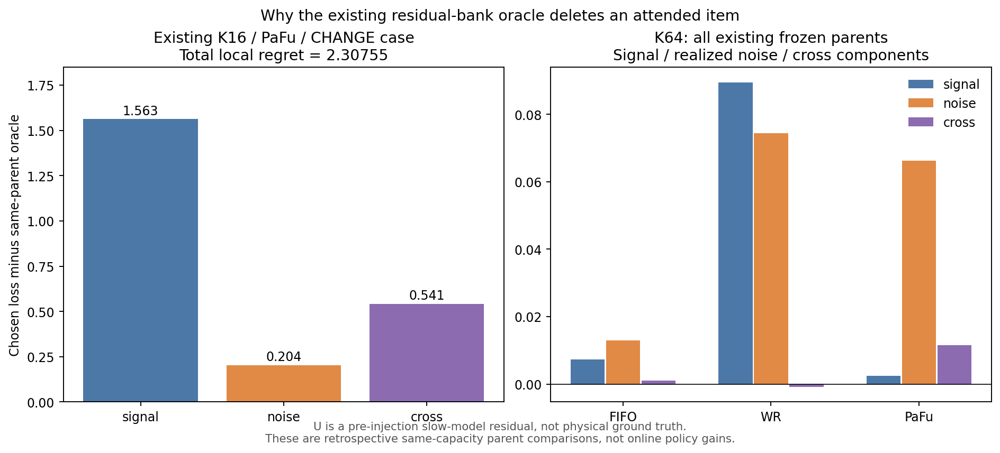

# 将已有 PM bad case 与 CV oracle 问题连接起来

2026-10-22。这里接着分析已经保存的案例，没有重新启动一轮 PM bad-case 搜索，
没有新增在线策略、训练、感知诊断、GPU任务或 FINAL/test 评测。

**可以结合的是研究问题和诊断方法：被注意到、被保存下来，是否等于对未来任务有
正的边际贡献？不能合并的是算法胜负和失效原因。** 旧 A2 小物体损失、当前残差 bank
的噪声放大、CV 删 cue 后 feature MSE 下降，涉及不同表示和读取器，不能当作同一
种失败的三次重复证据。

## 原有结论继续成立

旧 A2 分析已经定位：EXACT 的物体坐标有局部 signal 代价，但 A2 同时减少噪声，
grid 获益；CHANGE 物体坐标还会改善。若只修复那个已观察到的 EXACT 坐标损失，
原先账面估计只改善合并保留 MPE 约 **0.0125%**，不是新方法的实际收益或上界。
因此，**不把修补这项 A2 小损失重新提为论文主线**。

本轮保留了[原结论的逐字副本](prior_a2_conclusion.json)，其原始 SHA 见
[冻结输入清单](frozen-protocol.json)。旧结论中的 signal/noise 方向与下文 bank
不一样：A2 是“降噪同时损失部分 signal”，朴素 bank 则可能直接引入旧值和旧噪声。

## 这次只核查原有 864 个 parent

沿用 BR-0.1 的全部已保存 parent：K=4/16/64、R=4、三个条件、8个开发 A source、
四个固定时刻。对同一个 K+1 候选集合，比较原策略留下的 K 项与局部 oracle 留下的
K 项，输入、容量、近期缓冲、读取器和六步目标完全相同。这个同预算 memory-vs-memory
对照是事后删除诊断，不是可部署的新在线方法。

核对旧 R25/R50 两份混合残差的文件哈希、Z/EPS 身份记录、样本顺序及实际 O/W/key
数组后，代数恢复 `R50=U+N`。U 是注入噪声前的标准化 slow-model residual，
**不是物理无噪真值**；原始 Z、动作、pose、RGB 仍然缺失。

固定原选择及 masked-mean 权重，误差可以精确分解为：

`总误差 = signal error + realized-noise error + cross term`。

全部 **25,056 个原候选删除损失**重算通过，最大绝对差 **1.78×10⁻¹⁵**，
耗时 **10.25 CPU 秒**。没有重训学生或改变其选择；没有把理想无噪输入提供给在线策略。
[完整逐 parent 分解](parents.json)和[全部汇总](summary.json)保留，而不是只展示最大案例。

## 已有 attention 反例：确实读到了有害旧值

仍使用之前选定的 **K16/PaFu/CHANGE/source31/t464**，不重新挑更差的样本：

| 同 parent 的结果 | 六步 MPE |
|---|---:|
| 原 PaFu 选择 | 3.118468 |
| 原 attention teacher 选择 | 3.118468 |
| 局部 oracle 选择 | 0.810922 |
| 不使用记忆的零残差输出参照 | 0.590660 |

teacher 把全部历史 attention 给了 key195、年龄450个有效步骤的旧条目。
删掉它的 **2.307546** 收益由 signal **1.562500**、noise **0.203846**、cross
**0.541201** 组成；signal-only 最优删除也是它。因此这个案例不能仅归因为噪声。

但删除后不是“恢复了正确新状态”：key195 的未来查询失去历史覆盖，改为预测零残差；
整体 scored-coordinate 覆盖从 **93.90% 降至34.15%**，误差反而降低。
oracle 仍比完全无记忆的参照差。更准确的解释是**当前 reader 用坏的旧证据时，
放弃读取比继续读取更好**，尚不能证明一个更好的保留器会产生有用的状态记忆。
pre-splice 与 age 只是描述；没有单独干预它们，不能据此断言“老”是原因。

[原案例逐查询证据](previous_top_case.json)保留了覆盖率和每个损失分量。

[矢量 PDF](connection_components.pdf)。图左为原最大案例，图右为 K64 全部旧 parent
的加权均值，三组重复使用同一8个源簇，不能把它们当作独立实验。

## 更重要的总体检查：有些 oracle 收益并不改善 signal

原来129/864个 parent 有正 regret，其中：

- **81个**：oracle 删除同时改善 signal。
- **48个（37.2%）**：总误差降低，signal 反而变差。
- **69/864个**：按总误差和按 signal 误差得到的最优删除集合完全不相交。
- **96/129个**：oracle 通过降低 scored-coordinate 的历史覆盖获得收益；另外33个
  覆盖不变，没有一个增加覆盖。这支持“退回不读旧值”的解释，但不是普遍定律。

| 已有 K64 parent，三条件合并 | 总 regret | signal 部分 | noise 部分 | cross 部分 |
|---|---:|---:|---:|---:|
| FIFO | 0.021309 | 0.007369 | 0.012975 | 0.000964 |
| WR | 0.163238 | 0.089531 | 0.074500 | −0.000793 |
| PaFu | 0.080211 | 0.002420 | 0.066258 | 0.011533 |

PaFu 这组均值的 **82.6%** regret 来自已实现 noise 项；signal 均值只有0.002420，
源簇 bootstrap 95%区间为 **[−0.011607, 0.023609]**。这和最大 CHANGE 案例主要由
signal 失配构成的情况不同，不能用最大例解释全部均值。

三个条件也不同：有正 regret 的 EXACT/NEWPATH/CHANGE parent 分别为55/38/36个，
其中 oracle 改善 signal 的为30/19/32个。CHANGE 的旧值冲突更值得与 proposal 2
的“已看到变化后如何更新”联系；EXACT/NEWPATH 必须认真保留降噪与不确定性对照。

真实 future-attention 在180/864个 parent 上非空，其中129个 teacher 决策有正
regret；88个正-regret parent 的最高 attention 条目恰好全部落在 task-optimal
删除集合内。它检验的是这个退化 residual reader 的 attention，不是原 PaFu 视频模型。

[区间与计数](connection_statistics.json)按8个 A source重采样2,000次；相邻 CHANGE
B source仍有相关性，且这是重复使用的开发数据，区间只作描述，不是确认性结论。

## 能不能结合成同一条研究主线

| 已有证据 | 能结合的具体问题 | 不能推出什么 |
|---|---|---|
| CV 的真实同 parent 中，部分保 cue 子集预测更偏向错误未来分支 | cue 的条件贡献是否被预测器和目标正确反映；要同时检查任务 probe 与 feature loss | 不能仅凭 oracle gap 说忘掉关键线索是更好策略；内容、时间与动作因素尚未完全分离 |
| PM attention 偏爱有害旧 key | attention 预测的是“会读取”，不保证“读它比不用更好” | 不能说原 PaFu 已被击败，或年龄就是失效原因 |
| 旧 A2 的局部 signal/noise tradeoff | 同一更新强度会交换保留、修正和降噪收益，平均目标可能掩盖小维度代价 | 不能把只有0.0125%账面改善的局部修补当论文主线 |
| Proposal 1 静态回访与 CV 有限历史 | 固定 reader 后检验条件删除贡献、冗余、延迟用途，比较任务准确率 | 不能把有特权 hindsight 的收益直接视为可学习收益 |
| Proposal 2 状态更新 | 用“真实变化／未变化／噪声或遮挡”配对，比较最新记录与合并，同时保护未变化对象 | 当前残差 parent 没有完整对象状态证据，不能称已完成此实验 |

建议共用**证据链与对照协议**，不把两仓库的分数拼在一起：
过去证据是否可见 → 写入是否保留 → reader 是否正确使用 → 任务误差是否改善 →
仅看过去的策略能否预测这种条件贡献。若只在 noisy feature loss 上成立，需明确
它在优化当前预测器的风险，不能改称保存了更多物理任务信息。

CV 后续同 parent 核查中，72个 attention parent 允许一次删除所有 cue，其中27个
严格偏好删除；其误差改善多数也出现在原 feature 尺度和 TRAIN-only 位置 probe。
但全部96对 sibling 的全历史 oracle 都能利用未来挑选不同的非 cue 时间子集，
即使这些帧的 feature 相同。前者说明保 cue 子集在共同 reader 上预测更差，但交换
条目也改变时间与动作摘要，尚未单独定位为 cue 内容；后者还包括事后时间选择，
两者应分开。此证据不能直接说明 PM 的误差也是同一种预测器问题；
跨仓库综合见 [CV PR #1](https://github.com/JasonLIN0226/CV_project/pull/1) 的
`docs/BASELINE_ORACLE_DIAGNOSIS_20261022.md`。

## 可学性：这批旧数据仍缺少判定所需的反事实

96个相同的完整可用因果前缀，各自被九种K/策略产生的不同 bank状态读取；
但**864个 candidate/recent 状态全部不同**，没有“同一个允许输入、不同未来”的
重复 parent，故精确碰撞检查无法判定冲突或可学性。`summary.json` 的 full-prefix
比较同时要求候选列表一致；原始 prefix 数量在 `connection_statistics.json` 明列。

没有冲突记录不是可学性成立；注入噪声的具体实现、未保存的动作／上下文与真正
可预测的状态贡献还没有分离。本轮没有新增训练 probe。CV 的 train-only learnability
诊断可以复用这一问题定义，但不能把其结果直接迁移给缺少完整 L0 输入的 PM bank。

下一步优先完成 CV 共同预测器／任务 probe 的核查，再用已有 PM 状态变化 bad case
设计同输入、同预算、同评价的配对确认。如果未来进入新方法开发，应预测可泛化的
期望条件损失，而不是追逐单个未来噪声实现下的 oracle 标签。本轮不改变任何旧 gate。
