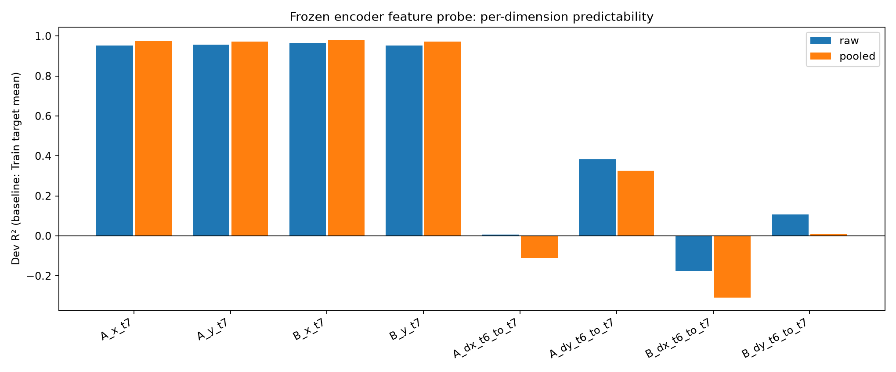

# V5 first round on DGX: stopped at the feature prerequisite

**Partial scientific run; negative prerequisite result.** The official frozen I-JEPA encoder loaded successfully and the GPU profile passed. Eight H800 workers produced the complete Train/Dev probe caches. The unchanged pooled-feature gate failed on observed displacement, so P0 training, the nine memory/reference fits, and reader-only replay were not started. No trained checkpoint exists. Test was not opened.

## Actual result

| Feature representation | Position R² | Observed-displacement R² |
|---|---:|---:|
| Raw spatial tokens | 0.957126 | 0.080553 |
| 4×4 pooled spatial tokens | 0.974691 | **−0.020927** |
| Required pooled gate | > 0.1 | > 0 |

The Train-only ridge probe used 128 Train and 128 Dev episodes (64 paired worlds per split), coefficient 0.01, and the original deterministic seeds. Offline reconstruction from the caches reproduced every recorded metric exactly. The eight GPUs are extraction workers, not eight independent repetitions.

The four position targets are A/B x/y at t=7; the last four are their observed displacements from t=6 to t=7, including boundary reflections. The legacy JSON key `velocity_r2` denotes those displacements. Each R² uses the Dev error of the **Train target mean** as its baseline.

| Displacement component | Raw R² | Pooled R² |
|---|---:|---:|
| A Δx | 0.006396 | −0.110545 |
| A Δy | 0.382966 | 0.326859 |
| B Δx | −0.174607 | −0.308117 |
| B Δy | 0.107456 | 0.008096 |



Position decoding is strong in this probe, while motion decoding is uneven. Both pooled horizontal components are below the Train-mean baseline; raw B-horizontal decoding is also below baseline. The raw positive average does not imply that every motion component is reliable. This comparison does not isolate pooling as a cause: representation geometry, finite samples, and the fixed probe fit also differ in their effects.

The probe observes two early visible frames before the later hold/interference/update interventions. **No conclusion about writer/reader quality, long-term retention, interference resistance, or update behavior is supported by this stopped run.** Negative probe R² does not establish that the encoder contains no motion information.

[Full diagnostic figures and definitions](run/feature_diagnostics/README.md) · [Every Dev prediction/error](run/feature_diagnostics/dev_predictions.csv) · [Numerical reconstruction](run/feature_diagnostics/verification.json) · [Selected failure cases and cue frames](analysis/bad_cases.md)

## Execution and accounting

- Source: [d0b4fef25e98eefb58bfba737997cb0145f27daa](https://github.com/XintongYang1010/predictive-memory-lab/commit/d0b4fef25e98eefb58bfba737997cb0145f27daa), containing requested upstream main commit `df9e780fbe8372269ab4066c11231ea04b19e4e3`.
- Host `dgx-097`, existing allocation **415453**, account `hansirui`, partition/QOS `llm`, **8 NVIDIA H800 80GB**. The user explicitly chose this existing allocation after the A100 mismatch was identified.
- V5 shared the cards with IndexMem with explicit authorization. The six original IndexMem PID/GPU pairs remained present after V5; step **415453.5** remained RUNNING. See [post-run process evidence](logs/post-run-gpu-processes.txt).
- Separate Python 3.11.15 / PyTorch 2.8.0+cu128 environment under the new WM root. The shared IndexMem environment was not modified. All 50 CPU tests passed locally and remotely; [remote preparation log](logs/preparation.log), [dependency versions](logs/pip-freeze.txt).

| Stage | Actual Slurm step | Terminal scheduler state | Scientific outcome |
|---|---|---|---|
| Profile | **415453.14** | COMPLETED, exit 0:0, 32 s | Throughput gate passed |
| Eight-worker probe/features | **415453.15** | FAILED, exit 1:0, 180 s | All 256 probe records complete; intentional stop on failed pooled gate |
| P0 / adaptations / reader replay | none | Not submitted | Blocked by prerequisite |

The feature step is marked partial because the full 2048/256 feature cache and downstream experiment were not reached. Its eight workers completed successfully; no OOM or encoder-loading fallback was involved. Per-worker logs, distinct GPU UUIDs, actual submissions, and both 128-record cache SHA inventories are archived.

The profile measured 264 frames over nine warm measurements at 0.00152314 seconds/frame, with 32 warmup frames and about 2.93 GiB peak allocated CUDA memory. Encoder loading took 25.58 seconds. The estimate of 0.0763 GPUh excludes RGB generation and worker startup, and is only the throughput-gate estimate, not the observed total run cost. Shared H800 timing is not an A100 or exclusive-use benchmark.

[Budget ledger](run/budget.json): **0.391611676 selected-device process-window GPUh** (profile 0.007657659; features 0.383954017), including sequential worker loading. From Slurm's full step elapsed times, selected-device walltime is **0.408888889 GPUh** (1×32 s + 8×180 s). Both steps reserved access to the existing eight-GPU allocation: their summed step-TRES walltime is **0.471111111 GPUh**. These overlap the existing parent reservation and are not an incremental billing claim. Read-only resource/binding probes are separately visible in [Slurm accounting](logs/slurm-accounting-final.txt); no new eight-GPU parent reservation was submitted. Both scientific accounting views remain far below the 60-GPUh cap.

## Reproduction and archived evidence

The exact [configuration, source hashes and seed scheme](run/run_manifest.json), [source snapshot](source/), [launch/controller commands](logs/execution_controller.sh), environment, GPU receipts, logs, diagnostics, previews, and [original remote file inventory](workspace/remote_run_inventory.json) are retained.

Official encoder: I-JEPA ViT-H/14 target encoder, code commit `52c1ae95d05f743e000e8f10a1f3a79b10cff048`. [Official checkpoint download](https://dl.fbaipublicfiles.com/ijepa/IN1K-vit.h.14-300e.pth.tar), 10,358,004,345 bytes, SHA256:
`0382013c481743e9ccea89f970bc6c6aa126aa19a62127500d6e672a641aae22`.
Strict state-dict loading with `weights_only=True` succeeded.

No large release asset is required: no training checkpoint was produced. As permitted by the handoff, official pretrained weights, environments, installation caches, and 256 reproducible feature tensors (655,082,496 bytes) are excluded. Every feature tensor's original SHA256/size is preserved in the Train/Dev manifests and reconciled against the remote inventory. See [reconstruction/exclusions](reconstruction.json) and [independent partial-evidence audit](archival_audit.json).

To reproduce, check out the frozen source commit into a fresh directory, run `PMR_BASE_PYTHON=/path/to/python3 bash scripts/prepare_visual_v5.sh /new/work/root dgx`, compare the recorded official-asset hashes and dependency versions, then follow [DGX execution](source/docs/DGX_V5_EXECUTION.md) with a currently valid allocation and the archived configuration. Do not reuse stale job IDs blindly. The archived controller contains the exact commands used here. Probe diagnostics can be recomputed with `python scripts/diagnose_visual_features.py --out /new/work/root/run1 --threads 1` after the cache exists. Preserve the recorded failed gate; do not lower thresholds or repeatedly reseed to obtain a pass.

For the archive itself:
```bash
python3 scripts/archive_visual_v5.py --verify results/wm/visual-v5-dgx-20261009
```

[SHA256SUMS](SHA256SUMS) and [archive_manifest.json](archive_manifest.json) cover the published files. [Completion assessment](experiment_status.json) deliberately lists the missing downstream outputs. Packaging/byte verification does not turn this partial experiment into a completed pilot.

## Next diagnostic question and retention

Inspect the selected horizontal-displacement failures and paired t=6/7 cue images, then distinguish rendering/target sensitivity, frozen-encoder sensitivity and finite-sample probe fit under a separately specified follow-up protocol. Any new hypothesis needs fresh confirmation data. This run supplies no repeated-seed confidence intervals and no natural-video or downstream-memory claim.

**Remote cleanup: not performed.** The full new directory `/aifs4su/guhao/KVCache/WM`, including official weights, environment and probe tensors, is retained because the scientific run is incomplete. Existing parent contents and IndexMem remain intact. The controller has terminated in the recorded failed-gate state. GitHub readback verification is recorded separately so its receipt can name the immutable result commit without a self-referential manifest.
