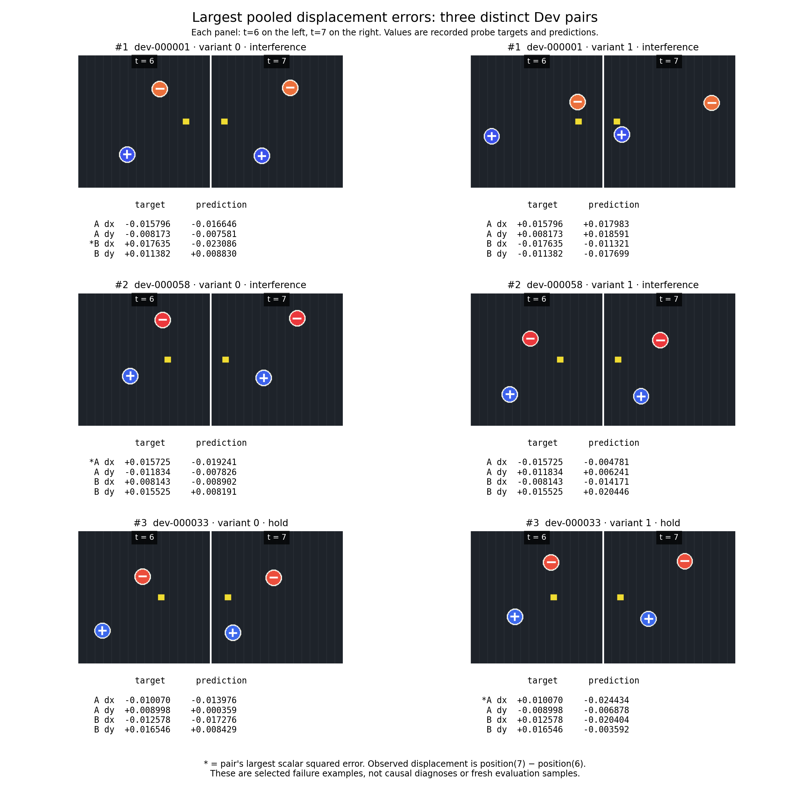

# Selected pooled-feature motion failures

Selection is deterministic: retain only pooled displacement dimensions 4–7; score each Dev pair by its **maximum scalar squared error over both variants and all four displacement dimensions**; sort descending by that score, break ties by pair ID, and select the first three distinct pairs. Both variants and all four displacement targets are retained for every selected pair.

| Rank | Dev pair | Pair maximum squared error | Worst episode | Worst dimension | Target | Prediction |
|---:|---|---:|---|---|---:|---:|
| 1 | dev-000001 | 0.00165821644 | dev-000001-0 | B_dx_t6_to_t7 | +0.0176354 | -0.0230858 |
| 2 | dev-000058 | 0.00122262433 | dev-000058-0 | A_dx_t6_to_t7 | +0.0157250 | -0.0192410 |
| 3 | dev-000033 | 0.00119052804 | dev-000033-1 | A_dx_t6_to_t7 | +0.0100699 | -0.0244342 |

The images reconstruct the archived generator's Dev episodes at t=6 and t=7. Object A is the upper red target; object B is the lower blue target. Both are visible in both cue frames. The columns labeled target/prediction use the actual archived ridge-probe values, not values estimated from the illustration. Targets are normalized position differences after reflection. The asterisk marks each pair's largest scalar error.

Validation: all 24 displayed/exported displacement targets exactly equal the regenerated `probe_state[4:8]` values; maximum absolute difference is **0**. Recomputed squared errors agree with the CSV. Cue times are exactly 6 and 7, with both shutters open. Only the selected Dev pairs are regenerated; Test is not read or generated.

These deliberately selected examples illustrate observed errors and their paired counterparts. They cannot establish a pooling mechanism, reflection failure, or a comparison of memory architectures. No scientific metric or gate has been modified.

[All 24 selected displacement records](bad_cases.csv) · [Reproduction script](reproduce_bad_cases.py)

Reproduce from this directory with `python reproduce_bad_cases.py`; it locates `../source/` and `../run/feature_diagnostics/dev_predictions.csv` automatically.

Archived generator SHA256: `ce5082f3be9006dcceb46fbaffadc27349f977a77abcf8992eda3e80f8775368`.

Prediction CSV SHA256: `b114eb1770e3625863a651b2b7b678e22924feb894717143a33bb96b5e21ab8d`.
