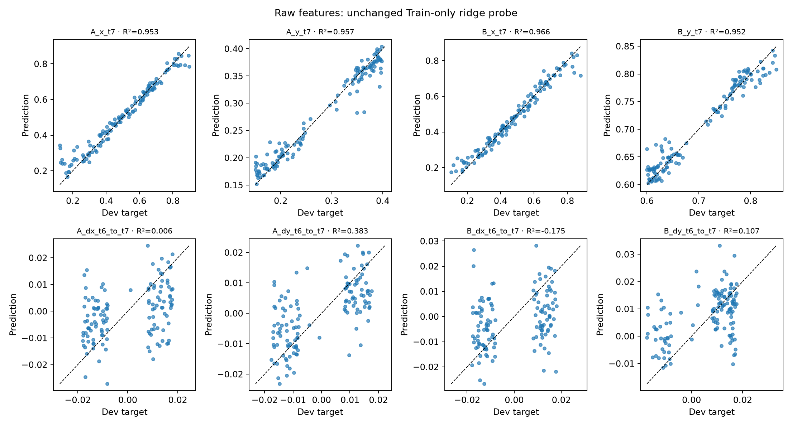
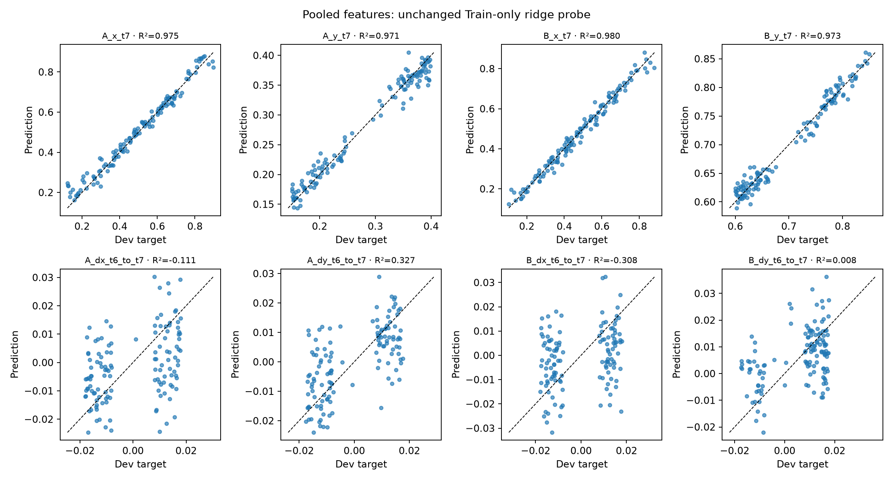

# Feature probe diagnostics

Reproduction of recorded gate: **verified**. Recorded pooled-feature gate: **failed**.

This is the original Train-only ridge fit evaluated on the same Dev records. No gate, target, seed, or regularization value is changed; Test remains unopened.

| Features | Position R² | Observed displacement R² | Mean MSE |
|---|---:|---:|---:|
| raw | 0.957126 | 0.0805527 | 0.000558468 |
| pooled | 0.974691 | -0.0209268 | 0.000357764 |

The first four target dimensions are A/B x/y positions at t=7. The last four are their visible t=6→7 displacements, including reflections. The legacy JSON key `velocity_r2` refers to these observed displacements. R² uses the Train target mean baseline.

[Per-Dev-episode target, prediction and error](dev_predictions.csv) · [Dimension metrics](r2_by_dimension.csv) · [Numerical verification](verification.json)

These probe diagnostics measure recoverable visual cues. A failed prerequisite does not establish a comparison between memory architectures or a causal failure mechanism.
