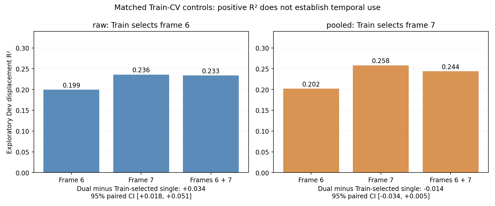
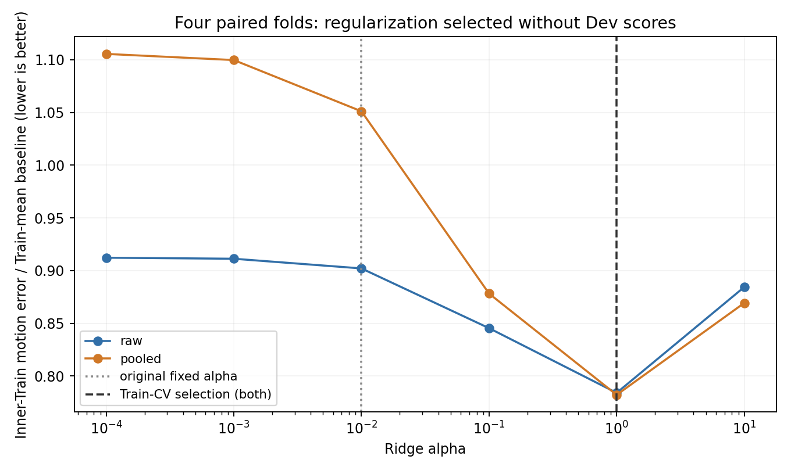

# V5 probe follow-up: CPU diagnostics

These are exploratory diagnostics of the previously inspected Train/Dev probe
cache. They do not change the original failed gate or authorize downstream
training. No new GPU inference or Test access was used.

The first round failed at pooled displacement R² = −0.020927. It did not evaluate
the memory architectures. This follow-up investigates what that prerequisite
actually measures and whether its failure reflects a correctable implementation
or statistical issue.

| Diagnostic | Pooled displacement R² |
|---|---:|
| Original two-frame concatenation, alpha 0.01 | −0.020927 |
| Same features, alpha 1 selected only by grouped inner-Train CV | 0.243895 |
| Direct temporal difference, alpha 0.01 | −0.282749 |
| Direct temporal difference, Train-CV alpha 10 | 0.010472 |
| Shared position decoder, Train-CV alpha 0.01 | −1.861991 |

The fixed ridge setting substantially affects this readout. However, matched
Train-CV single-frame controls show that the pooled improvement does **not**
establish temporal use. The Train-selected single frame (frame 7) obtains
0.258056, versus 0.243895 for two frames: paired difference −0.014161,
95% exploratory interval [−0.034358, 0.004930]. Raw two-frame features beat
the Train-selected frame 6 by 0.034022 [0.018122, 0.050844], but frame 7,
also reported, independently obtains 0.235745 versus raw two-frame 0.233477.
This does not establish a reliable temporal advantage across representations.

The order-reversed query gives displacement R² −1.022387 (raw) and −1.081230
(pooled). Only 7.42% and 6.45% of predicted signs reverse, respectively.
This intervention changes the generator prior; it is a distribution-shift
diagnostic, not a causal proof of the source of failure. It further cautions
against treating positive motion R² alone as a repaired prerequisite.

- [All 22 planned fits, Train-only selections and exploratory intervals](core_probe/README.md)
- [Input, repooling, single-frame and renderer controls](input_audit/README.md)
- [Original-Dev generator, pixel direction and bad-case audit](generator_audit/generator_analysis.md)
- [Matched-CV single-frame and query-order controls](temporal_controls/README.md)
- [Static source audit](static_review.md)
- [Independent explicit-feature Torch verification](validation/torch_reference.json)
- [Plan fixed before the core suite](../../../docs/VISUAL_V5_PROBE_DIAGNOSTIC_PLAN.md)
- [Original stopped run](../visual-v5-dgx-20261009/README.md)

The original 256 cache tensor hashes were verified before analysis. Reconstructed
raw/pooled baseline R² values differ from the original by less than 1e−12. The
input audit shows that repooling the cached raw tokens leaves the pooled gate
negative; batch/quantization differences tested here do not resolve the failure.
RGB motion is visible and agrees with the labels. A renderer-specific two-frame
color-centroid oracle obtains displacement R² = 0.977881, while a single-frame
centroid followed by Train-fitted linear ridge obtains 0.314306. These privileged
diagnostic controls expose a generator prior; they are never model inputs.

The original bad cases contain visible nonzero displacement with the correct
pixel direction. Reflection and border events are not concentrated among the
sign errors. The input pipeline, target construction and renderer checks found
no demonstrated implementation defect that explains the original failure.
The observed failure concerns this probe, data distribution and small sample;
it does not prove that the encoder lacks motion information, nor say anything
yet about the memory candidates.

The core suite ran 22 specified fits using only the existing 128 Train and
128 Dev episodes (64 complete pairs per split). Alpha selection uses four
grouped inner-Train folds. Later matched temporal controls are explicitly marked
as post-result exploratory analysis. Confidence intervals resample complete
Dev pairs and condition on the fitted models; they are not new confirmation
or estimates of training-set uncertainty. An independent Torch implementation
reproduced all 24 pooled CV fold scores within 1.17e−12 and the eight selected
Dev R² dimensions within 1.03e−14.

The immediate correction is to the diagnostic protocol: select regularization
on Train, include matched single-frame controls, and separate statistical
readability from temporal dependence. A future confirmation must fix its
protocol and independent seed namespace before extracting new features,
control position/direction priors, and test temporal advantage and order
consistency. The existing Test split remains sealed. Merely changing alpha
or lowering the old threshold does not authorize P0 or memory training.

Source code and results are synchronized through the
`diagnostics/visual-v5-probe-20261009` branch. At the time this CPU snapshot was
sealed, consultation with the original ChatGPT design conversation was ongoing.
The separate [consultation record](../../../docs/VISUAL_V5_GPT_REVIEW_20261009.md)
tracks its response and our verification without rewriting these measurements.
No new GPU job was launched and no remote cleanup was performed in this follow-up.
See [reproduction instructions](REPRODUCE.md), [validation](validation/environment.json)
and the archive manifest for evidence and limitations.
