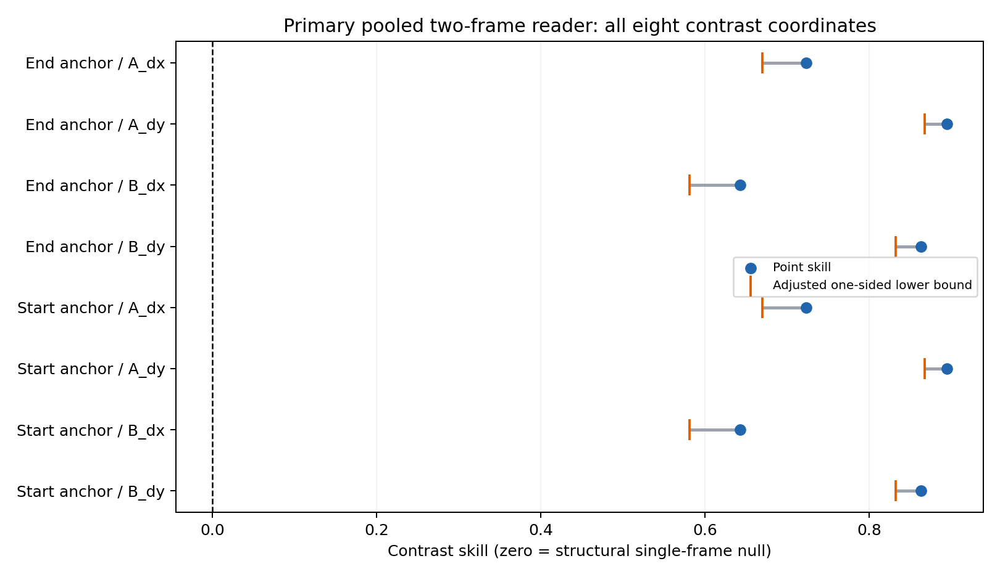
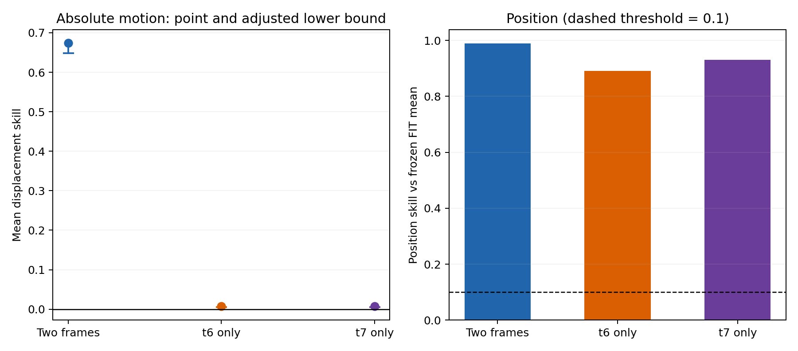
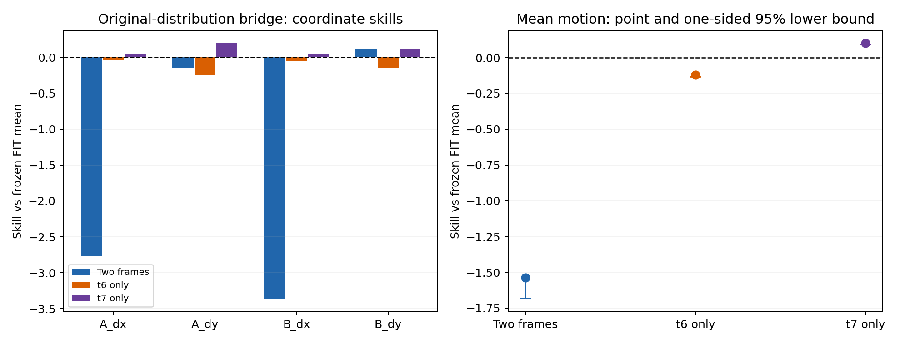
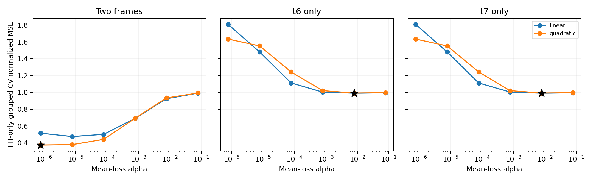

# V5.1 时间证据确认 / Temporal confirmation

时间确认报告通过，但原分布桥接门槛未通过；尚无进入P0的依据。

原 V5 的池化位移门槛失败保持不变。本报告是独立的事后展示，不更改门槛、不授予P0权限，也不将时间证据确认称为记忆机制有效。

科学源码：`0e50f6aadbdcec9c9b787208362d9dde9b6360dd`。

冻结读出器收据 SHA256：`27ae0593f90c2728529f607b09893780d75badbf54261198b3e6f4a3f7b4596a`。

## 已归档阶段

| 阶段 | 记录状态 |
|---|---|
| confirm_controller.json | scientific_prerequisite_failed |
| fit_controller.json | awaiting_freeze_publication |

`running`/队列状态不代表科学完成；缺少报告也不等于科学门槛失败。

## 时间确认

| 读出器 | 位移均值 skill | 相应单侧下界 | 位置 skill | 主检查全满足 |
|---|---:|---:|---:|---|
| Two frames | 0.674117 | 0.648395 | 0.988371 | True |
| t6 only | 0.007939 | 0.005839 | 0.890990 | False |
| t7 only | 0.007939 | 0.005839 | 0.929608 | False |

主读出器是冻结的双帧 concat；单帧结果全部展示，不用于事后更换赢家。

主检查未满足项：无（以本报告覆盖的指标检查为限）。

确认集为256个完整四-view block。八个逐坐标对比下界与绝对位移均值下界都必须>0，位置skill必须>0.1；零对比是结构性的单帧零假设。单侧bootstrap下界按九项作Bonferroni调整（.05/9），条件于冻结读出器。反对称模型下两类anchor对比会相同，不能称作八项独立证据。

## 原分布桥接

| 读出器 | 位移均值 skill | 相应单侧下界 | 位置 skill | 主检查全满足 |
|---|---:|---:|---:|---|
| Two frames | -1.538523 | -1.683154 | 0.942354 | False |
| t6 only | -0.121460 | -0.132472 | 0.813196 | False |
| t7 only | 0.100681 | 0.091226 | 0.830893 | True |

主读出器是冻结的双帧 concat；单帧结果全部展示，不用于事后更换赢家。

主检查未满足项：all_four_motion_coordinate_skills_positive、motion_mean_lower_bound_positive。

桥接为原生成器Dev pair128–383、每对保留两个variant。下界按完整world重采样，为单侧95%；另要求四个位移坐标点skill全部>0。它检验回到原分布的迁移，不独立证明时间利用。

## FIT内选择（无确认集选参）

| 输入 | 选中kernel | mean-loss alpha | FIT CV normalized MSE |
|---|---|---:|---:|
| Two frames | quadratic | 7.8125e-07 | 0.374503 |
| t6 only | linear | 0.0078125 | 0.990372 |
| t7 only | linear | 0.0078125 | 0.990372 |

全部候选与四fold分数见 `train_cv.csv`；惩罚形式为 `K+n_fit*alpha*I`。

## 作业与累计预算

| 阶段 | 实际Slurm step | 父allocation | 选中GPU数 | 状态 |
|---|---|---|---:|---|
| temporal_confirm | 415453.20 | 415453 | 8 | complete |
| reader_confirm | 415453.21 | 415453 | 0 | complete |
| temporal_bridge | 415453.22 | 415453 | 8 | complete |
| reader_bridge | 415453.23 | 415453 | 0 | complete |
| temporal_fit | 415453.18 | 415453 | 8 | complete |
| reader_fit | 415453.19 | 415453 | 0 | complete |

归档总账累计收费 **1.729414 GPUh / 60 GPUh**，包含继承的旧轮次记录；以总账是否含未闭合lease区分保留额度与已结算用量。

未闭合lease：无（按已归档总账）。
尚在活动的控制器预算包络：无（按已归档总账）；存在时不能视为最终结算。

## 图表与复现









```bash
python3 scripts/report_v5_1_confirmation.py --run-root FETCHED_RUN_ROOT --out NEW_REPORT_DIR
```

输入文件与SHA256见 `input_inventory.json`，机器摘要见 `summary.json`。脚本校验展示所用报告/缓存收据/预测文件的关联哈希、数量和状态一致性；它不代替独立的门槛复算、完整归档验证或GitHub回读。

Test与完整特征缓存不被本脚本打开。原失败现场及本轮清理状态应以执行/归档收据单独确认。
