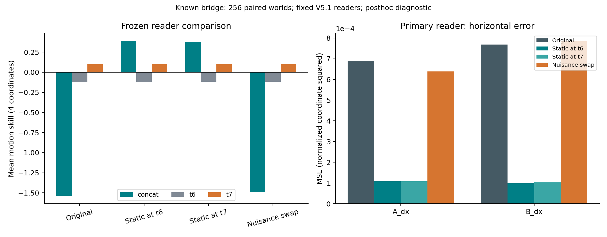
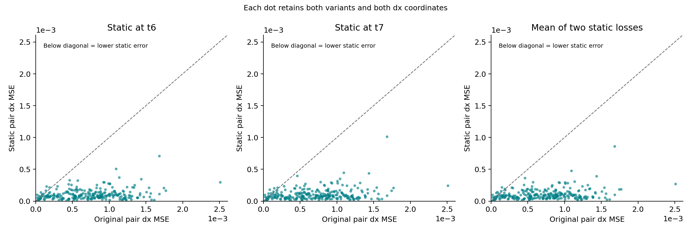
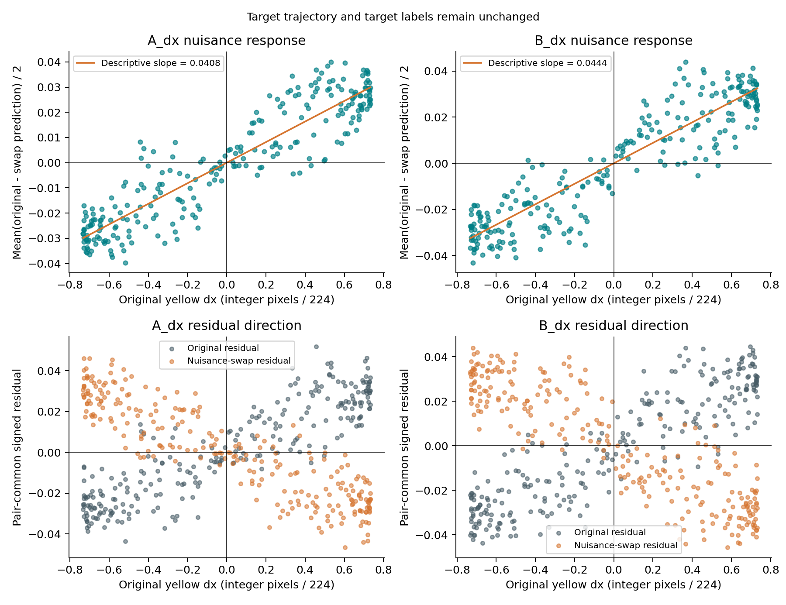

# V5.2：冻结读出器的黄色干扰物反事实诊断

在这批已看过的 bridge 场景上，固定两个静止干扰条件的平均水平位移误差低于原条件；配对区间整体为正。

这是已检查过的 Dev pairs 128–383（256 对世界、512 episodes）的探索性干预。目标轨迹、时间顺序、标签与背景保持不变，只改变黄色干扰物的位置组合；没有训练或选择新的读出器。

- 报告状态：`diagnostic_complete`。
- 主端点：两 variants × A_dx/B_dx 的 pair 内原始 MSE；单位是归一化图像坐标的平方。
- 主效应 Δorig = 原条件损失 − 两个静止条件损失均值：**0.0006248237**，95% 配对区间 **[0.000573715, 0.0006769732]**。
- 相对本次 original 的 dx MSE，平均静止条件减少 **85.63%**；这是误差减少比例，不是解释方差比例。
- 辅助平衡效应 Δbalanced = 两个移动条件损失均值 − 两个静止条件损失均值：**0.0006155496**，95% 区间 **[0.0005679008, 0.0006637192]**。
- 四维 motion NMSE 平均减少：1.92395，95% 区间 [1.761691, 2.092458]。
- 10,000 次完整 pair bootstrap，seed 7810。唯一主端点是 Δorig；其他区间为未调整的描述性区间。静止条件平均的是损失，不是预测值，未构造预测集成。

## 每个条件都报告

| 条件 | dx MSE | A_dx MSE | B_dx MSE | 四维 motion skill | position skill |
|---|---:|---:|---:|---:|---:|
| original | 0.0007296754 | 0.0006902358 | 0.000769115 | -1.538523 | 0.9423538 |
| static_t6 | 0.0001040312 | 0.0001089083 | 9.915415e-05 | 0.3898176 | 0.9432733 |
| static_t7 | 0.0001056721 | 0.000108893 | 0.0001024512 | 0.3810355 | 0.9448862 |
| swap_nuisance | 0.0007111271 | 0.000638186 | 0.0007840682 | -1.492813 | 0.9414396 |

| 与 original 比较 | dx MSE 减少 | 描述性 95% 区间 |
|---|---:|---:|
| static_t6 | 0.0006256442 | [0.0005747704, 0.0006778735] |
| static_t7 | 0.0006240033 | [0.000572464, 0.0006763588] |
| swap_nuisance | 1.854831e-05 | [-2.287759e-05, 6.149506e-05] |

正减少表示误差变小。两个静止锚点和 swap 都完整列出，不选最好的一项。skill 的参考是冻结 FIT 目标均值，不能把本表的正分解释成新的 gate 通过。





## 单帧对照

| 冻结读出器 | Δorig | 主式的描述性 95% 区间 | Δbalanced |
|---|---:|---:|---:|
| concat | 0.0006248237 | [0.000573715, 0.0006769732] | 0.0006155496 |
| t6 | 1.317941e-07 | [-6.692764e-08, 3.269326e-07] | 4.76456e-22 |
| t7 | -1.350104e-08 | [-2.07328e-07, 1.740784e-07] | 7.279189e-22 |

concat 是预先固定的主读出器；t6/t7 只是已冻结的对照。单帧成绩为正或变化明显，都不能证明利用了目标的时间信息。单帧 balanced 对照接近零是匹配时间槽位置边际带来的代数恒等，不能计为独立实验支持。输入复用的四项最大预测差：

- `t6_original_static6`：0。
- `t6_static7_swap`：0。
- `t7_original_static7`：0。
- `t7_static6_swap`：0。

## Nuisance swap 响应

η 是原黄色干扰物实际整数像素位移 / 224；R 是 pair 内两 variants 的 (original − swap) 预测均值 / 2。只交换干扰物，不交换目标帧或标签。

| 主读出器轴 | R 对 η 的过原点描述性斜率 | 同向比例（排除零值） | 同向/反向 | residual 反号对数 |
|---|---:|---:|---:|---:|
| A_dx | 0.04083587 | 0.921875 | 236/20 | 229/256 |
| A_dy | 0.0017676 | 0.5351562 | 137/119 | 130/256 |
| B_dx | 0.04439324 | 0.96875 | 248/8 | 230/256 |
| B_dy | 0.003978304 | 0.6523438 | 167/89 | 114/256 |

零 η、零 R 和 residual 平局计数保存在原始 report.json；任何零值都没有从主 MSE 分析删除。该斜率只是描述预测对干扰物交换的响应，没有用于训练、校正或选择模型。



## Original parity

| 读出器 | parity | 最大 motion RMS drift / target RMS | 最大 motion max drift / target RMS | 最大 motion skill drift |
|---|---|---:|---:|---:|
| concat | 通过 | 0 | 0 | 0 |
| t6 | 通过 | 0 | 0 | 0 |
| t7 | 通过 | 0 | 0 | 0 |

固定阈值依次为 0.01、0.10、0.02，分别检查四个 motion 维度和三个读出器。比较使用本次重算的 matched original；旧 original 仅是数值 parity 基准。若结果与数值漂移相当，应保留方向不确定性。

## 解释边界

通过像素与数值一致性检查后，配对干预支持的是“黄色渲染分配对该冻结 encoder＋reader 在这些已知场景上的误差贡献”。balanced 对照进一步匹配了每个时间槽的黄色位置边际。这不定位到 encoder 内部的某个机制，不证明目标运动信息缺失，也不证明目标时间信息或记忆被利用。

旧 V5 gate 与 V5.1 bridge 仍为 failed_unchanged；P0、适配、replay 均不因本诊断启动。Test 未访问；没有新鲜确认集。即使静止条件恢复，也没有恢复原移动干扰物任务。多个相关的次要指标不构成独立重复证据。

编码沿用 BF16 autocast，FP32 pooling 后再量化为 BF16，最终转 FP32 存储；“FP32 cache”不表示全精度提取。

## 执行证据与复现

- 冻结执行源码：`9792b93f4e0203b52a2e26ab7700eb1975150231`。
- 冻结 reader receipt SHA256：`27ae0593f90c2728529f607b09893780d75badbf54261198b3e6f4a3f7b4596a`。
- `counterfactual_v5_2`：状态 `complete`，实际日志 step ID `415453.26`，选卡数 8。
- `counterfactual_score_v5_2`：状态 `complete`，实际日志 step ID `415453.27`，选卡数 0。
- 下载 ledger 的累计选卡记账：2.208254 / 60 GPUh；以归档中的最终 Slurm 对账为准。
- 最终对账累计：**2.208254413604737 / 60 GPUh**；本轮科学计算 0.4766185 GPUh，管理开销 0.002222222 GPUh。
- 新 step 全部完成：`True`；仍有新 lease：`False`。
- 最终对账时 既有 IndexMem `415453.5` 状态 `RUNNING`；保留原工作负载。
- 最终对账时 共享 parent allocation `415453` 状态 `RUNNING`；保留原工作负载。
- 清理状态：**远端诊断现场保留，未删除**。本次技术诊断完成，但原科学门槛仍失败；归档成功不改变用户要求保留失败现场的边界。
- 本生成器只读 JSON/NPZ，并独立重算 MSE、主效应、balanced、锚点差和输入复用差。置信区间沿用已冻结 scorer 的输出，未在绘图时改变端点或重选模型。
- `input_inventory.json` 记录使用的文件字节数与 SHA256；`SHA256SUMS` 覆盖本次生成的 README、图和表。

```sh
python3 render_report.py --scene <downloaded-scene> --out <new-report-directory>
```
