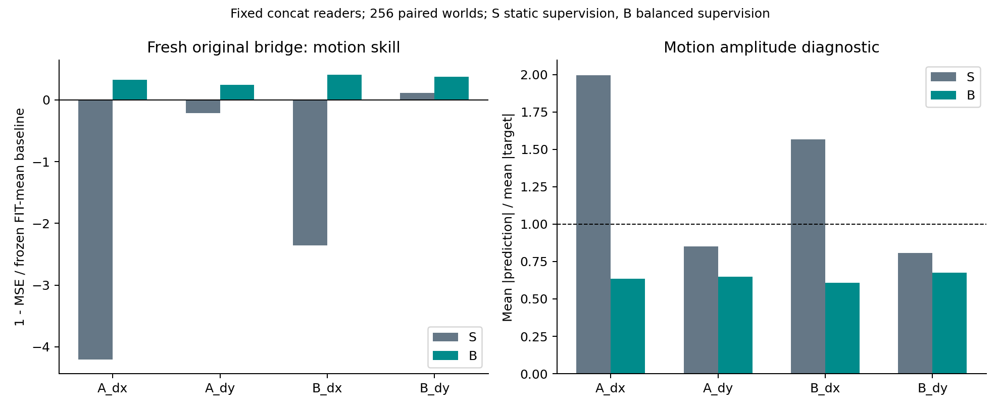
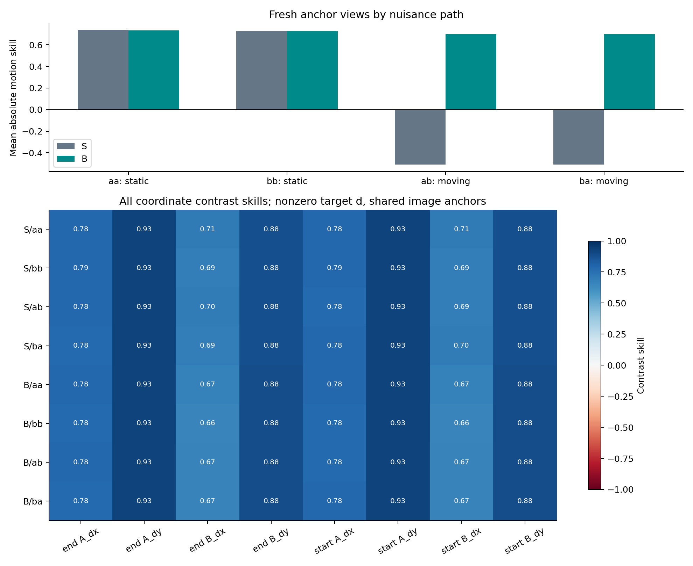
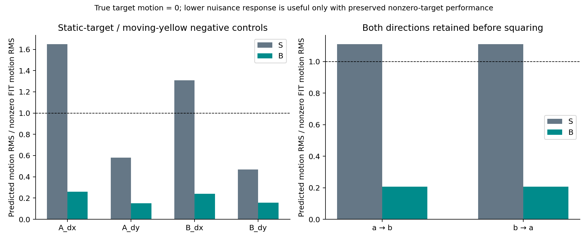

# V5.3：匹配 S/B 读出器修复诊断

B 在新原分布 bridge 上降低了水平位移误差，主配对区间整体为正。B 的四个运动坐标点估计均超过基线；是否保留目标运动还须结合逐路径 anchor 和静止目标负控，不能据单端点宣布全面修复。

S 使用静止干扰监督，B 使用静止与双向移动干扰的平衡监督。两组共享同一 FIT 图像、核标准化、quadratic 核和 alpha；每个世界总损失权重相同，两组均拟合不受惩罚的截距。S 也使用共享的无标签 FIT 标准化，不能把它描述为完全没见过移动视图特征分布。

- 唯一主端点：fresh bridge Dev 384–639 的 pair 内两 variants × A_dx/B_dx 原始 MSE；**S−B = 0.0006382055**，95% CI **[0.0005843579, 0.0006926271]**。
- 绝对表现：S motion skill **-1.664064**，B **0.3386574**；B 最低单坐标 motion skill **0.2437399**。
- Bootstrap：10,000 次完整 pair 重采样，seed 7811，双侧 percentile 95%。区间以本轮已拟合、冻结的模型为条件，不包含 FIT 抽样或重新训练的不确定性。
- 主端点为正只代表相对水平误差改善；绝对分数、非零目标 anchor 和零目标负控共同约束解释，未新增 P0 gate。

## Fresh bridge：全部固定读出器

| 读出器 | motion skill | A_dx | A_dy | B_dx | B_dy | position skill |
|---|---:|---:|---:|---:|---:|---:|
| S_concat | -1.664064 | -4.203132 | -0.2114327 | -2.352964 | 0.1112726 | 0.9459552 |
| S_t6 | -1.812855 | -1.049337 | -2.795518 | -1.330733 | -2.075833 | 0.8963953 |
| S_t7 | -0.8983357 | -1.004505 | -0.6845518 | -1.182146 | -0.7221405 | 0.9508522 |
| B_concat | 0.3386574 | 0.3220737 | 0.2437399 | 0.410631 | 0.3781849 | 0.9495026 |
| B_t6 | -1.812855 | -1.049337 | -2.795518 | -1.330733 | -2.075833 | 0.8963953 |
| B_t7 | -0.8983357 | -1.004505 | -0.6845518 | -1.182146 | -0.7221405 | 0.9508522 |

| 输入 | S−B dx MSE | 配对 95% CI |
|---|---:|---:|
| concat | 0.0006382055 | [0.0005843579, 0.0006926271] |
| t6 | 9.094851e-22 | [-9.081538e-17, 8.883882e-17] |
| t7 | -1.366996e-16 | [-1.81947e-16, -9.378464e-17] |

concat 是固定主读出器，t6/t7 是固定对照，不根据评估分数挑选。单帧 S/B 的加权输入—标签分布相同，它们的等价是实现检查，不是独立科学重复。



## Fresh anchor：逐路径而非只看总平均

| Arm/path | absolute motion skill | 8 项 contrast 最低点估计 | mean-motion 描述性 95% CI |
|---|---:|---:|---:|
| S/aa | 0.7356451 | 0.7061159 | [0.7175218, 0.7529578] |
| S/bb | 0.7287201 | 0.6909452 | [0.7097234, 0.7471026] |
| S/ab | -0.5101291 | 0.6914225 | [-0.6754661, -0.3528503] |
| S/ba | -0.5101291 | 0.6914225 | [-0.6754661, -0.3528503] |
| B/aa | 0.7330948 | 0.6745734 | [0.7155362, 0.7497527] |
| B/bb | 0.7260705 | 0.6611219 | [0.7081363, 0.7434512] |
| B/ab | 0.6979158 | 0.6680732 | [0.6790278, 0.7157193] |
| B/ba | 0.6979158 | 0.6680732 | [0.6790278, 0.7157193] |

aa/bb 为静止干扰，ab/ba 为两种移动方向。共享 end/start anchor 对照以非零目标位移 d 评分。各路径先计算 contrast 与误差，再平均；图中保留全部八个坐标对照。辅助区间为未调整的描述性区间，不把多个相关正分当独立复制。



## 静止目标、移动干扰负控

| 读出器 | A_dx RMS/FIT | A_dy RMS/FIT | B_dx RMS/FIT | B_dy RMS/FIT | overall RMS/FIT |
|---|---:|---:|---:|---:|---:|
| S_concat | 1.649052 | 0.581509 | 1.309284 | 0.4701614 | 1.110108 |
| S_t6 | 0.7283429 | 0.7289473 | 0.7400147 | 0.6601983 | 0.7148101 |
| S_t7 | 0.7283429 | 0.7289473 | 0.7400147 | 0.6601983 | 0.7148101 |
| B_concat | 0.2587405 | 0.1520967 | 0.2405486 | 0.1569918 | 0.2070485 |
| B_t6 | 0.7283429 | 0.7289473 | 0.7400147 | 0.6601983 | 0.7148101 |
| B_t7 | 0.7283429 | 0.7289473 | 0.7400147 | 0.6601983 | 0.7148101 |

两方向分别平方后再平均计算 RMS，未通过先平均正负响应使误差相消。归一化分母是固定 FIT 非零位移 RMS。负控越低表示对黄色干扰的虚假运动响应越小，但若非零目标 motion 同时塌缩，不能称修复。
Anchor 中 a/b 落在同一像素的世界数：1；按注册保留。



## 数值与科学边界

| 评估 | t6 S/B 最大差 | t7 S/B 最大差 | 数值等价 |
|---|---:|---:|---|
| anchor | 2.741306e-10 | 1.618758e-10 | True |
| bridge | 3.192372e-10 | 1.441971e-10 | True |

固定数值阈值为 1e-7；anchor 的 negative 单帧等价也包含在检查中。图表脚本独立核对预测 SHA、实际 MSE、S−B 主效应、每路径 contrast 和负控 RMS；置信区间直接使用冻结评分器输出，未重选或改变统计方案。

原 V5 gate 和 V5.1 bridge 始终 failed_unchanged。V5.3 没有自动启动 P0，Test 未打开；结果只针对冻结视觉表示与读出器，不是 world-model 训练或记忆有效性的结论。BF16 推理后转 FP32 存储的 cache 不等于全精度视觉提取。

## 执行与归档

- `fit_controller.json`：状态 `reader_frozen_awaiting_publication`，源码 `875be45515276cc8559ffcdb21c7412c6048d5ad`。
  - `v53_fit`：`complete`；step `415453.29`；选卡 8。
  - `v53_fit_reader`：`complete`；step `415453.30`；选卡 0。
- `evaluation_controller.json`：状态 `repair_diagnostic_complete`，源码 `875be45515276cc8559ffcdb21c7412c6048d5ad`。
  - `v53_anchor`：`complete`；step `415453.31`；选卡 8。
  - `v53_anchor_reader`：`complete`；step `415453.32`；选卡 0。
  - `v53_bridge`：`complete`；step `415453.33`；选卡 8。
  - `v53_bridge_reader`：`complete`；step `415453.34`；选卡 0。
- 下载 ledger 累计：3.573925619125368 / 60 GPUh；最终以 Slurm 对账记录为准。
- 所有输出、原始预测、模型和旧失败档案应保留；归档校验通过不改变失败现场的保留要求。
- `input_inventory.json` 记录本报告实际使用的文件；`SHA256SUMS` 覆盖新生成的图表、表格和 README。

```sh
python3 build_results.py --scene <downloaded-v53-scene> --out <new-analysis-directory>
```

完整模型见 [FIT reader Release](https://github.com/XintongYang1010/predictive-memory-lab/releases/tag/visual-v5_3-fit-20261010)。硬件为既有分配中的8张H800，与IndexMem共用；GPUh按选卡数量乘实际wall time保守计账，不声称A100等效速度。

完整现场、缓存、全部检查点和复现资料见 [V5.3 Release](https://github.com/XintongYang1010/predictive-memory-lab/releases/tag/visual-v5_3-20261010)。归档逐文件回读凭证会单独存入 results/wm/visual-v5_3-20261010-verification.json。未修复的科学问题及历史失败现场均保留，未删除WM已有目录或停止IndexMem。

逐例图像、方向错误与位置覆盖分组见 [bad-case 分析](bad_cases/README.md)。
