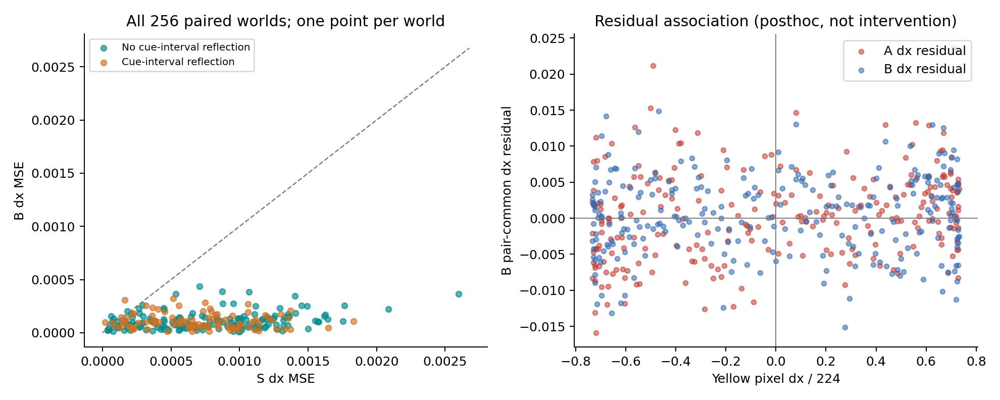
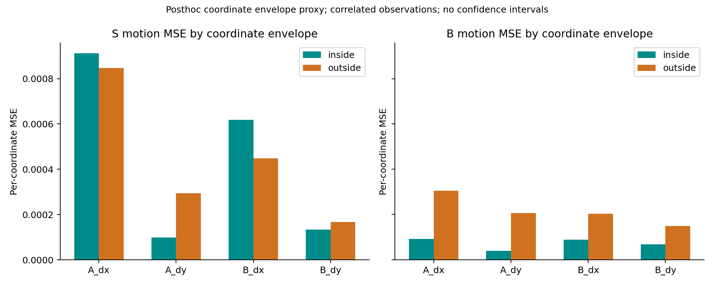
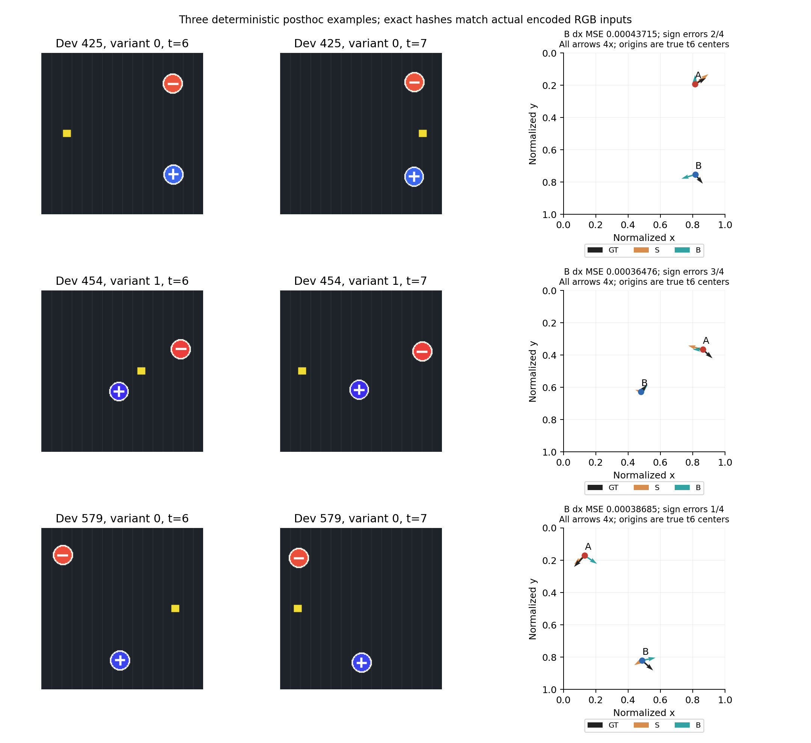

# V5.3 已评估 bridge 的后验 bad-case 诊断

只分析本轮已经评估的 Dev384–639（256 个配对 world、512 个 episode）。未增加新样本、未训练或选择读出器、未使用 Test 或 GPU。这里的分组、相关性和三例选择均是后验探索；不构成新确认实验或 P0 许可。

三例按公开的固定后验规则选择：① B 的 pair dx MSE 最大；② 剩余 pair 中水平符号错误数最多；③ 剩余且 t6→t7 无反射的 pair 中 B dx MSE 最大。并列依次按误差及较小 ID；每个 pair 展示 B dx MSE 最大的 variant（并列选 0）。完整排序可由 `paired_worlds.csv` 复核。

| 分组 | world 数 | S dx MSE | B dx MSE | B 水平方向错误率 |
|---|---:|---:|---:|---:|
| 全部 | 256 | 0.00074936158 | 0.00011115604 | 21.58% |
| t6→t7 发生反射（任意轴） | 92 | 0.00069385334 | 0.00011094799 | 25.27% |
| t6→t7 无反射（任意轴） | 164 | 0.00078050035 | 0.00011127276 | 19.51% |
| t6→t7 发生水平反射 | 10 | 0.00046294803 | 0.00013312665 | 35.00% |
| t6→t7 无水平反射 | 246 | 0.00076100441 | 0.00011026293 | 21.04% |
| 截至 t7 曾反射（任意轴） | 168 | 0.00075896057 | 0.00011389638 | 23.07% |
| 截至 t7 未反射（任意轴） | 88 | 0.00073103623 | 0.00010592449 | 18.75% |
| 至少一个 cue 坐标超出 FIT 外包络 | 244 | 0.00074768001 | 0.0001131058 | 22.03% |
| 全部 cue 坐标处于 FIT 外包络 | 12 | 0.00078355361 | 7.1511116e-05 | 12.50% |

反射由原始固定 seed 的初始位置、速度及镜面公式解析判定，并与归档的全部目标标签逐值一致；没有从预测方向推断反射。“任意轴”包含垂直反射，因此同时列出与 dx 直接对应的水平反射组。两个时间定义不同，且这些分组不互相独立。分组样本量与误差为描述统计，未做多重比较校正，也未把目标或 variant 当作独立 world。

位置外包络按冻结生成器 C±d 推导：名义 x∈[.182,.818]，A_y∈[.182,.368]，B_y∈[.632,.818]；实际比较使用中心和位移按 2⁻²⁰ 舍入后的精确边界（见 `summary.json`），不从本轮得分选择阈值。这只是逐坐标外包络代理，处于其中不代表完整联合支持或经验 FIT 覆盖；分组没有 CI 或因果解释。完整 motion MSE 和逐坐标 in/out MSE 也保存在 `summary.json`。

两提示帧的目标快门均打开。黄色矩形与目标包围盒的 y 区间交集计数为 0，因而这些提示帧不存在黄色遮挡目标的情况；残差关联不能解释为遮挡，也不能单独证明编码器内的因果机制。

同向/反向相对运动见 `object_observations.csv` 与 `summary.json`。归一化 motion skill 使用零运动基线（文件中标为 `zero_motion_skill`），不与正式报告的冻结 FIT 均值基线混写。全部相关性是在同一已看 bridge 上的后验残差关联；修复的确认结论仍应以正式 bridge 主比较及 anchor/负控共同评估。

| pair-common dx 残差与黄色 pixel dx 的相关系数 | S | B |
|---|---:|---:|
| A_dx | 0.93099 | 0.23594 |
| B_dx | 0.89258 | 0.04409 |

配对均值先减各自真实 motion 再平均两个 variant；这张表表明原有干扰残差关联减弱，不能证明所有残差均由黄色运动造成。B 仍有水平符号错误，故不能把改善写为完全解决。

| 坐标 | 外/内 episode 数 | S 外/内 MSE | B 外/内 MSE |
|---|---:|---:|---:|
| A_dx | 61/451 | 0.000846755/0.000911983 | 0.000305201/9.24661e-05 |
| A_dy | 247/265 | 0.000294564/9.78889e-05 | 0.000206445/4.00839e-05 |
| B_dx | 70/442 | 0.000447726/0.000617758 | 0.00020273/8.89438e-05 |
| B_dy | 223/289 | 0.000167288/0.000132974 | 0.000149715/6.78295e-05 |

这些“外/内”组仅按相应坐标的两提示位置划分，每个坐标合计 512 个 episode。不同坐标的组成员不同，同一 world 的两个 variant 有相关性。外包络组误差更高是进一步研究空间覆盖的线索，不能据此断言扩大 FIT 支持就必然修复，亦不能将全部残差归于反射或特征细度。

| 实例 | pair / variant | B pair dx MSE | 水平符号错数（两 variant × 两目标） |
|---|---:|---:|---:|
| 1 | 425 / 0 | 0.00043714622 | 2/4 |
| 2 | 454 / 1 | 0.00036475549 | 3/4 |
| 3 | 579 / 0 | 0.00038685262 | 1/4 |

例图的两帧 RGB 已逐个对照实际编码输入的 SHA256、shape、dtype；详见 `render_verification.json`。箭头均为 4 倍位移、起点为真实 t6 位置，便于比较方向与幅度，不能把箭头终点当作实际 t7 预测位置。

所有旧失败 gate 保持不变，后验诊断不授权 P0。原 scene、冻结模型及 cache 均只读。
