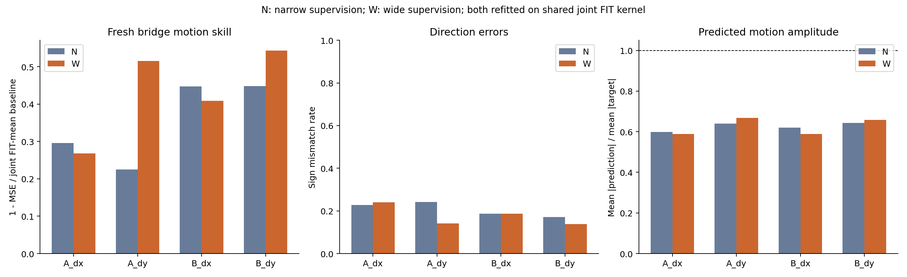
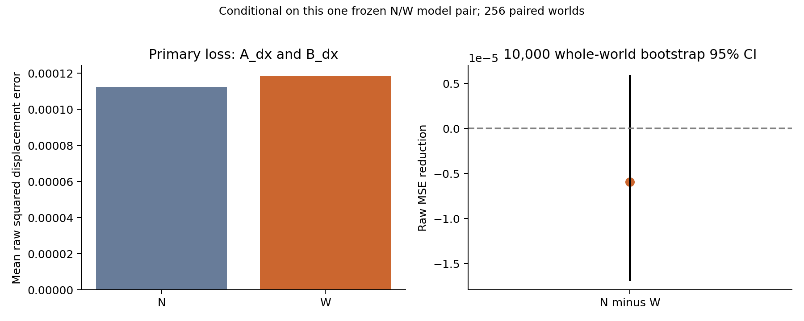
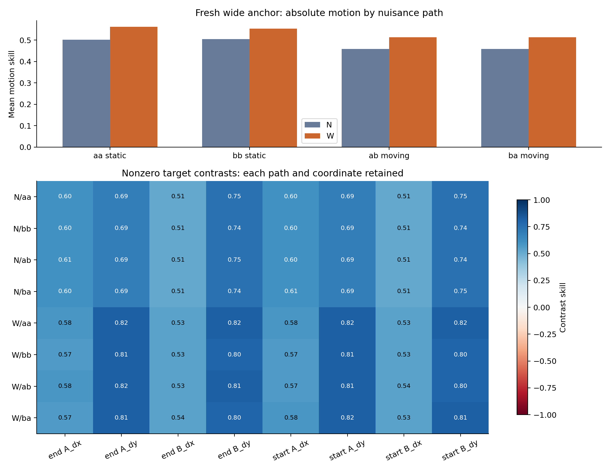
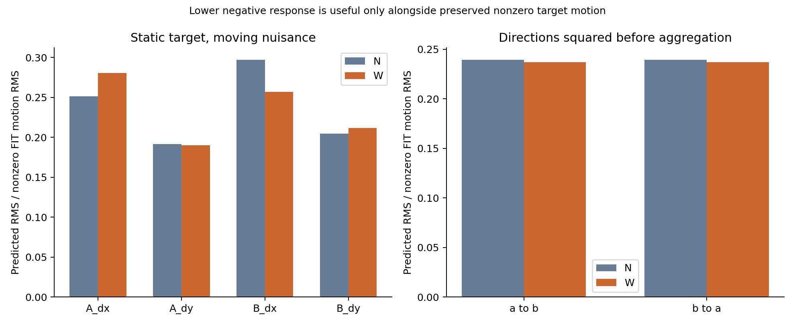
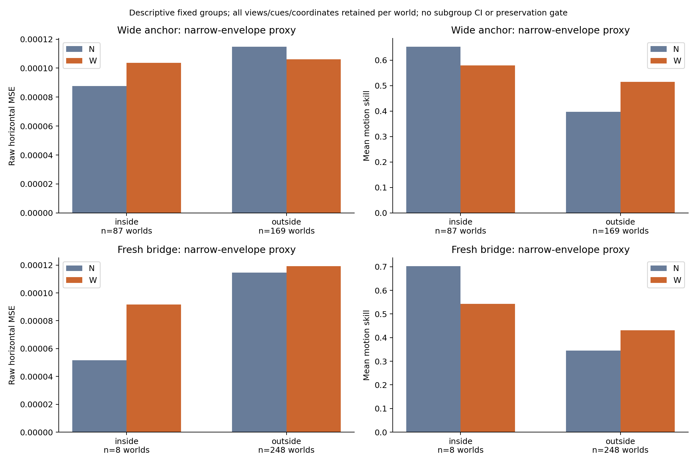

# V5.4：匹配窄域/宽域覆盖确认

主区间包含零：本轮无法明确确认 W 相对 N 降低 fresh bridge 水平位移误差。W 的四个运动坐标点估计均超过固定基线；这仍不等于准确追踪或完整协议通过。

N 复用 V5.3 已有 FIT 特征和标签，W 使用同一组 latent seeds 与量化前中心分位数，只扩大中心采样范围。两组各 256 个世界、16 个平衡 nuisance 视图；联合 8192 个 FIT 视图定义同一 quadratic 核及两级中心化/尺度。两组各用 4096 个监督行重新拟合，不惩罚截距，固定 mean-loss alpha=7.8125e-7（对角项 0.0032）。N 不是直接复用 V5.3 旧模型，也使用联合 N+W 的无标签归一化；本轮只有固定 concat 输入。

- 唯一主端点：新 original-generator Dev 640–895；每世界两个 variants 和 A_dx/B_dx 的原始平方误差。
- N dx MSE：**0.0001125443**；W：**0.0001184554**；相对下降 **-5.252238%**（负值代表增加）。
- **N−W = -5.911093e-06**；配对 95% CI **[-1.679266e-05, 5.87985e-06]**。
- 10,000 次完整世界重采样，seed 7811；同时保留两个 variants、两组预测与坐标。CI 条件于这一对已经拟合的冻结模型，不包括重新抽取 FIT、重复训练或模型选择不确定性。
- 该工具独立重算主效应及 bootstrap，未调用科学评分器、拟合模型、重新选择 alpha 或生成任何评估样本。

## Fresh bridge 的绝对表现

| Arm | mean motion skill | A_dx | A_dy | B_dx | B_dy | position skill |
|---|---:|---:|---:|---:|---:|---:|
| N_concat | 0.3538354 | 0.2953965 | 0.224747 | 0.4473868 | 0.4478112 | 0.9491055 |
| W_concat | 0.4339992 | 0.2678423 | 0.5158411 | 0.4086917 | 0.5436216 | 0.9874411 |

| Arm / 坐标 | sign error | mean abs 幅度比 | RMS 比 | SD 比 | signed bias |
|---|---:|---:|---:|---:|---:|
| N_concat/A_dx | 0.2285156 | 0.597956 | 0.7316511 | 0.7314008 | 0.0003837078 |
| N_concat/A_dy | 0.2421875 | 0.6403896 | 0.7436769 | 0.7333124 | -0.001017214 |
| N_concat/B_dx | 0.1875 | 0.6198619 | 0.743618 | 0.7434657 | 0.0001758846 |
| N_concat/B_dy | 0.171875 | 0.6433023 | 0.755156 | 0.7549162 | -0.001383938 |
| W_concat/A_dx | 0.2402344 | 0.5890689 | 0.7137675 | 0.7137822 | 6.101826e-05 |
| W_concat/A_dy | 0.140625 | 0.6678484 | 0.7805654 | 0.7777608 | -0.0003523454 |
| W_concat/B_dx | 0.1875 | 0.5893904 | 0.7093514 | 0.7087658 | 0.0003584793 |
| W_concat/B_dy | 0.1386719 | 0.6582287 | 0.7676264 | 0.7635461 | -0.001224307 |

幅度比以真实非零运动为分母；只看 MSE 降低可能掩盖输出缩幅。符号错误把预测/标签符号不同计为错误，零和 tie 计数保留于原报告。





## Fresh wide anchor：每条路径保留非零目标对照

| Arm/path | absolute motion skill | 8 个 contrast 中最低点估计 | mean-motion 描述性 95% CI |
|---|---:|---:|---:|---:|
| N_concat/aa | 0.5023994 | 0.5140571 | [0.4624157, 0.538908] |
| N_concat/bb | 0.5042476 | 0.5081289 | [0.4640173, 0.5405848] |
| N_concat/ab | 0.4583985 | 0.5100722 | [0.4168823, 0.4959808] |
| N_concat/ba | 0.4583985 | 0.5100722 | [0.4168823, 0.4959808] |
| W_concat/aa | 0.5625253 | 0.532148 | [0.5361048, 0.5874188] |
| W_concat/bb | 0.5537348 | 0.533163 | [0.5258921, 0.5801299] |
| W_concat/ab | 0.5137985 | 0.532391 | [0.4857425, 0.5402068] |
| W_concat/ba | 0.5137985 | 0.532391 | [0.4857425, 0.5402068] |

N / W 的逐路径、逐坐标最低 contrast skill 分别为 **0.5081289 / 0.532148**。
aa/bb 是静止 nuisance，ab/ba 是两种移动路径；每条路径先作 end/start 差分、平方误差，再汇总。辅助 CI 使用已冻结评分器输出，属于未调整的描述性区间；相关坐标和反向视图不能当作独立重复。



## 静止目标负控

| Arm | A_dx RMS/FIT | A_dy RMS/FIT | B_dx RMS/FIT | B_dy RMS/FIT | overall RMS/FIT |
|---|---:|---:|---:|---:|---:|
| N_concat | 0.2511974 | 0.1917657 | 0.2970858 | 0.2043603 | 0.239414 |
| W_concat | 0.280613 | 0.1901433 | 0.2568547 | 0.2114888 | 0.2369774 |

负控标签为零目标位移。a→b 和 b→a 的响应分别平方后再求 RMS，未先平均有符号响应。分母是冻结 FIT 非零目标 motion RMS；负控更低只有结合非零目标表现才可解释为减少虚假运动响应。
Anchor 中 nuisance 两位置落在同一像素的 block 数为 1，按计划保留。



## 原窄域外包络内外的描述性表现

| Population/group | worlds | N dx MSE | W dx MSE | N mean motion skill | W mean motion skill |
|---|---:|---:|---:|---:|---:|
| wide anchor/inside | 87 | 8.771307e-05 | 0.0001035584 | 0.6527295 | 0.57945 |
| wide anchor/outside | 169 | 0.0001147458 | 0.0001060303 | 0.3978206 | 0.5146999 |
| fresh bridge/inside | 8 | 5.166854e-05 | 9.162849e-05 | 0.7030831 | 0.5435145 |
| fresh bridge/outside | 248 | 0.000114508 | 0.0001193207 | 0.3445697 | 0.4308041 |

Wide-anchor 的全坐标窄域内子集实际只有 **87 个世界**；原样报告，不补抽、不合并成新的通过阈值。
p7 使用缓存 FP32 标签转 FP64，p6=p7−d；按预注册窄域量化外包络、零容差判定。整体分组中，只要一个世界任一视图/variant、任一 cue、任一坐标越界，该世界即 outside。逐坐标分组同样保留整个世界，完整 counts/MSE/skill 见 CSV。空组或零分母为 null。这些是条件组点估计，无 subgroup CI；外包络不是完整联合支持集或实际 FIT 最近邻覆盖。宽 anchor 总分改善不能证明窄域能力完整保留，尤其不能忽略很小的 inside 子集。



## 结论边界与复核

扩大位置范围同时改变空间密度与目标相对 nuisance 的几何关系。即使相对误差改善，也不能仅据本轮区分所有机制；负结果也不能排除其他覆盖设计。所有解释限于这一冻结 I-JEPA pooled-feature 表示、固定 quadratic 读出器和注册分布。BF16 推理、FP32 pooling、BF16 量化后 FP32 缓存不等于完整 FP32 特征提取。

**原 V5 feature gate 与 V5.1 bridge 的失败档案不变；本轮没有替换旧门槛、打开 Test 或授权 P0。**尚不能据此声称 world-model、历史必要性、记忆机制或完整 V5 训练协议有效。

- 主 bootstrap 独立复算与冻结报告的最大绝对 CI 差：3.388132e-21。
- 全坐标 MSE/skill、方向/幅度/偏差、逐路径 anchor contrasts、零目标 RMS、窄域内外 counts 与点分数均从实际预测重新计算。
- 评分均值及 FIT motion RMS 的数组字节 SHA 与冻结模型收据一致；预测、原始 cache receipt、模型发布收据均核对。
- `independent_recomputation.json` 保存复算结果；`input_inventory.json` 记录所有实际输入及哈希；输入目录保持只读。

## 执行与复现

- `fit_controller.json`：`reader_frozen_awaiting_publication`，source `3279bbe49f8db5ec1bd4b2f5c343db1ce9e5684b`。
- Stage `v54_fit`：`complete`；Slurm step `415453.35`；selected GPUs `8`。
- Stage `v54_fit_reader`：`complete`；Slurm step `415453.36`；selected GPUs `0`。
- `evaluation_controller.json`：`repair_diagnostic_complete`，source `3279bbe49f8db5ec1bd4b2f5c343db1ce9e5684b`。
- Stage `v54_eval`：`complete`；Slurm step `415453.37`；selected GPUs `8`。
- Stage `v54_anchor_reader`：`complete`；Slurm step `415453.38`；selected GPUs `0`。
- Stage `v54_bridge_reader`：`complete`；Slurm step `415453.39`；selected GPUs `0`。
- 已下载 ledger charged GPUh：`4.522264341248407`；最终对账以完整归档为准。
- 这个派生报告工具不运行远端命令，也不执行或推定清理；清理状态由最终归档记录说明。
- 主图、CSV、README、独立复算 JSON 的字节哈希记录在 `SHA256SUMS`；脚本本身随输出复制。

```sh
/Library/Developer/CommandLineTools/usr/bin/python3 build_results.py \
  --scene /path/to/verified/report-snapshot \
  --plan /path/to/frozen/scripts/v5_4_plan.json \
  --out /path/to/new-analysis-directory
```

逐坐标预注册分组显示覆盖取舍：A_dx域外MSE由2.0862e-4降至1.7522e-4（70世界），域内由9.6844e-5升至1.1627e-4（186世界）；B_dx域外1.4026e-4降至1.1570e-4（65世界），域内8.3189e-5升至1.0072e-4（191世界）。这些是描述性分组点估计，无分组显著性结论。本次固定256世界的扩域未确认总体水平收益，不能据此否定所有覆盖方案。网页端复核见 [完整讨论](web_result_review.md)。

按W水平误差排序的三个事后坏例与实际输入RGB哈希复核见 [逐例图像](bad_cases/README.md)；这是选择的坏例，不代表总体或因果结论。

完整冻结的两组 reader、共同特征基底和原始 FIT 收据见 [V5.4 FIT Release](https://github.com/XintongYang1010/predictive-memory-lab/releases/tag/visual-v5_4-fit-20261010)。

只读CPU复核显示N/W自身FIT运动分数为0.999493/0.999508，训练方向错误均为0，而fresh bridge仅0.353835/0.433999。全部65536个训练预测另经KRR正规方程核验，最大偏差1.73e-12；详见 [训练与新样本的差距](training_generalization/README.md)。这是事后诊断，不能单独定位编码器、池化、正则化或数据密度的原因。

硬件是既有 Slurm 分配415453中的8张 H800，与 IndexMem 共用。GPUh按选卡数量乘实际wall time计账，不换算为A100等效吞吐。原V5/V5.1门槛未更改，Test未打开，P0与memory训练未启动。

完整现场、所有新缓存、模型、日志与复现资料见 [V5.4完整归档](https://github.com/XintongYang1010/predictive-memory-lab/releases/tag/visual-v5_4-20261010)。独立GitHub回读凭证位于 results/wm/visual-v5_4-20261010-verification.json。科学问题尚未全部解决，现场保留，未取消IndexMem或删除既有内容。
