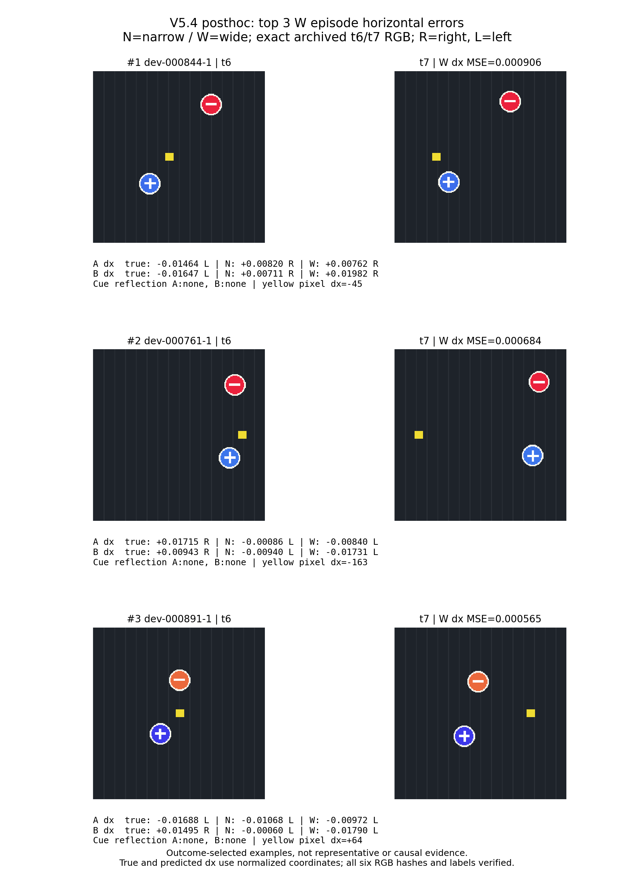

# V5.4 已评估坏例：posthoc 选择

按已评估 512 个 episode 的 W concat A_dx/B_dx 平均平方误差降序，取前三个；并列时按 pair ID、variant 升序。选择单位是 episode，不要求不同 pair。没有重选模型、计算新 CI、生成新 split/ID 或启动 GPU。

| Rank | Episode | W dx MSE | N dx MSE | t6→t7 反射轴 |
|---|---|---:|---:|---|
| 1 | dev-000844-1 | 0.00090619147 | 0.00053880712 | A:none, B:none |
| 2 | dev-000761-1 | 0.00068395084 | 0.0003394263 | A:none, B:none |
| 3 | dev-000891-1 | 0.00056508152 | 0.00014004895 | A:none, B:none |



A 是上方红色目标，B 是下方蓝色目标。图中 true/N/W 为 t6→t7 的归一化水平位移及左右方向。RGB 没有美化或改动；contact sheet 仅按最近邻显示原像素，标注放在图像外。

三个 episode 的 6 张 cue RGB 数组 SHA256 均逐项等于原 encoded-input shard 收据；重建标签逐 bit 等于已评估 predictions targets。原生成器 SHA256：`ce5082f3be9006dcceb46fbaffadc27349f977a77abcf8992eda3e80f8775368`；本地 Pillow `11.3.0`。完整源、输入、环境及逐 RGB 哈希见 `render_verification.json`。

反射标志来自原生成器的镜像位置公式：t6/t7 的未反射位置落入不同镜像区间即标记该轴。这不是根据图像猜测遮挡，也不把反射、黄色位移或误差共现解释成因果。这些样本按误差结果选出，不代表总体分布；总体结论以已冻结主端点及完整评估报告为准。

```sh
python3 execution/V54/posthoc_bad_cases.py \
  --scene execution/visual-v5_4-20261010/report-snapshot \
  --verification execution/visual-v5_4-20261010/report-snapshot-verification.json \
  --generator pmr/visual_memory/data.py --out execution/V54/bad_cases
```
