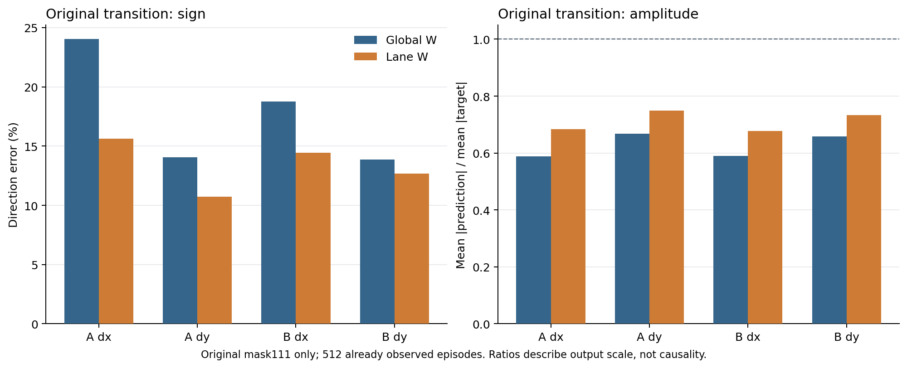
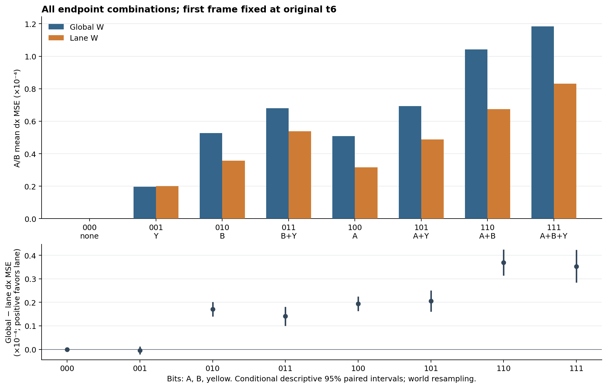
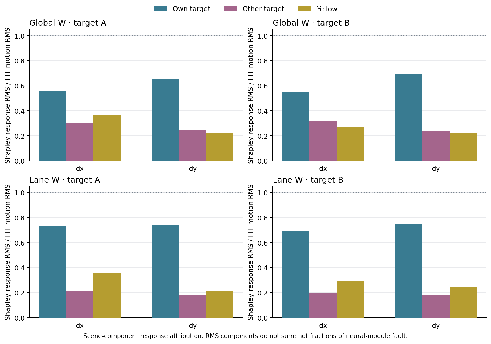
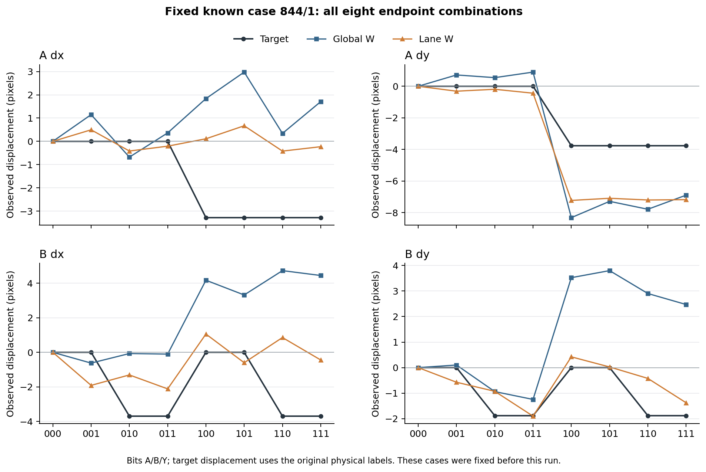
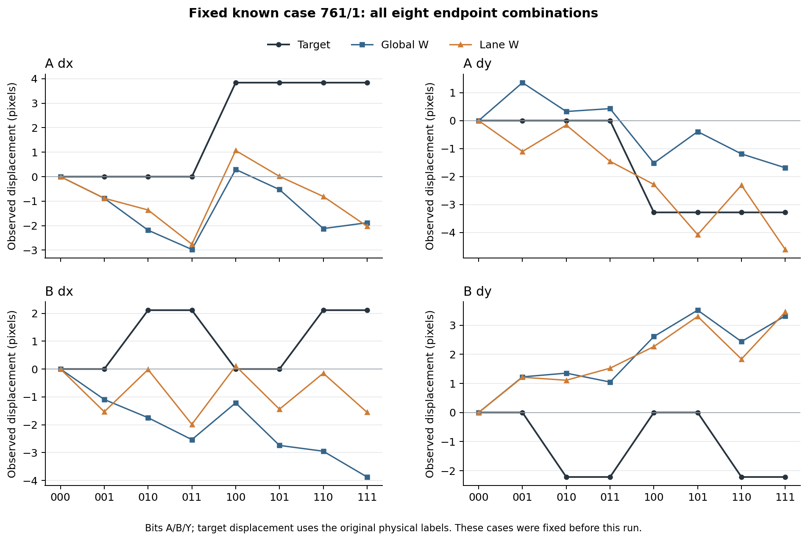
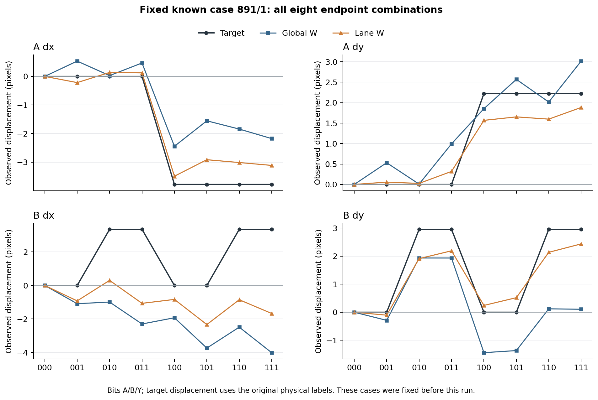
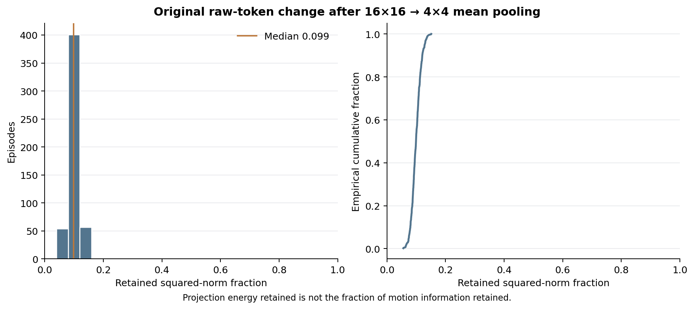

# V5.5：运动错误的模块定位与 lane 读出器对照

**本轮找到了一项可执行的读出器改进，但尚未修复整个运动任务。** 在已观察过的 Dev640–895（256 个世界、每个世界两个运动变体，共 512 个 episode）上，只改变读出器的空间访问范围，原始运动条件的横向位移 MSE 降低 **29.78%**；至少一个目标横向方向错误的 episode 从 **196/512 降到 139/512**。对象干预显示，原全局读出器对自身目标的响应偏弱，同时受另一目标及黄条运动影响。lane 读出器增强了自身目标响应、减轻了跨目标干扰，**没有消除黄条干扰**。

这些结果来自已开放 Dev 上的事后诊断；它们支持下一步改进方向，不能充当独立新评估，也没有重新宣布原 V5/P0 门槛通过。没有打开 Test，没有训练 memory writer。完整数值见[主报告](report/report.json)、[逐 episode 记录](report/per_episode.csv)与[冻结预测](report/predictions.npz)。

## 这次实际改变了什么

被检查的路径是：`原始 RGB → 冻结 I-JEPA ViT-H/14 → 16×16 空间 tokens → 4×4 平均池化 → BF16 保存 → 两帧核读出器`。此路径不包含 memory writer、长期记忆写入或检索；因此本轮无法归因到这些尚未参与的模块。

全局 W 读出器是 V5.4 已冻结模型。新的 lane W 沿用同一份已归档 FIT、同一二次核、固定正则强度与自由截距：预测目标 A 时只访问 4×4 网格的上两行，预测 B 时只访问下两行；各 lane 使用同样的 N+W 共 8,192 参考视图计算核归一化，只由 W 的 4,096 视图提供监督。lane 结构是在观察这些 Dev 失败后提出的诊断选择；其系数仅由 FIT 拟合，正则强度与访问范围在本轮评分前已固定，未用 Dev 拟合或调参。该对照同时改变了可见特征和相应核几何，支持“读出方式可改进”的结论，不能把改进量等同于某个模块的故障占比。空间 token 本身仍具有全局上下文，lane 访问限制也不等于从图像中移除了黄条。

| 原始两帧条件（mask111） | 全局 W | lane W |
|---|---:|---:|
| A/B 横向位移平均 MSE（归一化坐标） | 0.0001184554 | 0.0000831771 |
| 四维运动 skill（同一冻结 FIT 均值基线） | 0.4340 | 0.5799 |
| 至少一个目标 dx 方向错误 | 196/512 | 139/512 |
| 两个目标 dx 方向均错误 | 23/512 | 15/512 |
| A 的 dx 方向错误 | 123/512 | 80/512 |
| B 的 dx 方向错误 | 96/512 | 74/512 |

横向 MSE 的全局减 lane 差值为 0.0000352782，按整个世界保留两个变体共同重采样的 95% 区间为 `[0.0000283909, 0.0000423095]`（10,000 次，seed7812）。这是对已开放数据和固定读出器的描述性区间。两个模型的横向预测幅度仍偏小：`mean(|预测|)/mean(|真值|)`，A 从 0.589 到 0.684，B 从 0.589 到 0.677。

## 如何把自身运动、另一目标和黄条分开

对每个 episode 固定首帧为原始 t6，末帧分别让 A、B、黄条取原 t6 或 t7 的位置，形成全部八种组合。三位 mask 依次为 A/B/黄条：`000` 是重复 t6，`111` 是原始 t7。目标位移只随相应目标的位置选择变化，不随黄条变化。

原始端点 RGB 与 V5.4 归档输入哈希完全一致；八个端点都保留原背景、颜色和绘制规则。每个 episode 的 12 条单对象干预边都验证了：改变只能发生在该对象旧、新像素支持的并集内，其余对象与背景保持不变。全部 512 个 episode 共验证 6,144 条边。

八种组合的 Shapley 分解显示以下结构。表中各项为横向响应 RMS 除以冻结 FIT 的相应真实运动 RMS；它们不能相加成“错误来源百分比”。

| 响应分量 | 全局 W：A dx / B dx | lane W：A dx / B dx |
|---|---:|---:|
| 自身目标变化 | 0.558 / 0.547 | 0.731 / 0.694 |
| 另一目标变化 | 0.304 / 0.316 | 0.211 / 0.200 |
| 黄条变化 | 0.366 / 0.268 | 0.361 / 0.290 |

lane 对自身目标的响应增强，另一目标引起的响应减弱；黄条响应没有一致降低。只移动黄条的 `001` 条件下，lane 也没有改善整体横向 MSE。因此这里得到的是**自身目标响应不足、跨目标混合可减轻、黄条干扰仍存在**的组合诊断，并非“通过裁掉黄条解决了问题”。

## 三个提前固定的已知坏例

下表仅展示原始 `111` 条件的 `(A dx, B dx)`，单位为 224×224 图像上的像素。完整图保留全部八种条件和四个运动轴，不因对照是否改善而删除样本。

| episode | 真实 dx | 全局 W 预测 | lane W 预测 |
|---|---|---|---|
| 844/1 | (−3.278, −3.690) | (+1.707, +4.439) | (−0.229, −0.444) |
| 761/1 | (+3.841, +2.113) | (−1.882, −3.877) | (−2.027, −1.555) |
| 891/1 | (−3.781, +3.348) | (−2.176, −4.009) | (−3.115, −1.669) |

844/1 的两个横向方向恢复正确，但幅度仍严重不足。761/1 的两个方向仍错，显示访问限制不是普遍修复。891/1 的 A 更接近真值，B 仍错：B dx 的 lane Shapley 分量为自身 `+0.294`、A 的变化 `−0.906`、黄条 `−1.057` 像素，合成后仍为 `−1.669`；这直接展示了弱自身响应被其他变化压过的个例。

## 已排查的实现问题与尚未回答的问题

| 环节 | 本轮证据 | 结论边界 |
|---|---|---|
| 原始渲染、标签、时间顺序 | 原 t6/t7 RGB 哈希、原目标与历史归档一致；12 条干预边逐像素验证 | 未发现这条诊断路径中的端点重建或标签错位 |
| 批次大小 | 全部 4,096 个图像槽再用 batch4 编码，与首轮 batch4/12 对照 | 83,886,080 个 canonical 特征值全部一致；三个冻结读出器预测差异全部为零 |
| 池化实现与最终 BF16 | 原始 FP32 tokens 重新池化与保存前池化仅有浮点累加差异；同次结果 BF16 往返完全一致 | 没有支持池化索引/量化实现错误；尚不能判断降采样是否损害可读出的运动信息 |
| 冻结 W 读出器结构 | 交换两帧的运动预测反号、相同两帧输出约零；存在不可忽略的跨帧项 | 不能将该模型概括为单帧位置估计的简单相减；结构恒等式也不保证真实运动预测正确 |
| writer/长期记忆 | 本轮路径没有调用这些模块 | 不对它们作成败判断 |

池化从 16×16 降到 4×4 后，原始两帧 token 差值的正交投影能量平均保留 **9.98%**，中位数 **9.90%**。这只说明特征变化能量主要落在该投影丢弃的方向，**不能解释为丢失了约 90% 的运动信息**。证明运动信息损失还需要公平的读出控制；本轮没有完成这一项。

原始 FP32 tokens 经 CPU 高精度重新池化，与 GPU 保存前 FP32 池化的最大绝对差为 `2.414×10⁻⁶`，RMS 为 `5.258×10⁻⁸`；GPU 同次池化后的 BF16 结果与 canonical 缓存严格一致。仅把原始条件的查询特征替换为保存前 FP32 池化值、保持 W 读出器冻结时，运动 skill 从 0.433999 变为 0.433981，没有出现性能恢复。该查询侧控制不等价于重新训练一个全 FP32 读出器。

首轮对原始图像用 batch4、对编辑图像用 batch12，可能引入数值混淆，因此额外完成了全量 batch4 补验。所有端点的 RGB/掩码/标签身份再次核对；全部 canonical 特征逐值相等，N/W/lane 的全部预测、最大差和 RMS 差均为零。这里展示的首轮图表因此也准确反映匹配 batch4 的结果，无需重绘。见[补验报告](batch_match_run/comparison/report.json)、[全部端点差异](batch_match_run/comparison/feature_per_endpoint.csv)、[补验预测](batch_match_run/comparison/predictions.npz)和[绘图核验说明](figure_visual_review.json)。

## 作业、复现与归档

所有步骤复用 `415453` 分配中的 8 张 H800，节点 `dgx-097`，account `hansirui`，partition/QOS `llm`。没有另建 GPU allocation，也没有停止 IndexMem；现存父作业及 IndexMem 的状态以归档中的最后核验为准。

| 实际 Slurm step | 工作 | 资源与完成状态 |
|---|---|---|
| `415453.40` | 首轮全部对象组合提取 | 8 GPU，COMPLETED / 0:0 |
| `415453.41` | 首轮冻结读出与模块诊断 | CPU，COMPLETED / 0:0 |
| `415453.42` | 全量 batch4 匹配提取 | 8 GPU，COMPLETED / 0:0 |
| `415453.43` | 全量特征和冻结预测对比 | CPU，COMPLETED / 0:0 |

两个 GPU 控制器按 8 卡整体步骤计入启动、执行与确认终止开销：首轮 **0.681470273191161 GPUh**，补验 **0.125353053730861 GPUh**，V5.5 合计 **0.806823326922022 GPUh**；继承此前账本后的累计为 **5.32908766817043 GPUh**。这是本实验控制器的可归属用量，已有父 allocation 的 Slurm 预留统计单独保留，不能把它们混为同一口径。V5.5 未超过原定 1.2 GPUh，累计仍低于诊断上限 6 GPUh。

首轮源提交为 `d0cae2237fe2cc8e562e1c62744a6958157a3e60`；批次补验提交为 `280548d78f7a146fa2c20ed158fde4458fa867d4`，保留首轮科学源不变。两次运行均先发布、回读并验证新源码/协议，然后才生成对应诊断输入。官方 encoder 和 checkpoint 身份保持此前登记值。

- [复现说明](REPRODUCE.md)、[首轮 source manifest](source_manifest.json)、[首轮发布回读凭据](registration_publication.json)。
- [对象干预与提取源码](../../../scripts/v5_5_counterfactual.py)、[lane 读出器](../../../scripts/v5_5_lane_reader.py)、[冻结模型结构审计](../../../scripts/audit_v5_5_reader.py)、[主评分器](../../../scripts/score_v5_5.py)。
- [批次补验源码](../../../scripts/v5_5_batch_match.py)、[主协议](../../../docs/V5_5_MODULE_DIAGNOSTIC.md)、[批次补验补充说明](../../../docs/V5_5_BATCH_MATCH_ADDENDUM.md)。
- [完整结果 Release](https://github.com/XintongYang1010/predictive-memory-lab/releases/tag/visual-v5_5-20261010)、[依赖的完整 V5.4 归档](https://github.com/XintongYang1010/predictive-memory-lab/releases/tag/visual-v5_4-20261010)。模型、特征、原始 token shards、输入记录、控制器、账本、日志与复现配置的完整清单由 archive manifest 指定；官方大权重按哈希引用。

远端清理与归档是独立于科学结论的操作状态。GitHub 资产是否完整回读、远端目录是否按授权清理或保留、已有内容与作业是否保持不变，以本目录的 [完整 GitHub 回读凭据](github_verification.json)与[清理记录](cleanup_receipt.json)为准；本说明不以“结果已生成”代替归档或清理成功证明。

清理范围沿用用户的明确指示：本次 V5.5 全部执行成功且完整归档回读验证后，仅删除新建 V5.5 目录和本次导出临时文件；所有较早诊断目录、失败现场、共享环境及父作业保留。已完成的负面或混合科学诊断不等于运行失败。
