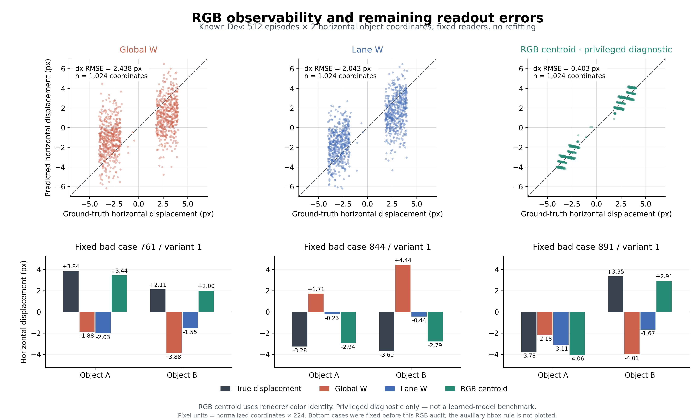

# V5.5 后续定位：RGB 可观测性与模块消融设计

本次新增的实际证据是一次 **CPU、无训练、已见 Dev 的 RGB 诊断**。它进一步排除了原坏例“图像里本来就看不清运动”的解释；encoder、pooling 与 reader 的具体责任仍待后续控制。其余模块消融与研究 idea 为设计，尚未执行。

## 实际补查得到什么

重建同一批 Dev640–895、每个 world 两个变体的原 t6/t7 两帧。**1,024 幅 RGB 和 512 个标签逐一匹配原归档**。预测器仅根据固定红/蓝色像素规则找可见目标质心，再计算两帧差；不把真实位置、真实位移或未来帧作为预测输入。

| 方法 | 横向位移 RMSE，像素 | 四维运动 skill |
|---|---:|---:|
| 原全局 W，已有冻结结果 | 2.438 | 0.4340 |
| lane W，已有冻结结果 | 2.043 | 0.5799 |
| RGB 颜色质心，本次特权诊断 | **0.403** | **0.9810** |

三个方法的 skill 使用完全相同的冻结 FIT 均值基线。RGB 方法使用场景颜色先验，是输入可观测性参照，不是学习架构的公平性能排名。辅助包围盒中心结果单独保留，不按得分替换主质心方法。

全部 2,048 个运动坐标中，2,015 个真实位移绝对值至少为 1px，RGB 质心方向全部正确；全局 W 与 lane 在这部分分别有 351、262 个严格反向。其余 33 个坐标为非零且小于 1px，质心的 11 个严格反向与 2 个零预测全部在这组。没有删除小位移或反射样本。这些是坐标计数，不是 episode 数；不能直接与旧报告的 196/139 个横向错误 episode 混用。

三个已固定坏例的横向结果如下，顺序均为 `(A dx, B dx)`、单位像素：

| episode | 连续坐标真值 | lane W | RGB 质心 |
|---|---|---|---|
| 761/1 | (+3.841, +2.113) | (−2.027, −1.555) | (+3.445, +2.000) |
| 844/1 | (−3.278, −3.690) | (−0.229, −0.444) | (−2.945, −2.791) |
| 891/1 | (−3.781, +3.348) | (−3.115, −1.669) | (−4.055, +2.912) |

标签是反射后连续位置的 `p7−p6`，绘图包含整数栅格化，所以光栅中心和标签之间确有小误差。该误差不足以解释原三个坏例的明显横向错向。这里不能把质心误差当作不可突破的误差下界，也不能单凭 RGB 成功认定 encoder 失败；损失可能发生在 encoder、pool 或读出器的任何组合。

## 推荐的下一步

详细对照与判读见 [模块消融设计](../../../docs/V5_5_FOLLOWUP_ABLATIONS.md)。优先级为：

1. **拆解 lane 收益。** 先匹配全局/lane 的有效正则；随后保持全部 token，只删除二次核的上下区域乘积；最后比较正确 lane 与等维度空间对照。这能把收缩、跨区域交互与目标对齐分开研究。
2. **同 raw 派生 pool 的局部匹配。** 现有 1,024 张原始帧足够做固定匹配规则的 CPU 对照；共同物理位移网格避免 14px/56px 最近邻带来的不公平。当前没有 N/W FIT raw，不能假装已经具备公平重训所需数据。
3. **八个端点组成 8×8 完整图像查询。** 不拼接 token，分别控制首帧、末帧与无关物体运动，直接使用冻结 reader。必要时再作特征替换与 encoder 层级探针；特征替换的分布外风险要单列。

[网页端讨论](web_review.md)补充了两个经源码核实的线索：现有 B-only 同时移动 x/y，尚未排除轴间串扰；每个训练布局只提供一组联合运动往返，尚未独立覆盖 A/B 运动组合。设计文档因此加入单轴 `2×2` 像素干预，以及固定每物体边缘分布的联合/交叉监督对照。这些新图像实验尚未执行。

从不同结果可发展三条可证伪方向：对象自身运动与物理交互分开建模；按运动证据保留局部高分辨率记忆；由可信状态变化控制写入、避免把干扰的视觉变化当重要事件。它们是机制假设，不是已证明有效或新颖的方案；设计文档列出了反例、必要 baseline 和已有研究。

## 文件与操作状态

- [RGB 审计详情和复现命令](rgb_observability/README.md)、[脚本](rgb_observability/audit_rgb.py)、[完整报告](rgb_observability/report.json)、[逐坐标 CSV](rgb_observability/per_episode_coordinate.csv)、[冻结预测](rgb_observability/predictions.npz)。
- [全部 RGB 哈希与读出中心](rgb_observability/frame_hashes_and_centers.json)、[输入清单](rgb_observability/input_inventory.json)、[输出 SHA256](rgb_observability/SHA256SUMS)。
- 图表及源代码保存在 `figures/`；[网页端讨论](web_review.md)作为独立分析记录保存，不作为实验复现证据。

本次 **没有新增 Slurm job、GPU 用量为 0**，未连接或修改远端；不将最后封存的 allocation 状态当成当前实查状态。此前 V5.5 已验证归档后的清理状态保持不变，旧现场保留。没有打开 Test、训练 memory writer 或宣布 P0 通过。
