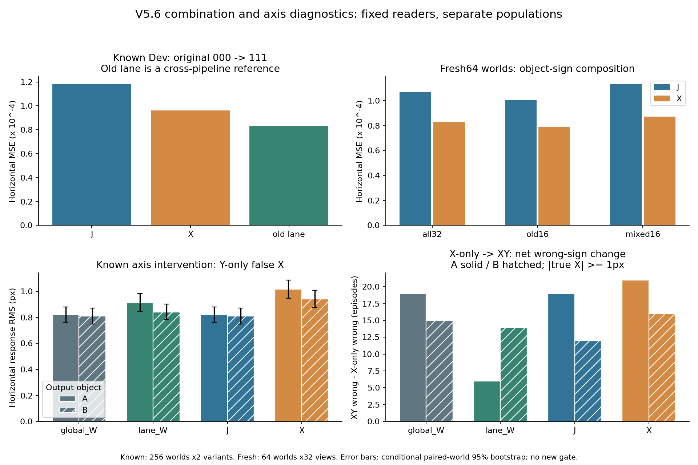

# V5.6 — controlled ablations and optimization trials

**2026-10-10：所有预定实验完成。对象组合增强在模型冻结后生成的64个新场景上，使水平位移MSE降低22.34%。目标相关空间访问与细节保留得到支持；变化幅度优先的存储和更新原型失败。坐标串扰与静止假运动仍未修复，尚无memory收益结论。** Source and protocol were frozen at [031788e](https://github.com/XintongYang1010/predictive-memory-lab/commit/031788e0499c242a3671f57d026f3ed71da4872e) before these runs and all114 source blobs were read back byte-for-byte. Original Test/P0 and all older results remain unchanged.

## What the executed CPU trials currently show

The target-aligned readout advantage survives the original global kernel scale and FIT-only effective-df matching. Matching df alone does not repair the full reader. Fixed raw local correspondence substantially outperforms matching after averaging the same raw tokens, and an equal-byte source-RGB-ROI bank preserves much of that advantage. A naive change-magnitude retention policy fails. The frozen-reader local-change write gate also fails to beat latest/FIFO on the bounded endpoint replay. These are exploratory results on already opened256 paired Dev worlds/512 episodes.

指标口径：水平MSE只平均A_dx/B_dx两个坐标的平方误差，表中像素RMSE为其平方根乘224。四轴motion skill则先逐坐标计算 `1 − MSE / mean((target − frozen FIT mean)²)`，再等权平均A_dx/A_dy/B_dx/B_dy；分母不是以Dev均值中心化的方差。更新replay的position RMSE衡量四个位置坐标，不能与位移RMSE直接当作同一指标比较。

### Frozen reader ablation

All arms use identical W4096 supervision. Df targets come only from FIT; no Dev alpha selection. Horizontal errors refer to the original000→111 query; direction column counts episodes with at least one horizontal sign error. Full all8-mask data are in [reader_ablation.json](cpu/reader_ablation.json).

| Reader | Horizontal RMSE (px) | Any horizontal sign error |
|---|---:|---:|
| global__original | 2.438 | 196/512 |
| global__df_matched | 2.441 | 197/512 |
| additive__original | 2.360 | 181/512 |
| additive__df_matched | 2.355 | 180/512 |
| target_common__original | 2.099 | 144/512 |
| target_common__df_matched | 2.072 | 140/512 |
| correct_lane__original | 2.043 | 139/512 |
| correct_lane__df_matched | 2.043 | 139/512 |
| opposite_lane__original | 3.580 | 330/512 |
| opposite_lane__df_matched | 3.583 | 333/512 |
| checkerboard__original | 2.722 | 250/512 |
| checkerboard__df_matched | 2.721 | 249/512 |

Original-query parity max errors: global1.43e-12, lane1.87e-12. Common-scale target kernels retain about26–28% MSE improvement, while opposite lanes and checkerboards fail. This supports target-aligned feature access within the fixed kernel family; it does not establish learned object identity.

### Same-source correspondence and equal-byte storage

| Fixed matcher input | Horizontal RMSE (px) | Mean four-axis skill |
|---|---:|---:|
| Raw16x16 |1.534|0.758|
| Mean pool4x4 from same raw |3.878|−0.775|
| Uniform bank, equal bytes |3.753|−0.745|
| Source-RGB ROI bank, equal bytes |1.738|0.675|
| Random detail bank |4.772|−1.642|
| Two-frame change-priority bank |6.663|−4.227|

All625 displacement costs and every prediction are retained for the full archive. See [correspondence.json](cpu/correspondence.json). All matchers use privileged source-RGB object ROIs. Each equal-byte bank stores16×1280 FP32 descriptors plus16 uint16 locations:81,952 bytes/frame. This excludes the full-raw selection workspace. The sparse banks use fixed IDW reconstruction; change-priority reads both frames. A failing matcher does not prove that pooled features contain no useful motion information. These are two-frame storage diagnostics, not long-term memory results.

ROI比uniform的MSE降低78.55%。变化优先选出的12个细节cell，源A/B面积覆盖仅0.74%/0.56%，黄色干扰物覆盖80.06%；955/1024个对象匹配撞到搜索边界。cell footprint不等于Transformer感受野，bank仍有4个全局coarse描述符，但这直接支持“变化能量不等于目标相关性”的问题定位。

### Fixed-reader update replay: negative result

| Policy | Position RMSE (px) | Missed writes on2048 true object changes |
|---|---:|---:|
| Latest |2.691|0|
| FIFO |2.685|0|
| Feature-surprise threshold |3.124|1375|
| Local-feature threshold |3.001|842|

All policies use the same frozen lane position reader and32B state payload plus8B common metadata. Thresholds were fixed from FIT nuisance-only changes. Local gating reduces misses relative to full-feature surprise but remains worse than latest/FIFO; stale-state failures are retained. This is a binary-endpoint stress test with observation-free hold gaps, not a trained writer or a physically integrated motion sequence. See [replay.json](cpu/replay.json), which also contains all64-transition and yellow feature-path summaries.

## 对象组合覆盖：Fresh64确认有效，坐标串扰仍存在

J重复旧16种视图两次；X用旧16种加16种独立A/B运动组合。两者同256个FIT场景、8192加权视图、共同X8192归一化参考、同mean-loss alpha；J重复样本按精确等价方式折叠求解。X增加了新的唯一图像，所以这里识别的是这一组合增强方案的收益，不声称优于所有等量新图像方案。

完整模型（含特征basis、系数和配置）先在[模型Release](https://github.com/XintongYang1010/predictive-memory-lab/releases/tag/visual-v5_6-fit-20261010)发布、完整下载核验，再生成独立命名空间的64个新场景，没有换seed或调门槛。

| 评估 | J水平RMSE / px | X水平RMSE / px | J−X MSE的95%配对区间 |
|---|---:|---:|---|
| 已看Dev，原000→111 |2.437|2.198|[1.570e−5, 2.851e−5]|
| Fresh64，全32视图（预定主比较） |2.316|2.041|[1.546e−5, 3.200e−5]|
| Fresh64，旧组合16视图 |2.245|1.991|[8.543e−6, 3.463e−5]|
| Fresh64，混合对象16视图 |2.385|2.090|[1.656e−5, 3.628e−5]|

Fresh64主比较MSE降低22.34%，四轴motion skill从0.505升到0.623。中心静止负控仍有四维假运动RMS：J0.769px、X0.808px；差的配对区间跨零，不能声称可靠恶化，也不能称完整修复。区间以world重采样，保留同world全部视图，10,000次；64×32不是2048个独立world。该确认只覆盖对象组合，不确认坐标解耦、布局交换或长期记忆收益。[独立重算、逐轴统计及分母](combination_analysis/interpretation.md)。

Fresh64主比较中每个运动坐标有2048个非零且≥1px的方向样本，但只有64个独立world。中心静止负控是64×2=128个view，每坐标的非零方向分母为0，只报告假运动RMS；上述0.769/0.808是四轴合并RMS，不是仅两横轴的dx RMSE。

512个旧episode另做目标x、y、xy像素端点控制，固定另一个对象及黄色条件，不声称这些混合端点是一条完整物理轨迹。纯y造成的错误水平响应如下：

| Reader | A RMS / px | B RMS / px |
|---|---:|---:|
| 原global |0.820|0.809|
| 原lane |0.912|0.841|
| J |0.821|0.810|
| X |1.016|0.940|
| X−J，配对95%区间 |+0.195 [0.145, 0.246]|+0.130 [0.089, 0.170]|

补对象组合提高总体精度，却加大这一错误响应，因此对象组合覆盖与对象内坐标分离是不同问题。x-only变成xy时既有正确→错误，也有错误→正确，还存在二阶interaction；不能把全部xy错误归因于y-only项。区域mask也没有去掉这个响应，仍不能唯一分配给encoder或reader。[完整轴分析与图](combination_analysis/README.md)。

## 新方向与解释边界

目前更符合证据的解释是：任务相关的局部运动线索仍在，但空间汇聚、读出依赖与预算分配没有稳定优先使用这些线索；训练组合覆盖又贡献了另一部分泛化误差。这不是唯一encoder或pooling故障的证明。

1. **对象相关的细节预算。** 用可学习的对象对应/查询相关性替代颜色ROI，保留少量全局背景，在同字节预算下与uniform、random、ΔL2比较，先检验能否接近本次有特权ROI参照。
2. **共享二维对应读出及响应约束。** 固定表示、bank、访问范围和FIT，只替换读出为跨对象/位置共享的二维位移代价面；在新的FIT干预中独立变化x、y和干扰，约束纯y不诱发dx、干扰不诱发目标运动，同时保留正确运动幅度。允许内部联合二维建模，不能简单删除全部跨轴交互或靠缩小全部输出制造改善。
3. **基于对应可靠度更新。** 用匹配一致性或状态不确定性决定写入，专测小目标变化、大干扰和静止误触发。当前硬阈值漏写是必须击败的负基线。

这些是后续可证伪设计，尚不是已完成的学习型模块，不主张文献新颖性。本轮已执行固定reader、存储、组合增强、坐标和更新原型。先固定reader及FIFO单独验证学习型选择，再单独研究更新门控。原memory writer未参与reader诊断。另做的上下外行等大小控制不支持对两个对象都成立的“目标外行更重要”故事；混合激活不一定在真实特征流形上，RMS不能当错误责任比例。[空间路径控制](replay_spatial_control/README.md)、[CPU解释审阅](cpu_idea_review.md)、[网页端机制审阅](web_review_gpu.md)。

## 执行和归档

真实资源为现有Slurm allocation **415453**，account **hansirui**，partition/QOS **llm**，node **dgx-097**，8×H80080GB。IndexMem未被终止，parent allocation保留。

| Step | 内容 | 状态 / Slurm秒 |
|---|---|---|
|415453.44|八卡FIT＋axis编码|COMPLETED 0:0 / 67|
|415453.45|J/X拟合冻结，CPU|COMPLETED 0:0 / 50|
|415453.46|旧reader axis评分，CPU|COMPLETED 0:0 / 17|
|415453.47|J/X known评分，CPU|COMPLETED 0:0 / 10|
|415453.48|J/X axis评分，CPU|COMPLETED 0:0 / 7|
|415453.49|八卡Fresh64编码|COMPLETED 0:0 / 41|
|415453.50|Fresh64评分，CPU|COMPLETED 0:0 / 5|

八worker每阶段全部完成，共4256编码槽；512个FIT旧锚点和32个Dev锚点逐位复核。两次GPU控制器实计0.238702974GPUh，继承5.329087668后累计 **5.567790642GPUh**，小于6GPUh诊断上限及原60GPUh上限。Slurm整数秒与monotonic计时的小于1秒分辨率差单独记录，账本未改写。[完整账务与作业状态](final_accounting.json)。

CPU数学/软件校验、旧global/lane预测复现、全视图统计和配对区间独立重算通过。完整协议：[V5_6_EXECUTION_PROTOCOL.md](../../../docs/V5_6_EXECUTION_PROTOCOL.md)。大文件入口：[完整结果Release](https://github.com/XintongYang1010/predictive-memory-lab/releases/tag/visual-v5_6-20261010)。包含新cache、J/X及12臂模型、全部预测/匹配cost、配置、源码、日志、图表及manifest；旧V5.4/V5.5依赖以既有封存内容及引用清单验证。

本Git目录镜像小型报告和图表；GPU报告manifest所列的NPZ/逐样本CSV完整文件位于Release的`scene/`，CPU大模型与cost位于`local/`。重建顺序、SHA256和依赖入口见[ARCHIVE.md](ARCHIVE.md)。

**归档状态：实验和远端封存核验完成，正在传输与独立回读；尚未清理远端。** 仅在完整回读后删除本次新建work及reference staging根；已有目录、共享环境、权重及其他作业保留。

运维恢复记录完整保留：首次部署参数过长后改stdin传输；模型首次流式压缩参数不兼容后改显式gzip流；一次只读封存检查SSH断开后重试。科学源码、模型、seed和门槛未因此改变。

## Detailed CPU evidence

- [Twelve-arm reader report and figures](reader_ablation/README.md). Complete model/CSV/binary predictions are reserved for the final Release.
- [Fixed bad cases, uncertainty intervals and selected-token coverage](correspondence_interpretation/README.md).
- [Independent update replay reconstruction](cpu/replay_verification.json).
- [Web ChatGPT method review and replies](web_review.md). No scientific thresholds or models were changed in response.
- [网页端对最终J/X和坐标结论的复核](web_final_review.md)。22.34%是MSE降幅；old16/mixed16是同一批64个world的子集。
