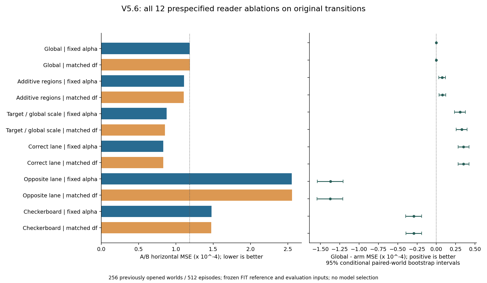
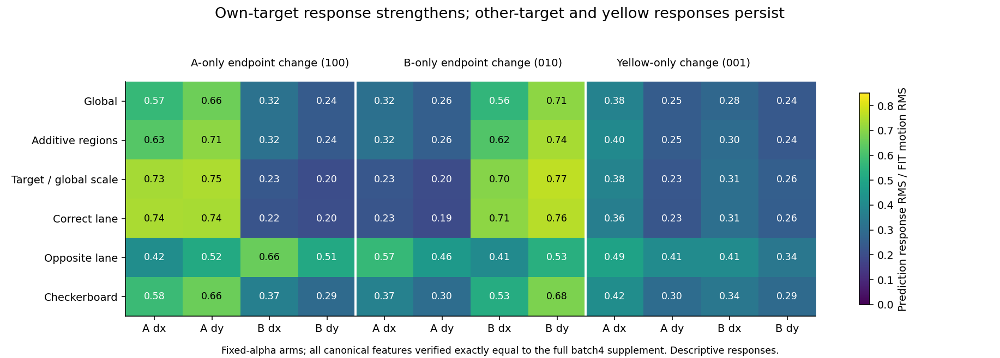

# V5.6 CPU 读出器消融：实际结果

全部 12 个预先固定对照均完成；复用了已封存的编码器特征，GPU 用量为 0。

**主要发现：目标对齐的空间访问比一般的降维或单一有效自由度差异更能解释 lane 的改善。** 仅删除跨区域乘积使原始转移 dx MSE 降低约 6%；保持全局核尺度、仅使用正确目标区域，仍降低约 26%–28%；原 lane 降低约 30%。反向区域和同为 8 tokens 的棋盘格更差。

训练为相同 256 个 W 世界、4096 监督行；归一化参考为冻结 N+W 的 8192 行。评估为已经看过的 Dev640..895：256 个世界 × 2 variants × 8 masks；没有新确认数据、CV、结果选型或 Test 访问。

| arm | dx MSE × 10⁻⁴ | 相对 global 降低 | motion skill | 水平任一目标方向错 /512 | global−arm dx MSE 95% CI ×10⁻⁴ |
|---|---:|---:|---:|---:|---|
| global__original | 1.184554 | 0.00% | 0.433999 | 196 | [0.000000, 0.000000] |
| global__df_matched | 1.187615 | -0.26% | 0.432592 | 197 | [-0.004967, -0.001179] |
| additive__original | 1.109833 | 6.31% | 0.476059 | 181 | [0.032174, 0.117251] |
| additive__df_matched | 1.104895 | 6.72% | 0.479133 | 180 | [0.036840, 0.122400] |
| target_common__original | 0.877689 | 25.91% | 0.568335 | 144 | [0.236576, 0.376998] |
| target_common__df_matched | 0.855963 | 27.74% | 0.580504 | 140 | [0.257970, 0.398950] |
| correct_lane__original | 0.831771 | 29.78% | 0.579947 | 139 | [0.281666, 0.422806] |
| correct_lane__df_matched | 0.831771 | 29.78% | 0.579947 | 139 | [0.281666, 0.422806] |
| opposite_lane__original | 2.554572 | -115.66% | -0.216565 | 330 | [-1.540473, -1.207554] |
| opposite_lane__df_matched | 2.558117 | -115.96% | -0.218209 | 333 | [-1.544090, -1.211230] |
| checkerboard__original | 1.476661 | -24.66% | 0.288579 | 250 | [-0.395687, -0.190933] |
| checkerboard__df_matched | 1.475437 | -24.56% | 0.289077 | 249 | [-0.394617, -0.189169] |

所有区间按 256 个完整世界成对 bootstrap，重复 10000 次、固定 seed 7816；它们条件于既有 FIT、该已看评估集和本次固定模型，不是新的确认性显著性检验，也没有多重比较校正。

## 控制实验说明了什么

- global 匹配到对应原 lane 的 FIT 有效自由度后没有改善，因此这一次 DF 差异解释不了主要增益；这不排除所有标量正则参数，也不意味着各方向的谱收缩相同。
- additive 保留两区域的加性分量，只移除跨区域乘积分量；其小幅改善支持该交互特征族在此数据及拟合方案下有代价，但不证明每个乘积都有害。
- target_common 继承全局 linear/quadratic 尺度，增益仍保留，说明独立 lane 重新归一化不是获得主要改善的必要条件。
- 相同 token 数的反向 lane 和棋盘格均变差；受支持的是测试过的正确空间对齐，而非任意减半维度。
- 正确区域对自己目标的响应增强，原始方向错误减少、运动幅度更接近真值；改善并非仅将所有输出压向零。黄色干扰和另一个目标引起的错误响应仍在，黄色四坐标没有一致下降。
- 此次改变了读出器的特征访问和核族；编码器全局上下文、池化损失及其与读出器的交互仍不能唯一拆分。没有定位到某个 encoder 层的实现错误，也没有验证 memory 模块或启动 P0。

同批次补验已排除原 batch4/12 的数值混淆：V5.5 的作业 `415453.42` / `415453.43` 重新以 batch4 编码全部 4096 个图像槽，并比较全部 8 masks。83,886,080 个 canonical 特征坐标与原缓存逐值相等，N/W/lane 的 98,304 个预测坐标差异也全为零。本次又校验其封存哈希，并直接重读两份特征数组确认完全相等；因此本轮全部读出器和对象响应使用的输入与全量 batch4 补验一致，无需重训或替换缓存。这排除了该具体批次因素，未自动建立唯一神经模块归因。

补验收据 `batch_match_run/cache/receipt.json` SHA256：`86c3a9d076819c26b1ddf7d85e8f96f222bd3b612179141fdedcccbf2156edd8`；补验比较报告 SHA256：`745879fd9aee5b6948cfa9082dcd0e9b5662f71721a9737c765e59f7b2ad88c9`。完整绑定见 `postrun_verification.json` 的 `v55_full_batch4_supplement`。

## 数值与归档核对

- FIT 实测 95.643 秒；score 报告计时 17.925 秒（CLI 含尾部输出 17.939 秒）；本机 4 BLAS threads。
- 原 global / lane 逐例、全 8 masks 预测最大绝对复现误差为 1.425e-12 / 1.861e-12，低于固定容限 1e−7。
- 原 alpha=7.8125e−7；DF 目标 A=2629.765903419、B=2810.204109543；所有匹配残差 ≤7.910e-07，固定容限 1e−6。
- 冻结源码提交 `031788e0499c242a3671f57d026f3ed71da4872e`；所有来源哈希与冻结记录一致。
- 模型 20 文件、报告 4 文件的精确目录集合、bytes 和 SHA256 已独立回读；见 `postrun_verification.json`。
- 模型先完整序列化及回读，随后打开既有 Dev 评分。原始输出与 sealed 历史结果未修改。
- `fit.stderr` / `score.stderr` 保留本机 NumPy/Accelerate 的 matmul 警告；实际模型、预测、方程残差及 parity 的有限值和数值检查均通过。

`model/` 包含模型、核谱、配置、来源和冻结收据；`report/` 包含所有逐例预测、CSV、原始统计及哈希清单。本目录的 README、图和 `analysis_summary.json` 只整理已完成结果，不参与训练或选择。
