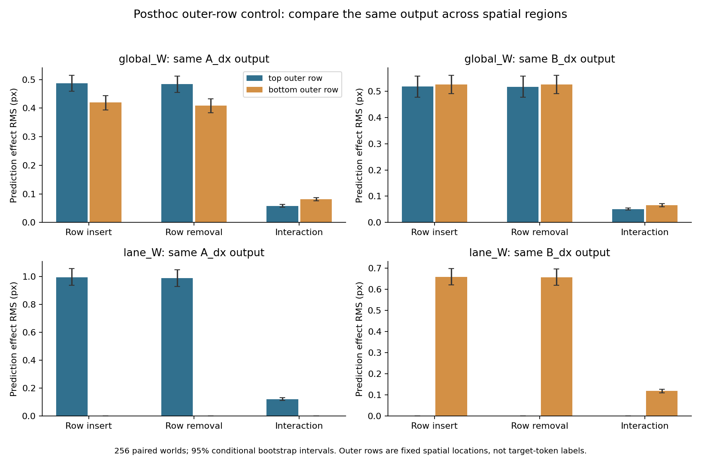

# V5.6 事后空间控制：同一输出上的上、下外侧行

本报告只重算已保存的路径预测和特征。没有训练模型、调用编码器、生成新样本或调整阈值。

上外侧行是 4×4 池化后的 tokens 0–3，下外侧行是 tokens 12–15；它们是固定空间位置，不能称为“目标 tokens”，也不保证总覆盖目标本体。这里分别固定 A_dx、固定 B_dx，在同一输出上比较两行；不再用“上行→A”与“下行→B”充当空间对照。

| reader / 同一输出 | 上行插入 RMS px [95% CI] | 下行插入 RMS px [95% CI] | 上−下 RMS px [配对 CI] |
|---|---|---|---|
| global_W / A_dx | 0.487519 [0.459462, 0.515551] | 0.419683 [0.394345, 0.444441] | 0.067836 [0.033113, 0.103491] |
| global_W / B_dx | 0.517763 [0.477485, 0.558355] | 0.525120 [0.490278, 0.560713] | -0.007357 [-0.047347, 0.033359] |
| lane_W / A_dx | 0.995099 [0.936139, 1.055442] | 0.000000 [0.000000, 0.000000] | 0.995099 [0.936139, 1.055442] |
| lane_W / B_dx | 0.000000 [0.000000, 0.000000] | 0.658721 [0.621169, 0.697750] | -0.658721 [-0.697750, -0.621169] |

“插入”以整幅 low-yellow 编码为基底，只换选定外侧行；“移除”以整幅 high-yellow 编码为基底，换回 low-yellow 的该行。移除与插入的背景特征不同，因此二次核下不必严格等幅。interaction 是四条件差分 11−01−10+00。两个方向、互补区域替换、交互与完整 yellow 变化的 RMS、带符号均值及配对世界区间均在 `report.json`；原逐世界效应在 `per_world_effects.npz`。

## 真实黄色变化是否改变外侧行特征

| 区域 | 非零变化上下文 /2048 | 非零坐标 /总坐标 | 特征差 L2 RMS [95% CI] |
|---|---:|---:|---|
| top_outer_row | 2040 | 10229361 / 10485760 | 4.815495 [4.709938, 4.921253] |
| bottom_outer_row | 2040 | 10234773 / 10485760 | 5.087270 [4.977193, 5.198351] |

这些差异来自实际 yellow-only 两张图的编码，并非人造特征替换。黄色矩形位于图像中间，而外侧池化行也会改变：编码器的上下文敏感性可把变化带到外侧区域。再结合路径替换结果，可说明冻结读出器能使用这类变化；不能据此判为 encoder 实现错误，也不能把各效应 RMS 相除解释成模块责任百分比。逐一回读并验证 256 份原 RGB 哈希记录后，2040 个实际 RGB 变化上下文全部在两侧外行产生非零特征差；剩余 8 个来自 world816 的两 variants ×4 布局，黄色像素中心均为 [148,148]，RGB 本就相同且特征差为零。

## 范围和限制

- Posthoc fixed spatial comparison on already opened Dev640..895; no new fitting, images, encoder calls or tuning.
- Names object0/object1 in the historical NPZ index top/bottom path construction; all eight saved outputs are used here. They do not certify object coverage.
- Top tokens0..3 and bottom tokens12..15 are outer pooled rows. Objects move and need not lie inside them. These are not target tokens.
- Both top and bottom effects are compared on the identical A_dx or identical B_dx output, using identical paired worlds and A/B configurations.
- Activation replacements mix parts of two real encodings; mixed states can be off manifold. Effects are reader responses under this intervention, not unique encoder responsibility percentages.
- Lane A ignores bottom outer tokens and lane B ignores top outer tokens by construction. Their near-zero opposite-row effect is an expected access-control check, not a discovered encoder property.
- The 10000 paired-world percentile intervals are conditional exploratory intervals, with no multiplicity correction or new pass gate.
- Nonzero outer-row changes under real yellow-only pixel changes establish contextual feature sensitivity outside the directly changed yellow pooling area, not an encoder defect or pure object identity.
- The archived full batch4 supplement established exact equality of every canonical feature; the former batch4/12 concern is excluded for these inputs.

读取范围是已看 Dev640..895 的 256 个世界，每世界 2 variants ×4 个 A/B 布局；完整世界一起重采样 10000 次，seed7816。历史全 batch4 补验已证明全部 canonical 特征逐值相等，此处不存在此前提出的 batch4/12 输入差异。
