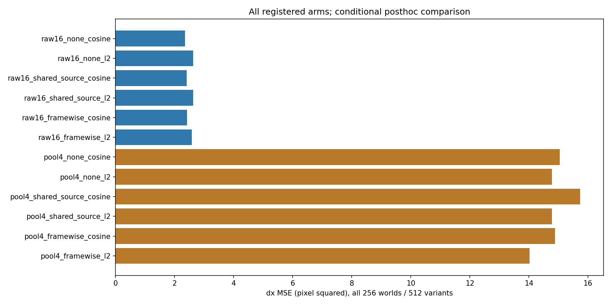
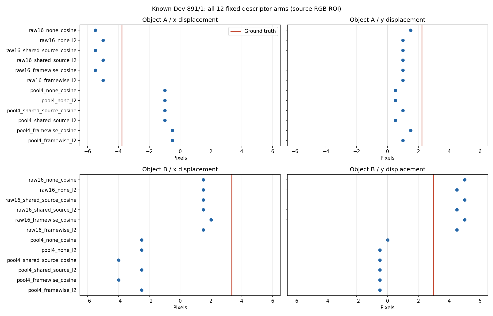

# V5.7：正确 y 仍救不回 x；简单均值/度量改动不能修复粗空间匹配

本轮完成两组 CPU 定位实验：6 种旧 token bank × 5 种代价面读法，以及 2 种分辨率 × 3 种描述子原点 × 2 种距离度量。全部使用已知 Dev 的 256 个 world、512 个 episode、1024 个对象查询；不是新确认。没有训练 shared head、selector 或 memory，没有开启 Test/P0。

**实际结论：固定匹配器在正确 y 行上也经常没有把正确 x 排在最前。原失败不能只解释为选错 y，减一个全局均值或直接换平方距离也不能消除 Raw/Pool 差距。** 这把诊断集中到当前表示的空间定位与插值/匹配组合，但仍未分离池化平滑、采样间距、空间插值和编码器非平移等变性，不能判定某个 encoder 模块损坏或 pooled 信息不可恢复。

源码冻结并回读后才评分：[4375e57](https://github.com/XintongYang1010/predictive-memory-lab/tree/4375e57c8e5f736a43ffae5d4ce74393555d41b9)。28 个源码、测试、设计、文档逐字节回读通过。[执行协议](../../../docs/V5_7_EXECUTION_PROTOCOL.md)；[7 篇相关原论文及边界](../../../docs/V5_7_RELATED_WORK.md)。

## 1. 正确纵向位移并未修复水平定位

GT-y 把候选限制在距离真实 dy 最近的一行，然后仍由原成本选 dx。错配行从 world 索引固定循环 +37 的 donor 获得，保持对象、variant 和 y 边缘分布；它也只有 25 个候选。以下只比较没有直接提供给读出器的 dx。

| 原有方法 | 原二维搜索 RMSE (px) | 正确 GT-y 行 | y=0 行 | 错配 GT-y 行 | 正确行 − 原二维 MSE，95% CI (px²) |
|---|---:|---:|---:|---:|---|
| raw_native | 1.534 | 1.562 | 1.508 | 1.517 | 0.085 [-0.046, 0.273] |
| pool_native | 3.878 | 4.080 | 3.930 | 4.006 | 1.610 [1.008, 2.281] |
| uniform_budget | 3.753 | 4.309 | 3.973 | 4.144 | 4.484 [3.514, 5.510] |
| roi_adaptive_budget | 1.738 | 1.850 | 1.729 | 1.800 | 0.401 [0.147, 0.727] |
| random_budget | 4.772 | 5.004 | 4.700 | 4.851 | 2.267 [1.134, 3.402] |
| change_priority_budget | 6.663 | 6.770 | 6.667 | 6.715 | 1.433 [0.234, 2.652] |

Raw 的变化区间跨零；Pool、Uniform、ROI 等正确行控制的水平 MSE 反而增大。不能把这些结果解释成真实 y 信息无用：它说明当前固定成本面并不保证在真实坐标处取得最小值，错误 y 有时补偿了错误的水平匹配。

错配 donor 有 95/1024 次落在同一个量化 y 行；这部分预测完全相同。剩余 929 次的分层比较保留了世界内计数，结论未因同行重合而改变。所有连续真值都在 ±6px 范围内。最近网格点的水平 RMSE 下界为 **0.1415px**，远小于当前误差；该下界只针对输出网格，不排除图像栅格化、表示/插值误差。

最近 GT 格点在正确 y 行的中位排名：Raw **5/25**，Pool **12/25**，ROI **6/25**。这些是固定 cost 的排序，不是表示信息量的测定。|GT dx|≥1px 的 1022 个坐标中，Pool 原来有 429 个非零错向、113 个零输出；正确 y 后变成 467/92。它救回 44 个原非正确样本，同时破坏 61 个原正确样本。Raw 救回 5 个零输出，但没有救回原来的非零反向样本，并新增 3 个反向样本。

完整逐例、五类读出、GT-x 的未提供 dy 结果与全部区间见 [cost/report.json](cost/report.json) 和 [per_case.csv](cost/per_case.csv)。GT-x 的 dx 接近真值只是直接提供了 dx，不能算自主推断收益。

## 2. 描述子原点 × 距离度量 × 分辨率

保持相同 source RGB 特权 ROI、候选网格与插值。共享 source 均值指两帧减相同的源图全局向量；framewise 指各减各帧均值。平方距离没有单位范数归一化，因而不是余弦距离的简单倍数。

| 原点 | 度量 | Raw16 水平 RMSE (px) | Pool4 水平 RMSE (px) |
|---|---|---:|---:|
| none | cosine | 1.534 | 3.878 |
| none | l2 | 1.622 | 3.843 |
| shared_source | cosine | 1.554 | 3.966 |
| shared_source | l2 | 1.622 | 3.843 |
| framewise | cosine | 1.557 | 3.857 |
| framewise | l2 | 1.606 | 3.744 |

六组固定原点/度量内的配对 Raw−Pool 比较都保留明显差距，全部 Pool−Raw 水平 MSE 区间为正。Raw 的均值减法没有改善，平方距离也较差。Pool 的 framewise L2 相对 none L2 有小幅改善：差为 −0.7515px²，95% CI [−1.0521, −0.4495]，但仍处于约 3.7–4.0px 的误差范围。它不能被描述为已修复，也没有证明被去掉的均值就是背景或黄色干扰。

原 cosine 的全部成本和预测与 V5.6 **完全一致**。共享 source 均值前后的 L2 成本最大差 **1.707×10⁻¹⁵**，预测完全一致，关键数值负控通过。所有成本、范数和预测有限。Mac NumPy 仍发出已有的矩阵乘法浮点状态 warning；完整原始日志保留，独立显式插值复核与有限值检查通过，没有据此放宽容限。

## 3. 两个具体坏例

- **844/1 的 A**：真实 dx=−3.278px；Pool 预测 +6px，提供正确 y 后仍是 +6px。真实最近格点在正确行只排第 20/25，问题发生在该行的匹配排序。Raw 为 −4px，说明这一次保持更细空间表示能得到正确方向，但不是 encoder 普遍充分性的证明。
- **891/1 的 B**：真实 dx=+3.348px；Pool 为 −2.5px，正确 y 后仍为 −2.5px。Raw/ROI 都是 +1.5px，正确 y 后幅度低估仍在。12 组原点/度量控制也没有修复 Pool 的方向。

[844/1完整成本面](cost/case_844_1.png)；[761/1](cost/case_761_1.png)；[891/1](cost/case_891_1.png)。所有案例沿用上一轮固定清单，没有按新结果选例。

## 4. 研究方向和下一项可证伪问题

RAFT/TAPIR 的二维对应、OSTrack 的目标相关筛选、STCN 的共享对应与度量选择、XMem/Cutie 的对象记忆、MemLearner 的 world-model context 查询均已有先例。不能把这些模块名称的组合当作创新。

当前更具体的未决问题是：**平均池化造成的空间平滑，与稀疏采样和插值造成的定位偏差，各有多大作用？** 下一项应固定原始 token 与匹配器，分开干预平滑核和采样网格；同时检查表示对已知像素平移的等变性。若要训练共享对应头，必须固定表示、访问先验和 FIT，再用新世界确认，而不是继续调当前 Dev 的成本函数。按目标细节选择也需要正确查询/错配查询、固定字节与固定 reader/FIFO 对照。上述是后续候选，尚未执行或确认。

本轮是固定匹配器诊断；原来的 KRR、训练型读出和 memory writer 没有参与这些新路径。因此没有证明原 memory 有效，也没有修复 P0/history gate。

## 执行、复现与归档

- 两个 CPU 实验均正常结束，原 148 项测试及新增 8 项软件测试通过。实验 A 约 6.14s，实验 B 约 33.43s（不含实现、审阅与上传时间）。
- 本轮没有新 Slurm job ID、GPU 小时或远端目录。上一轮实际 GPU steps 为 415453.44 与 415453.49；累计诊断 charge 保持 **5.56779064169697 GPUh**。本轮没有取消或修改任何远端作业。
- [reproduce.sh](reproduce.sh) 给出两组完整命令；需先从 V5.5/V5.6 Release 恢复认证输入，并 checkout 已冻结源码。输出必须使用新目录。
- [完整本轮 Release](https://github.com/XintongYang1010/predictive-memory-lab/releases/tag/visual-v5_7-20261010) 保存全部成本、预测、FP64 范数、源码/设计、图表、CSV、原始日志及核验信息；没有新训练检查点。旧输入和模型按精确哈希引用先前完整 Release。
- 最终归档状态以本目录后续 `github_verification.json` 回执为准。没有新建远端目录，因此本轮无需远端删除；此前 V5.6 清理结论保留。

所有区间为10,000次固定种子、整 world 配对 bootstrap；两个 variant 和对象一起重采样。它们是已知 Dev 上条件性的探索区间，未做多重比较校正，不能作为独立确认或普遍容量结论。
