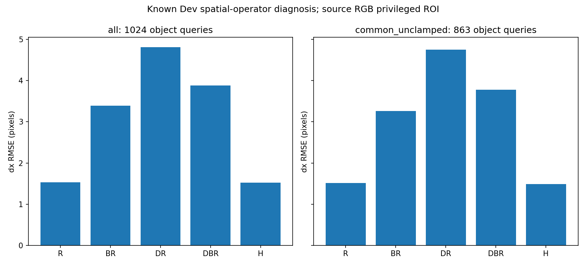

# V5.8：大窗口平均与粗采样重建都损害当前对应定位，但两者作用不相加

**本轮将问题进一步定位到：在冻结的 I-JEPA 特征和余弦匹配器之间，空间平均范围和粗网格重建都会改变匹配排序，足以产生大量错向。** 在相同物理中心和密度上，把 2×2 平均扩大到 4×4，已经明显变差；保留 2×2 平均而改成粗采样重建，恶化更大。排除全部触边查询后差异仍然存在。

另一方面，粗网格上 4×4 平均优于 2×2 平均，说明平均的影响依赖采样条件。不能把结果概括为“平均都坏”，也不能给 pooling、sampling、encoder 分配责任百分比。该证据定位的是**具体空间算子与当前固定匹配器的耦合失败**，没有证明特征信息不可恢复，没有识别 encoder 内某层损坏，也未测试原训练型 reader 或 memory writer。

代码和完整设计先发布于 [980a194](https://github.com/XintongYang1010/predictive-memory-lab/tree/980a194adf503bbf6b64ce0ce4b9f66bc066ab86)，25 个文件逐字节回读后才评分。[冻结协议](../../../docs/V5_8_EXECUTION_PROTOCOL.md)；[网页端评分前设计复核](web_review.md)。

## 1. 五组受控比较

256 个已看过的 Dev world、512 个 episode、1024 个对象查询，复用同一 raw cache。固定 source RGB 特权九点 ROI、625 个二维候选、通道中心化 cosine 与 tie rule，无训练。原 raw16 中心为 6.5+14i；H/BR 为 27.5+14j 的 13×13；DR/DBR 为 27.5+56k 的 4×4。每组都直接在自己的物理网格插值，没有先上采样再二次插值。

H 是网页复核建议的同相位密集参照：原 raw 在半格中心的双线性取样，等于中央 2×2 平均。H[::4,::4] 逐位等于 DR。BR 同中心改用 4×4 平均，BR[::4,::4] 逐位等于 DBR 与旧 Pool。H−R 仍混合重采样、隐式平均和支持域变化，不能称为纯相位效应。

| 组 | 操作 | 全部 dx RMSE (px) | 共同内点 dx RMSE (px) | 全部 dy RMSE (px) |
|---|---|---:|---:|---:|
| R | 原 raw16 | 1.534 | 1.512 | 1.348 |
| H | 2×2 平均，密集同相位参照 | 1.520 | 1.487 | 1.489 |
| BR | 4×4 平均，密集网格 | 3.392 | 3.259 | 3.562 |
| DR | 2×2 平均，粗网格重建 | 4.808 | 4.749 | 4.773 |
| DBR | 4×4 平均，粗网格；原 Pool | 3.878 | 3.777 | 3.907 |

共同内点有 **863/1024** 个对象查询，覆盖 500/512 个 episode、全部 256 个 world。每个查询的全部九个源点和全部 625×9 个候选目标点，在全部五组都不触边；几何条件独立验证为所有源 ROI 坐标在闭区间 [33.5,189.5]。排除了 161 个查询、12 个 episode，没有排除整个 world。子集只由几何决定，但代表不同的样本人口，不能当成全样本的无偏替代。

H 的水平点估计略优于 R，但差的区间跨零，且 dy 更差、零输出更多；四维平均 MSE 反而增加 0.177px²，95% CI [0.055,0.302]。它不是已证实优于 R 的修复。

## 2. 同相位效应与交互

下表是水平 MSE 的配对差，单位 px²；正值表示前项更差。95% 区间使用 10,000 次整 world bootstrap，固定 seed 7819，两个 variant/对象一起重采样；共同子集按 loss sum/count 保持对象查询权重。

| 对比 | 含义 | 全部差值 [95% CI] | 共同内点差值 [95% CI] |
|---|---|---|---|
| BR−H | 密集同相位：4×4 vs 2×2 平均 | +9.199 [+8.216, +10.233] | +8.411 [+7.446, +9.407] |
| DR−H | 相同 2×2 场：粗采样与重建 | +20.811 [+19.356, +22.296] | +20.342 [+18.718, +22.027] |
| DBR−BR | 相同 4×4 场：粗采样与重建 | +3.531 [+2.491, +4.592] | +3.646 [+2.523, +4.810] |
| DBR−DR | 粗网格：4×4 vs 2×2 平均 | -8.081 [-9.548, -6.601] | -8.285 [-9.773, -6.833] |
| DBR−BR−DR+H | 同相位二因素交互 | -17.280 [-18.931, -15.641] | -16.696 [-18.403, -14.982] |
| H−R | 半格取样＋隐式平均 | -0.045 [-0.225, +0.134] | -0.076 [-0.269, +0.110] |

**可以成立的定位：** BR−H 在相同密度、相位、边界支持和插值规则下仍明显变差，因而不能仅用“换了网格中心”解释大窗口平均的损害。DR−H 与 DBR−BR 都为正，说明对这两种密集场做粗采样并重建，都进一步损害当前 matcher。共同内点上同样成立，边界复制不是充分解释。

**需要保留的反例：** DBR−DR 为负，4×4 平均在粗网格上有条件地缓解误差；但仍远差于 H/R。它与采样前更强平滑有帮助的解释相容，尚不能据此确认具体频谱混叠机制。负交互来自已测试的平均支持范围、网格和 matcher，不能泛化成所有滤波或插值的定律。D 始终把采样与双线性重建放在一起，尚未将二者分开。

完整九个预登记比较、四坐标 skill、xy 符号、bootstrap 和计数见 [spatial/report.json](spatial/report.json)。全部区间是已知 Dev 上的探索性区间，没有多重比较校正或独立确认。

## 3. 错向与正确位置排名也变差

| 组 | 水平非零错向 / 1022 | 水平零输出 / 1022 | GT 全局中位 rank / 625 | 正确 y 行中位 rank / 25 | 搜索边界命中 / 1024 |
|---|---:|---:|---:|---:|---:|
| R | 13 | 16 | 40 | 5 | 45 |
| H | 14 | 29 | 47 | 5 | 26 |
| BR | 306 | 101 | 166 | 9 | 131 |
| DR | 554 | 122 | 325 | 15 | 243 |
| DBR | 429 | 113 | 248 | 12 | 98 |

方向分母沿用 |GT dx|≥1px 的 1022 个查询，零输出单列，不并入非零错向。排名使用最近 GT 网格点，且保留固定 1e−12 tie 规则。R/H/BR/DR 没有最小值并列，DBR 只有 1/1024 次；大规模退化不能由 tie-breaking 解释。这里的边界命中是 ±6px 搜索边界，和空间特征网格的插值触边不是同一概念。

## 4. 原有坏例在哪里变坏

所有案例沿用事先固定的 761/1、844/1、891/1，两对象均完整保存；下列两个对象全部候选都不触边。

| 案例 | 真 dx | R | H（密集 2×2） | BR（密集 4×4） | DR（粗 2×2） | DBR（粗 4×4） |
|---|---:|---:|---:|---:|---:|---:|
| 844/1，A | −3.278 | −4.0 | −1.5 | **+3.0** | **+6.0** | **+6.0** |
| 891/1，B | +3.348 | +1.5 | +0.5 | **−2.0** | +0.5 | **−2.5** |

**844/1 A：** 不需要先变粗网格，扩大平均支持范围就让预测从 H 的正确负向变为 BR 的正向。最近 GT 的全局 rank 从 69 变为 558；正确 y 行 rank 从 11/25 变为 20/25。DR 也独立产生反向输出。

**891/1 B：** H 本来就明显低估位移，BR 进一步反向；全局 rank 从 37 降至 240，正确行从 4/25 降至 19/25。DR 在这个具体对象上仍是 +0.5，因此不能把所有案例都说成同一种采样失败；原 Pool 的 −2.5 与大平均支持范围有关的解释在该例得到更直接支持。

代价面每个 panel 使用自己的色标，只用于看各自最小点位置，不跨组比较颜色对应的绝对成本。[761/1完整案例](spatial/figures/case_761_1_costs.png) 中 A 不在共同内点集、B 在；该例还存在单次改善与退化并存，全部结果保留在 [fixed_cases.json](spatial/fixed_cases.json) 和逐对象 CSV。

## 5. 对优化方向的含义

当前优先级更明确：先处理**空间压缩之后仍能否稳定定位对象**。可以保留目标附近较密的局部细节，将粗全局上下文作为补充；不能仅因为总 token 数更少就假设强平均后仍能读出小位移。这个方向是由对照支持的研究假设，还不是本轮训练验证的算法。

下一项可证伪诊断是固定滤波和 token 数，改变粗采样相位并保存真实二维代价面：检验错误是否对网格对齐高度敏感；再在固定相同 coarse bank 上换重建规则，分开采样与插值。若要定位 encoder 本身，必须另做已知像素平移前后的 encoder 特征等变性测量，而不是从 pooled 失败反推 encoder 坏了。学习型修复需 FIT-only 开发和未用过的确认世界。上述下一项尚未执行。

原训练型 reader、P0/history gate 与 memory writer 均未进入本轮路径。R/H 仍有约 1.5px 水平误差及幅度低估，不能声称原任务已修复，更不能声称原 memory 有效。

## 执行与复现

- 完整 CPU 评分耗时 27.765s（不含开发、审查及上传）；没有新增 Slurm job/step、GPU 时间或远端目录。本轮不需要远端清理，也没有更动已有远端内容。
- Raw/Pool 全部预测与旧归档精确一致；全部成本最大差 3.89e-16，DBR bank 与旧 Pool、H 的粗子集与 DR 均逐位一致。512 个 source RGB 哈希通过，原始输入前后未变，全部成本、预测和范数有限。
- 原有 175 项测试与新增 4 项测试通过；五组算子另经独立窗口构造和显式描述子计算复核。Mac NumPy 仍输出已有的 matmul 浮点状态 warning，原日志完整保留；有限值检查及显式运算验证通过，未放宽阈值。
- [reproduce.sh](reproduce.sh) 给出完整命令，[environment.json](environment.json) 记录软件环境。旧 raw/模型与 baseline 分别从 V5.5/V5.6 的已核验 Release 恢复，哈希由方案固定；本轮没有新训练检查点。
- [本轮完整 Release](https://github.com/XintongYang1010/predictive-memory-lab/releases/tag/visual-v5_8-20261010) 保存全部 cost/prediction、clamp、bootstrap、源码设计、图表、CSV、日志与复核脚本。归档独立下载及每项哈希核验结果以本目录 `github_verification.json` 为准。所有本地原件保留。
